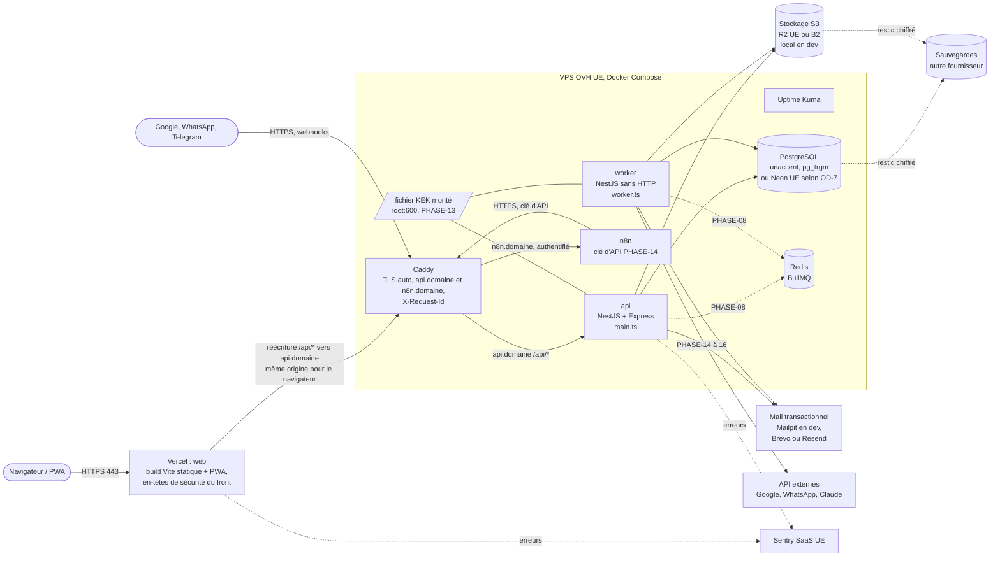
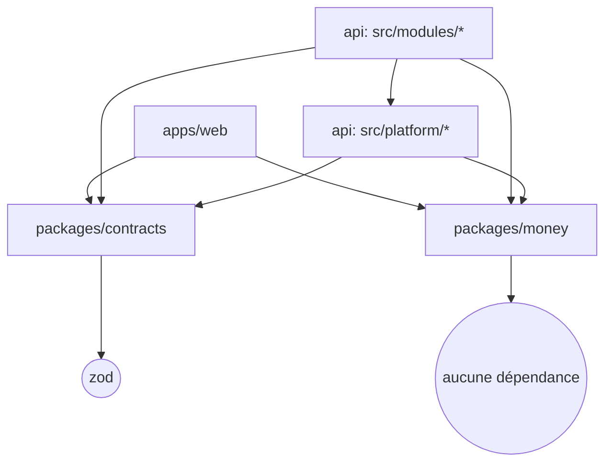

# ORBIT : architecture système

- **Statut :** référence. Subordonné à `DECISIONS.md` et `PRODUCT_SCOPE.md` ; remplace §7.2 et §7.3 de `PRODUCT_SPEC.md`.
- **Responsabilité :** où vit le code, comment les parties communiquent, quelles dépendances sont autorisées.
- **Documents liés :** `DECISIONS.md` (ADR-004 à ADR-013), `PRODUCT_SCOPE.md` §4, `DESIGN_PATTERNS.md` (comment écrire chaque brique), `CODING_STANDARDS.md` (à quoi ressemble le code), `API.md` (catalogue et format des réponses), `DATA_MODEL.md`, `INFRASTRUCTURE.md`, `FRONTEND.md`, `SECURITY.md`.

> Règle de lecture : ce document dit **où** et **dans quel sens**. Il ne redéfinit ni le format des réponses (`API.md`), ni le schéma (`DATA_MODEL.md`), ni les calculs (`FINANCE_RULES.md`).

---

## 1. Principes d'architecture

| # | Principe | Conséquence concrète |
|---|---|---|
| A1 | Monolithe modulaire (§1.3-7, §1.4) | Un seul dépôt, une seule base, un seul code d'API. Deux processus : `api` et `worker` (ADR-012). Pas de microservice. |
| A2 | Isolation par `user_id` (ADR-001, ADR-007) | Le `user_id` vient **uniquement** de la session, via le contexte CLS. Jamais d'un paramètre d'URL, d'un corps ou d'un en-tête. |
| A3 | Ports et adaptateurs pour toute dépendance externe | Stockage, mail, file de jobs, horloge, identifiants, IA, Google : toujours derrière une interface de `platform/` ou du module. |
| A4 | Contrats partagés (ADR-010) | Le schéma Zod de `packages/contracts` est la source unique de vérité des entrées et sorties HTTP. |
| A5 | Dépendances acycliques et vérifiées | dependency-cruiser bloque la CI à la moindre violation (§5). |
| A6 | Domaine pur | Les règles de calcul et de transition vivent dans `domain/`, sans NestJS, sans Prisma, sans I/O. |
| A7 | Pas d'asynchrone avant PHASE-08 | Avant PHASE-08, tout est synchrone dans la requête (y compris l'envoi d'e-mail). Ensuite, port `JobQueue` + outbox (ADR-012). |

---

## 2. Vue des conteneurs



| Conteneur | Rôle | Phase | Ne fait jamais |
|---|---|---|---|
| `web` (Vercel) | Fichiers statiques du build Vite, manifeste PWA, service worker ; en-têtes de sécurité du front (`vercel.json`) ; réécriture `/api/*` vers `api.<domaine>` (ADR-038) | 00 (dev, Vite) / 03 (Vercel) | Appel direct à la base ou à S3 ; porter un secret |
| `caddy` | TLS de `api.<domaine>` et `n8n.<domaine>`, routage `/api` → `api`, en-têtes de l'API, génération de `X-Request-Id` | 03 | Servir le front ; logique applicative |
| `n8n` | Workflows externes, appelle l'API avec une clé à portée limitée (ADR-032) | 03 (installation) / 14 (clé d'API) | Accéder à la base, à Redis ou aux fichiers |
| `api` | HTTP, auth, validation, règles métier synchrones | 00 | Tâches longues (> 2 s), envoi massif |
| `worker` | Jobs BullMQ, relais d'outbox, tâches planifiées | 08 | Exposer un port HTTP (sauf health interne) |
| `postgres` | Source de vérité unique | 00 | Être exposé hors du réseau Docker |
| `redis` | File BullMQ, compteurs de rate limiting éventuels | 08 | Stocker une donnée métier durable |
| S3 | Fichiers privés, URL signées ≤ 5 min (ADR-013) | 09 | Servir un fichier public |
| Mail | E-mails transactionnels (ADR-014) | 01 | Recevoir un secret dans un template |

Détails d'exploitation (Compose, réseaux, volumes, CI/CD, restic) : `INFRASTRUCTURE.md`.

---

## 3. Arborescence du monorepo

Arborescence **complète et normative**. Un dossier absent de cette liste ne se crée pas sans ADR. Les dossiers marqués `(PHASE-XX)` n'apparaissent qu'à cette phase.

```text
orbit/
├── AGENTS.md
├── package.json                      # scripts racine : lint, typecheck, test, depcruise, build
├── pnpm-workspace.yaml               # apps/*, packages/*
├── .npmrc                            # engine-strict, save-exact
├── .nvmrc                            # version Node LTS verrouillée
├── .dependency-cruiser.cjs           # règles §5 (bloquant en CI)
├── eslint.config.mjs                 # importe packages/config/eslint
├── prettier.config.mjs               # importe packages/config/prettier
├── .github/workflows/ci.yml
├── docs/                             # cf. 00-INDEX.md
├── infra/
│   ├── compose/
│   │   ├── compose.yml               # services communs
│   │   ├── compose.dev.yml           # + mailpit, ports exposés en local
│   │   └── compose.prod.yml          # (PHASE-03)
│   ├── docker/
│   │   └── api.Dockerfile            # même image pour api et worker (le front n'a pas d'image : Vercel, ADR-038)
│   ├── caddy/Caddyfile               # api.<domaine> et n8n.<domaine> uniquement
│   ├── n8n/workflows/                # workflows exportés, sans identifiants (PHASE-03 / 14)
│   ├── backup/                       # scripts restic + test de restauration (PHASE-03)
│   └── scripts/                      # bootstrap, rotation de clés, smoke tests
├── packages/
│   ├── config/
│   │   ├── tsconfig/                 # base.json, node.json, react.json, library.json
│   │   ├── eslint/                   # base.mjs, node.mjs, react.mjs, rules-orbit.mjs
│   │   └── prettier/index.mjs
│   ├── money/
│   │   └── src/
│   │       ├── money.ts              # type Money, constructeurs, add/subtract/compare
│   │       ├── currency.ts           # CurrencyCode, exposants (XOF=0, EUR=2, USD=2)
│   │       ├── rounding.ts           # divisions half-up sur bigint
│   │       ├── quantity.ts           # quantités NUMERIC(12,3), taux NUMERIC(7,4)
│   │       ├── parse.ts              # chaîne de chiffres ↔ bigint
│   │       ├── format.ts             # Intl.NumberFormat fr-SN / fr-FR
│   │       ├── index.ts
│   │       └── *.spec.ts             # couverture 100 % (ADR-021)
│   └── contracts/
│       └── src/
│           ├── common/               # id.ts (uuidv7), pagination.ts, amount.ts, dates.ts, sort.ts
│           ├── errors/error-codes.ts # codes d'erreur stables (CODING_STANDARDS §6)
│           ├── enums/                # un fichier par enum partagé
│           ├── auth/ users/ ideas/ tasks/ projects/ notes/ tags/
│           ├── finance/ pro/ calendar/ documents/ reminders/ notifications/
│           ├── goals/ habits/ learning/ journal/ dashboard/ search/ exports/
│           ├── dev/ vault/ integrations/ automations/ ai/ admin/
│           └── index.ts              # réexports par sous-chemin (@orbit/contracts/finance)
├── apps/
│   ├── api/
│   │   ├── prisma/
│   │   │   ├── schema.prisma
│   │   │   ├── migrations/
│   │   │   └── seed/                 # seed.ts + fixtures par module (currencies, catégories)
│   │   ├── test/
│   │   │   ├── setup/                # Testcontainers PostgreSQL, fabrique d'app Nest
│   │   │   ├── factories/            # fabriques de données par module
│   │   │   └── isolation/            # générateur de tests d'accès croisé (ADR-021)
│   │   └── src/
│   │       ├── main.ts               # bootstrap HTTP
│   │       ├── worker.ts             # bootstrap worker (PHASE-08)
│   │       ├── app.module.ts         # importe PlatformModule + modules métier
│   │       ├── worker.module.ts      # (PHASE-08) importe PlatformModule + processors
│   │       ├── platform/
│   │       │   ├── config/           # env.schema.ts (Zod), app-config.service.ts
│   │       │   ├── database/
│   │       │   │   ├── prisma.service.ts
│   │       │   │   ├── tenant-scope.extension.ts
│   │       │   │   ├── transactional.module.ts   # @nestjs-cls/transactional (Unit of Work)
│   │       │   │   ├── prisma-error.mapper.ts
│   │       │   │   └── raw/          # SEUL endroit autorisé pour $queryRaw/$executeRaw (ADR-007-5)
│   │       │   ├── auth/             # SessionAuthGuard, RolesGuard, ModuleEnabledGuard,
│   │       │   │                     # CsrfGuard, @Public, @Roles, @RequiresModule, @CurrentUser,
│   │       │   │                     # session-token.ts (génération, SHA-256), password-hasher.port.ts
│   │       │   ├── tenant/           # TenantContext (lecture CLS), runAsUser() pour le worker
│   │       │   ├── audit/            # AuditPort, @Audited, AuditInterceptor, audit.repository.ts
│   │       │   ├── crypto/           # libsodium : enveloppe DEK/KEK, KeyRing versionné (PHASE-13)
│   │       │   ├── storage/          # StoragePort, LocalStorageAdapter, S3StorageAdapter
│   │       │   ├── mail/             # MailPort, SmtpMailAdapter (Mailpit), ProviderMailAdapter, templates/
│   │       │   ├── jobs/             # JobQueue port, BullMqJobQueue, InMemoryJobQueue,
│   │       │   │                     # OutboxPort, outbox-relay.ts, job-envelope.ts (PHASE-08)
│   │       │   ├── http/             # GlobalExceptionFilter, ZodValidationPipe, ResponseSchema
│   │       │   │                     # interceptor, IdempotencyInterceptor, throttling, Express hardening
│   │       │   ├── time/             # ClockPort, SystemClock, FixedClock (tests), helpers de fuseau
│   │       │   ├── ids/              # IdGeneratorPort, UuidV7Generator, SequentialIdGenerator (tests)
│   │       │   ├── observability/    # pino (nestjs-pino), redaction, health, métriques (PHASE-03)
│   │       │   ├── errors/           # DomainError, Result, mapping code → statut HTTP
│   │       │   └── platform.module.ts
│   │       └── modules/              # cf. §4 ; une entrée par module NestJS
│   │           └── <module>/
│   │               ├── <module>.module.ts
│   │               ├── index.ts              # API publique du module (seul point d'import externe)
│   │               ├── <resource>.controller.ts
│   │               ├── <resource>.service.ts         # service applicatif (orchestration)
│   │               ├── <resource>.repository.ts      # accès Prisma, scopé tenant
│   │               ├── <resource>.query-service.ts   # lectures agrégées (CQRS léger), si besoin
│   │               ├── policies/<resource>.policy.ts
│   │               ├── dto/<resource>.dto.ts         # classes nestjs-zod issues des contracts
│   │               ├── domain/                       # fonctions pures, machines à états, erreurs
│   │               ├── jobs/<name>.processor.ts      # (PHASE-08+) consommateurs de jobs
│   │               └── tests/
│   │                   ├── <resource>.service.spec.ts      # unitaires
│   │                   ├── <resource>.domain.spec.ts       # domaine pur (+ fast-check)
│   │                   └── <resource>.int-spec.ts          # intégration HTTP + base réelle
│   └── web/
│       ├── index.html
│       ├── vite.config.ts            # vite-plugin-pwa, proxy /api en dev
│       ├── vercel.json               # réécriture /api, en-têtes de sécurité, cache (PHASE-03, ADR-038)
│       └── src/
│           ├── main.tsx
│           ├── app/                  # providers (QueryClient, Router, i18n), router.tsx, guards de route
│           ├── components/
│           │   ├── ui/               # shadcn/ui (généré, non modifié à la main sauf thème)
│           │   ├── layout/           # AppShell, BottomNav, Sidebar, QuickCaptureButton
│           │   └── data-display/     # Amount, DateLabel, EmptyState, ErrorState, Skeletons
│           ├── features/
│           │   └── <feature>/        # auth, dashboard, ideas, tasks, projects, notes, finance, pro,
│           │       │                 # calendar, documents, goals, habits, journal, dev, vault,
│           │       │                 # integrations, automations, ai, settings, admin
│           │       ├── api/          # <feature>.keys.ts (query keys factory), <resource>.queries.ts
│           │       ├── components/
│           │       ├── pages/
│           │       ├── hooks/
│           │       └── index.ts      # routes exportées vers app/router.tsx
│           ├── lib/                  # api-client.ts, money.ts (wrapper @orbit/money), dates.ts
│           ├── offline/              # file de capture IndexedDB (idées, notes, tâches ; jamais finance)
│           └── i18n/fr/              # un fichier JSON par feature
```

Règles d'arborescence :
- **Faire :** un module à plusieurs ressources (finance, pro, dev) place chaque ressource dans un sous-dossier qui reprend le même gabarit (`modules/finance/transfers/transfers.controller.ts`, etc.), avec un `domain/` partagé au niveau du module.
- **Faire :** les tests d'un module vivent dans son dossier `tests/` ; les fabriques partagées dans `apps/api/test/factories/`.
- **Ne pas faire :** créer `src/common/`, `src/utils/`, `src/helpers/` ou `src/shared/`. Un utilitaire transverse va dans `platform/<responsabilité>/` ; un utilitaire métier va dans le `domain/` de son module ; un utilitaire partagé front/back va dans `packages/`.
- **Ne pas faire :** importer `apps/api` depuis `apps/web` ou l'inverse. Le seul lien est `packages/contracts` (et `packages/money`).

---

## 4. Découpage en modules NestJS

Chaque ligne de `PRODUCT_SCOPE.md` §4 se traduit en un ou plusieurs modules NestJS. Les préfixes de routes suivent la convention de `API.md` (préfixe `/api/v1`, aucun `user_id` dans l'URL).

| Scope | Module(s) NestJS (`src/modules/…`) | Préfixe(s) de routes | Tables possédées | Garde d'accès |
|---|---|---|---|---|
| M01 | `auth` | `/auth/*` | `sessions`, `email_verification_tokens`, `password_reset_tokens`, `login_events` | `@Public` sur login/register/reset |
| M01 | `users` | `/me` (profil, préférences, sessions actives) | `users`, `user_preferences` | session |
| M01 | *platform/audit* | — (lecture via `/me/audit` si exposé) | `audit_logs` | — |
| M02 | *(aucun module API)* | — | — | — |
| M03 | `tags` | `/tags` | `tags`, tables `*_tags` | session |
| M03 | `ideas` | `/ideas` | `ideas` | session |
| M03 | `projects` | `/projects` | `projects` | session |
| M03 | `tasks` | `/tasks` | `tasks`, `task_dependencies` | session |
| M03 | `notes` | `/notes` | `notes`, `note_links` | session |
| M04 | `finance` (sous-dossiers `accounts`, `categories`, `counterparties`, `transactions`, `transfers`, `ledger`) | `/finance/accounts`, `/finance/categories`, `/finance/counterparties`, `/finance/transactions`, `/finance/transfers` | `financial_accounts`, `transaction_categories`, `counterparties`, `transactions`, `ledger_entries` | session |
| M04 | *platform/http (idempotence)* | — | `idempotency_keys` | — |
| M04 | *platform/database (référentiel global)* | — | `currencies` (globale, hors tenant) | — |
| M05 | `finance` (sous-dossiers `debts`, `recurring`, `forecasts`) | `/finance/debts`, `/finance/recurring` | `debts`, `debt_repayments`, `recurring_transactions`, `recurring_occurrences` | session |
| M06 | `dashboard` | `/dashboard` | — | session |
| M06 | `search` | `/search` | — (lit les index FTS des autres tables) | session |
| M06 | `exports` | `/exports` | `export_jobs` | session + ré-auth |
| M07 | `reminders` | `/reminders` | `reminders` | session |
| M07 | `notifications` | `/notifications` | `notifications`, `notification_preferences`, `push_subscriptions` | session |
| M07 | *platform/jobs* | — | `outbox_events` | — |
| M08 | `calendar` | `/calendar/events` | `calendar_events` | session |
| M08 | `documents` | `/documents` | `documents`, `document_links` | session |
| M09 | `pro` (sous-dossiers `clients`, `contacts`, `contracts`, `invoices`) | `/pro/clients`, `/pro/contacts`, `/pro/contracts`, `/pro/invoices` | `clients`, `contacts`, `client_contacts`, `contracts`, `invoices`, `invoice_items`, `invoice_payments`, `invoice_sequences` | session + `@RequiresModule('pro')` |
| M10 | `goals` | `/goals` | `goals`, `goal_links` | session |
| M10 | `habits` | `/habits` | `habits`, `habit_logs` | session |
| M10 | `learning` | `/learning/*` (ressources exactes : `API.md`) | `learning_items`, `learning_sessions` | session |
| M10 | `journal` | `/journal` | `journal_entries` | session |
| M11 | `dev` (sous-dossiers `applications`, `environments`, `domains`, `servers`, `subscriptions`, `technical-events`) | `/dev/applications`, `/dev/domains`, `/dev/servers`, … | tables M11 | `@Roles('ADMIN')` |
| M12 | `vault` | `/dev/vault/items` | `vault_items`, `vault_secret_payloads` | `@Roles('ADMIN')` + ré-auth + TOTP pour révéler |
| M12 | `auth` (sous-dossier `mfa`) | `/auth/mfa/*` | `user_mfa_factors`, `mfa_recovery_codes` | session |
| M13 | `integrations` (sous-dossiers `google`, `webhooks`, `api-keys`) | `/integrations`, `/integrations/webhooks/:provider` (`@Public`, signature vérifiée) | `integrations`, `integration_tokens`, `external_calendar_events`, `webhook_events`, `api_keys` | session ; clés d'API : `@Roles('ADMIN')` |
| M14 | `automations` | `/automations` | `automation_rules`, `automation_runs` | session |
| M15 | `ai` | `/ai` | `ai_requests`, `ai_proposals`, `inbound_messages` | session |
| M16 | `admin` | `/admin/users` | `usage_counters`, `feature_flags` | `@Roles('ADMIN')` |
| M16 | `account` | `/me/export`, `/me/deletion` (exactes : `API.md`) | `account_deletion_requests` | session + ré-auth |

Règles :
- **Faire :** un module NestJS = un dossier sous `src/modules/` = une entrée dans `contracts/src/`. Le nom est au pluriel kebab-case quand il désigne une ressource (`ideas`), au singulier quand il désigne un domaine (`finance`, `pro`, `dev`, `auth`).
- **Faire :** une table appartient à **un seul** module. Seul ce module écrit dedans. Les autres passent par son `index.ts`.
- **Ne pas faire :** créer un module `workspaces`, `members` ou `roles` (ADR-001). Ne pas créer de module `common` ou `shared`.
- **Ne pas faire :** exposer un module ADMIN sans `@Roles('ADMIN')` **au niveau de la classe du contrôleur** (pas méthode par méthode).

---

## 5. Graphe des dépendances autorisées

### 5.1 Couches techniques



| Règle dependency-cruiser | Interdit | Raison |
|---|---|---|
| `no-circular` | Tout cycle, à tout niveau | A5 |
| `platform-not-to-modules` | `src/platform/**` → `src/modules/**` | La plateforme ignore le métier ; elle expose des ports que les modules implémentent si besoin (ex. `ModuleAccessPort`, §8). |
| `domain-is-pure` | `src/modules/*/domain/**` (et `*/*/domain/**`) → `@nestjs/*`, `@prisma/client`, `src/platform/**` sauf `platform/errors`, tout `*.repository.ts`, `*.service.ts` | A6 |
| `controller-not-to-repository` | `*.controller.ts` → `*.repository.ts` ou `platform/database` | Le contrôleur ne parle qu'au service. |
| `module-public-api-only` | `src/modules/A/**` → `src/modules/B/**` autre que `src/modules/B/index.ts` | Encapsulation. |
| `module-allowed-edges` | Toute arête inter-modules absente du tableau §5.2 | Graphe acyclique maîtrisé. |
| `contracts-pure` | `packages/contracts/**` → `@prisma/client`, `@nestjs/*`, `react`, `apps/**` | ADR-010 |
| `money-standalone` | `packages/money/**` → toute dépendance externe | ADR-008 |
| `web-not-to-api` | `apps/web/**` → `apps/api/**` | Séparation front/back |
| `raw-sql-confined` | Import de `platform/database/raw/**` depuis autre chose qu'un `*.repository.ts` ou `*.query-service.ts` | ADR-007-5 |

### 5.2 Arêtes inter-modules autorisées

Les modules sont rangés en **niveaux**. Un module ne dépend que de modules de niveau **strictement inférieur**, plus les exceptions listées. Toute nouvelle arête exige une mise à jour de ce tableau **et** de `.dependency-cruiser.cjs` dans le même commit.

| Niveau | Modules | Dépendances autorisées |
|---|---|---|
| N0 | `users` | — |
| N0 | `auth` | `users` (exception intra-niveau) |
| N1 | `tags`, `notifications`, `dashboard`, `search`, `exports`, `documents` | `users` ; `dashboard`, `search`, `exports` ne dépendent d'**aucun** module métier (ils définissent des ports, §5.3) |
| N1 | `reminders` | `notifications` (exception intra-niveau) |
| N2 | `projects`, `notes`, `calendar`, `finance`, `habits`, `journal`, `learning` | N0, N1 |
| N2 | `tasks` | N0, N1, `projects` |
| N2 | `ideas` | N0, N1, `projects`, `tasks` (conversion idée → projet/tâche) |
| N3 | `goals` | N0–N2 (`tasks`, `projects`, `habits`) |
| N3 | `pro` | N0–N2 (`finance` pour les paiements de facture, `projects`) |
| N3 | `dev` | N0–N2 (`finance` pour lier une récurrence d'hébergement) |
| N3 | `vault` | N0–N2, `dev` (exception intra-niveau, lecture des environnements) |
| N4 | `integrations` | N0–N3 |
| N4 | `automations` | N0–N3 (actions : `tasks`, `ideas`, `notes`, `reminders`, `notifications`) |
| N4 | `ai` | N0–N3, `search` (exécution des propositions confirmées via les façades des modules) |
| N4 | `admin` | `users` uniquement (ADR-002 : métadonnées seulement) |
| N4 | `account` | N0–N3 (export et purge du compte) |

Remarques :
- Une **clé étrangère** n'est pas une dépendance de code. `note_links.task_id` n'oblige pas `notes` à importer `tasks` : la clé composite `(user_id, task_id)` garantit l'appartenance (ADR-007-4).
- `integrations` ne dépend pas de `ai` : un message WhatsApp entrant devient un événement d'outbox `integration.message.received`, consommé par un processor de `ai`. Les flux « vers le haut » passent **toujours** par l'outbox ou par un port, jamais par un import.

### 5.3 Inversion de dépendance pour les agrégateurs

`dashboard`, `search` et `exports` agrègent tous les modules **sans les importer** :

- chacun publie dans son `index.ts` un port : `DashboardWidgetProvider`, `SearchProvider`, `ExportProvider` ;
- chaque module métier implémente le port dans une classe marquée par le décorateur de découverte correspondant (`@DashboardWidget()`, `@SearchProvider()`, `@ExportProvider()`), que l'agrégateur collecte via `DiscoveryService` ;
- l'arête va donc de `finance` vers `dashboard` (niveau inférieur), ce qui respecte §5.2.

Chaque phase qui ajoute un module ajoute son provider (cf. `PRODUCT_SCOPE.md` §4, « widgets étendus par chaque phase »). Exemple de code : `DESIGN_PATTERNS.md` §13.

---

## 6. Cycle de vie d'une requête HTTP

```mermaid
sequenceDiagram
  autonumber
  participant B as Navigateur
  participant V as Vercel (réécriture /api)
  participant C as Caddy
  participant E as Express + middlewares
  participant G as Guards (ordre fixe)
  participant I as Intercepteurs
  participant P as ZodValidationPipe
  participant Ctl as Controller
  participant S as Service applicatif
  participant D as domain/ (pur)
  participant R as Repository
  participant X as Prisma + tenantScope
  participant DB as PostgreSQL

  B->>V: POST /api/v1/finance/transfers (cookie __Host-orbit_sid, X-Requested-With, Idempotency-Key)
  V->>C: réécriture vers api.domaine (en-têtes et cookie transmis)
  C->>E: + X-Request-Id
  E->>E: helmet, limite de corps, cookie-parser, pino-http (requestId)
  E->>E: ClsMiddleware : cls.set(requestId)
  E->>G: ThrottlerGuard → CsrfGuard (Origin + X-Requested-With)
  G->>G: SessionAuthGuard : SHA-256(jeton) → sessions → cls.set(userId, role)
  G->>G: RolesGuard (@Roles) → ModuleEnabledGuard (@RequiresModule)
  G->>I: LoggingInterceptor → IdempotencyInterceptor → AuditInterceptor
  I->>P: validation du corps (schéma contracts)
  P->>Ctl: DTO typé
  Ctl->>S: service.createTransfer(dto)
  S->>R: findAccount(id) ×2 (null ⇒ NotFound 404)
  R->>X: findFirst({ where: { id } })
  X->>DB: WHERE id = $1 AND user_id = <cls.userId>
  S->>D: buildTransferEntries(...) → Result
  S->>R: @Transactional : insert transaction + 2 ledger_entries (+ outbox dès PHASE-08)
  R->>X: create(...) (user_id injecté)
  X->>DB: BEGIN … COMMIT
  S-->>Ctl: TransferView
  Ctl-->>I: objet de réponse
  I->>I: ResponseSchema : parse(schéma de réponse) → retire les clés inconnues
  I->>I: AuditInterceptor écrit audit_logs ; IdempotencyInterceptor mémorise la réponse
  I-->>B: 201 + X-Request-Id
  Note over S,B: DomainError → GlobalExceptionFilter → code stable + statut HTTP (API.md)
```

Points non négociables :
1. **Ordre des guards** (enregistrés globalement dans `PlatformModule` via `APP_GUARD`, dans cet ordre) : `ThrottlerGuard`, `CsrfGuard`, `SessionAuthGuard`, `RolesGuard`, `ModuleEnabledGuard`. Une route est authentifiée **par défaut** ; seul `@Public()` l'exempte.
2. **Propriété** : vérifiée par le repository scopé (une ressource d'un autre utilisateur est introuvable ⇒ **404**, ADR-007-7). Les policies de module ajoutent les règles fines (statut, rôle) — `DESIGN_PATTERNS.md` §6.
3. **Sortie** : chaque route déclare son schéma de réponse (`@ResponseSchema(TransferViewSchema)`). Une route sans schéma de réponse échoue au test de contrat OpenAPI.
4. **Aucun** `try/catch` dans un contrôleur. Les erreurs remontent au `GlobalExceptionFilter`.

Webhooks entrants (`/integrations/webhooks/:provider`, PHASE-14) : `@Public`, pas de CSRF, vérification de signature, déduplication par `webhook_events`, résolution de l'utilisateur à partir de l'intégration, **puis** `TenantContext.runAsUser(userId, …)` avant tout accès aux données métier.

---

## 7. Traitements asynchrones (PHASE-08 et suivantes)

### 7.1 Composants

| Composant | Emplacement | Rôle |
|---|---|---|
| `JobQueue` (port) | `platform/jobs/job-queue.port.ts` | `enqueue(envelope, options)`, `schedule(cron)`. Adaptateurs : `BullMqJobQueue` (prod), `InMemoryJobQueue` (tests unitaires). |
| `JobEnvelope` | `platform/jobs/job-envelope.ts` | `{ jobType, version, userId, entityId, correlationId, idempotencyKey }` (ADR-012). Validé par Zod au dépôt **et** à la consommation. |
| `OutboxPort` | `platform/jobs/outbox.port.ts` | `record(event)` dans la transaction courante (`TransactionHost`). |
| Relais d'outbox | `platform/jobs/outbox-relay.ts` (worker) | Lit `outbox_events` non publiés (`FOR UPDATE SKIP LOCKED`, requête dans `platform/database/raw/`), dépose le job, marque `published_at`. |
| Processors | `modules/<m>/jobs/<name>.processor.ts` | Un processor par `jobType`. Rejoue le contexte : `runAsUser(envelope.userId, …)` **avant** toute requête. |
| Planificateur | `worker.module.ts` | Jobs répétables BullMQ : balayage des rappels, génération des occurrences récurrentes, purge des jetons expirés. |

### 7.2 Quand utiliser quoi

| Situation | Mécanisme |
|---|---|
| Effet de bord **critique** lié à une écriture (finance, intégrations, suppression de compte) | Outbox dans la même transaction, puis relais. |
| Effet de bord non critique (e-mail de bienvenue, notification informative) | `jobQueue.enqueue()` après le commit. |
| Calcul < 200 ms nécessaire à la réponse | Synchrone dans le service. |
| Calcul long (export, synchronisation Google, résumé IA) | Job ; l'API renvoie `202` avec l'identifiant du job ou de l'`export_job`. |

Règles :
- **Faire :** chaque processor est idempotent (rejouer deux fois le même job ne produit qu'un effet). La clé `idempotencyKey` sert de `jobId` BullMQ.
- **Faire :** retries exponentiels bornés (5 essais par défaut), puis état `failed` visible dans les métriques.
- **Ne pas faire :** mettre un secret, un jeton OAuth, un mot de passe ou le contenu d'une note dans un payload. Le processor relit la donnée en base.
- **Ne pas faire :** appeler BullMQ directement depuis un module. Toujours `JobQueue`.

---

## 8. Responsabilités transverses : où vivent-elles ?

| Responsabilité | Emplacement unique | Points d'entrée |
|---|---|---|
| Configuration et validation de l'environnement | `platform/config` | `AppConfigService` (typé) ; §9 |
| Connexion base, extension tenant, transactions | `platform/database` | `PrismaService`, `TransactionHost` |
| SQL brut (FTS, `SKIP LOCKED`, agrégats lourds) | `platform/database/raw/` | Fonctions typées exportées, relues à chaque modification |
| Session, rôles, CSRF, activation de module | `platform/auth` | Guards globaux, décorateurs `@Public`, `@Roles`, `@RequiresModule`, `@CurrentUser`, `@RequiresReauth` |
| Logique de compte (inscription, login, reset, MFA) | `modules/auth` | Contrôleurs `/auth/*` |
| Contexte utilisateur courant | `platform/tenant` | `TenantContext.userId()`, `runAsUser()` |
| Audit | `platform/audit` | `@Audited('finance.transfer.create')`, `AuditPort.record()` |
| Chiffrement (coffre, jetons OAuth) | `platform/crypto` | `EnvelopeCipher.seal/open` |
| Fichiers | `platform/storage` | `StoragePort` |
| E-mail | `platform/mail` | `MailPort` + templates |
| Jobs, outbox | `platform/jobs` | `JobQueue`, `OutboxPort` |
| Erreurs, mapping HTTP | `platform/errors` + `platform/http` | `DomainError`, `GlobalExceptionFilter` |
| Idempotence HTTP | `platform/http` | `@Idempotent()` + `IdempotencyInterceptor` |
| Rate limiting | `platform/http` | `@nestjs/throttler`, profils `auth`, `vault`, `public` |
| Horloge, fuseaux | `platform/time` | `ClockPort` |
| Identifiants | `platform/ids` | `IdGeneratorPort` (UUIDv7, ADR-011) |
| Logs, health, métriques | `platform/observability` | `PinoLogger`, `/api/v1/health/live`, `/api/v1/health/ready` |
| Activation des modules par utilisateur (ADR-024) | Port `ModuleAccessPort` dans `platform/auth`, implémenté par `modules/users` (préférences) puis enrichi par `modules/admin` (`feature_flags`, PHASE-17) | `ModuleEnabledGuard` |
| Arithmétique monétaire | `packages/money` | `Money`, `add`, `allocate`, `format` |
| Schémas d'entrée/sortie, codes d'erreur, enums | `packages/contracts` | Import par sous-chemin |

---

## 9. Configuration

- **Source :** variables d'environnement uniquement, plus des fichiers secrets montés pour les clés (`*_FILE`). Aucune valeur par défaut pour un secret.
- **Validation :** `platform/config/env.schema.ts` déclare un schéma Zod ; `ConfigModule.forRoot({ validate: (raw) => EnvSchema.parse(raw) })`. Échec ⇒ le processus s'arrête au démarrage avec la liste des variables fautives (sans leurs valeurs).
- **Accès :** uniquement via `AppConfigService` (getters typés). `process.env` est interdit par lint hors de `platform/config`.
- **Variables conditionnelles :** le schéma utilise des `superRefine` liés aux drivers (ex. `STORAGE_DRIVER=s3` rend `S3_BUCKET` obligatoire ; `JOBS_DRIVER=bullmq` rend `REDIS_URL` obligatoire).

| Groupe | Variables (noms normatifs) | Introduites en |
|---|---|---|
| Application | `NODE_ENV`, `APP_ENV` (`local`/`staging`/`production`), `APP_ORIGIN`, `PORT`, `LOG_LEVEL` | PHASE-00 |
| Base | `DATABASE_URL` | PHASE-00 |
| Auth | `SESSION_IDLE_DAYS=7`, `SESSION_ABSOLUTE_DAYS=30`, `ARGON2_MEMORY_KIB`, `ARGON2_TIME_COST` | PHASE-01 |
| Mail | `MAIL_DRIVER` (`smtp`/`brevo`/`resend`), `SMTP_URL`, `MAIL_API_KEY`, `MAIL_FROM` | PHASE-01 |
| Stockage | `STORAGE_DRIVER` (`local`/`s3`), `STORAGE_LOCAL_DIR`, `S3_ENDPOINT`, `S3_REGION`, `S3_BUCKET`, `S3_ACCESS_KEY_ID`, `S3_SECRET_ACCESS_KEY` | PHASE-09 |
| Jobs | `JOBS_DRIVER` (`none`/`bullmq`), `REDIS_URL` | PHASE-08 |
| Crypto | `KEK_FILE`, `KEK_ACTIVE_VERSION` | PHASE-13 |
| Intégrations | `GOOGLE_CLIENT_ID`, `GOOGLE_CLIENT_SECRET`, `WHATSAPP_*` | PHASE-14 |
| IA | `ANTHROPIC_API_KEY`, `AI_MODEL` | PHASE-16 |

`.env.example` est tenu à jour dans le même commit que toute modification du schéma. La liste exhaustive et les valeurs par environnement sont dans `INFRASTRUCTURE.md`.

---

## 10. Observabilité

- **Logger :** `nestjs-pino`, sortie JSON sur stdout, une ligne par événement. `pino-pretty` uniquement en `local`.
- **Corrélation :** `requestId` = en-tête `X-Request-Id` entrant s'il est un UUID valide, sinon UUIDv7 généré. Stocké dans CLS, ajouté à chaque log, renvoyé dans l'en-tête de réponse et dans le corps d'erreur. Les jobs propagent `correlationId = requestId` d'origine.
- **Champs standards :** `requestId`, `userId` (identifiant uniquement), `route`, `statusCode`, `durationMs`, `jobType` (worker).
- **Redaction :** configurée une seule fois dans `platform/observability/redaction.ts` (liste dans `CODING_STANDARDS.md` §7). Les corps de requête ne sont **jamais** journalisés.
- **Health :** `/api/v1/health/live` (processus vivant) et `/api/v1/health/ready` (PostgreSQL, Redis dès PHASE-08). Publics, sans détail interne.
- **Métriques et alertes** (latence, erreurs 5xx, profondeur de file, jobs échoués, sauvegardes, disque) : PHASE-03 et PHASE-08, outillage décrit dans `INFRASTRUCTURE.md`.

---

## 11. Frontend en bref

Le détail est dans `FRONTEND.md`. Contraintes d'architecture :
- même origine que l'API (ADR-006) : le client HTTP appelle `/api/v1/...` relatif, `credentials: 'same-origin'`, ajoute `X-Requested-With: orbit` à toute mutation ;
- les données serveur passent **uniquement** par TanStack Query (pas de store global pour elles) ;
- les formulaires valident avec les mêmes schémas `@orbit/contracts` que l'API ;
- la file hors ligne (`src/offline/`) n'accepte que idées, notes et tâches (ADR-016) ;
- le front n'affiche une zone ADMIN que si `/me` renvoie `role = ADMIN`, mais **la sécurité est côté serveur** : masquer un menu n'est pas un contrôle.

---

## 12. Évolution de l'architecture

| Changement | Exige |
|---|---|
| Nouveau module | Ligne dans §4, niveau dans §5.2, règle dependency-cruiser, sous-dossier dans `contracts`, provider dashboard/search/export si pertinent |
| Nouvelle dépendance externe | Un port dans `platform/` ou dans le module, un adaptateur de test, une variable d'environnement validée |
| Nouvelle arête inter-modules | Mise à jour de §5.2 et de `.dependency-cruiser.cjs`, justification dans le message de commit |
| Remise en cause d'un choix de ce document | Nouvelle ADR dans `DECISIONS.md` |
