# ORBIT : modèle de données (PostgreSQL 17 + Prisma)

- **Statut :** référence. Hiérarchie : `DECISIONS.md` > `PRODUCT_SCOPE.md` > **ce document** > `PRODUCT_SPEC.md` (§5 du cahier remplacé, cf. PRODUCT_SCOPE §6).
- **Responsabilité :** quelles tables, quelles colonnes, quelles contraintes, quels index, quelle stratégie de migration et de suppression. Ce document ne définit **pas** les calculs (`FINANCE_RULES.md`), les routes (`API.md`), ni la cryptographie (`SECURITY.md`).
- **Documents liés :** `DECISIONS.md` (ADR-001, 002, 007, 008, 009, 011, 017, 018, 019, 020, 023, 024), `PRODUCT_SCOPE.md` §4 (noms canoniques des tables), `FINANCE_RULES.md`, `SECURITY.md`, `ARCHITECTURE.md`, `phases/PHASE-XX-*.md`.
- **Lecteurs :** IA coordinatrice de chaque phase, agent `database-reviewer`.
- **Taille :** ce document dépasse volontairement le plafond de 800 lignes (règle `coding-style`). **Exception justifiée** : c'est une référence de consultation par section (une section par module), jamais chargée en entier par une phase. Chaque fiche de phase renvoie aux sections utiles.
- **Mise à jour :** une phase qui précise ou corrige une table met à jour sa section ici **dans la même PR** que la migration.

> Toutes les valeurs d'exemple de ce document sont fictives.

---

## Sommaire

1. [Conventions globales](#1-conventions-globales)
2. [Stratégie Prisma et migrations](#2-stratégie-prisma-et-migrations)
3. [Modules M01 à M16](#3-modules)
4. [Matrice de suppression et d'archivage](#4-matrice-de-suppression-et-darchivage)
5. [Invariants : base de données vs application](#5-invariants)
6. [Écarts avec le cahier et points ouverts](#6-écarts-avec-le-cahier-et-points-ouverts)

---

## 1. Conventions globales

### 1.1 Moteur et extensions

- **PostgreSQL 17** minimum (requis : `UNIQUE NULLS NOT DISTINCT`, `ON DELETE SET NULL (colonne)` sur FK composite, `num_nonnulls`).
- Extensions installées par la migration `0000_phase00_init_extensions` :

| Extension | Usage |
|---|---|
| `citext` | e-mails, noms de tags, slugs, domaines : unicité insensible à la casse. |
| `unaccent` | recherche sans accents (ADR-017). |
| `pg_trgm` | recherche floue (`%`, `similarity`) et `ILIKE` indexé. |

- **Non installées :** `pgcrypto`, `uuid-ossp` (UUIDv7 généré par l'application, ADR-011 ; aucun chiffrement en base, ADR-019).
- **Objets SQL créés en PHASE-00** (même migration) :
  - `public.f_unaccent(text) RETURNS text IMMUTABLE PARALLEL SAFE` : enveloppe de `unaccent('public.unaccent', $1)`, nécessaire aux index d'expression.
  - Configuration plein texte `public.orbit_search` : copie de `simple`, avec `unaccent` en tête des dictionnaires (`ALTER MAPPING FOR hword, hword_part, word WITH unaccent, simple`). Choix de `simple` plutôt que `french` : noms propres, wolof et termes mixtes sans racinisation erronée.
  - Rôles : `orbit_owner` (propriétaire du schéma, exécute les migrations), `orbit_app` (rôle de l'API et du worker), `orbit_maintenance` (purges de rétention, suppression de compte). Voir §1.10.

### 1.2 Nommage

| Objet | Règle | Exemple |
|---|---|---|
| Table | `snake_case`, anglais, **pluriel** | `financial_accounts` |
| Table de liaison | `<a_singulier>_<b_pluriel>` | `task_tags`, `environment_domains` |
| Colonne | `snake_case` | `occurred_at` |
| FK | `<cible_singulier>_id` | `counterparty_id` |
| Montant | suffixe `_minor` (BIGINT) | `amount_minor` |
| Instant | suffixe `_at` (`timestamptz`) | `cancelled_at` |
| Date civile | suffixe `_on` (`date`), sauf noms consacrés (`due_date`, `value_date`, `entry_date`, `log_date`) | `starts_on` |
| Booléen | préfixe `is_`, `has_`, `allow_` | `is_system` |
| Type enum PG | `snake_case` singulier | `transaction_status` |
| Valeur d'enum | `UPPER_SNAKE` | `VALIDATED` |
| Modèle Prisma | `PascalCase` singulier + `@@map("table")`, champs `camelCase` + `@map("colonne")` | `model FinancialAccount` |
| Contrainte manuelle (SQL) | `ck_<table>__<règle>`, `fk_<table>__<cols>`, `ux_<table>__<cols>` (unique partiel), `ix_<table>__<cols>`, `trg_<table>__<rôle>` | `ck_transactions__amount_positive` |

Les objets créés par Prisma gardent ses noms par défaut (`<table>_pkey`, `<table>_<col>_fkey`, `<table>_<cols>_key`, `<table>_<cols>_idx`).

### 1.3 Profils de colonnes communes

Pour rester lisibles, les tableaux de colonnes du §3 **n'affichent pas** les colonnes communes. Chaque table déclare son profil :

| Profil | Colonnes implicites | Contraintes implicites |
|---|---|---|
| **[B]** Base (défaut des tables métier) | `id uuid NOT NULL` (UUIDv7 applicatif, pas de défaut SQL) ; `user_id uuid NOT NULL` ; `created_at timestamptz NOT NULL DEFAULT now()` ; `updated_at timestamptz NOT NULL DEFAULT now()` (`@updatedAt` Prisma) | `PRIMARY KEY (id)` ; `UNIQUE (user_id, id)` (cible des FK composites, ADR-007) ; `FK user_id → users(id) ON DELETE NO ACTION` |
| **[A]** Append-only | `id`, `user_id`, `created_at` (pas d'`updated_at`) | `PRIMARY KEY (id)` ; `UNIQUE (user_id, id)` si la table est référencée |
| **[J]** Liaison pure | `user_id`, `<a>_id`, `<b>_id`, `created_at` | `PRIMARY KEY (user_id, <a>_id, <b>_id)` ; deux FK composites `ON DELETE CASCADE` ; index `(user_id, <b>_id)` pour le sens inverse |
| **[G]** Globale | pas de `user_id` | Tables de référence partagées : `currencies`, `feature_flags`. Seules exceptions avec `users` lui-même. |

Exceptions de clé primaire, toutes justifiées dans leur section : `users` (pas de `user_id`), `user_preferences` (PK = `user_id`, relation 1-1), `currencies` (PK = `code`), `feature_flags` (PK = `key`), `invoice_sequences` (PK = `(user_id, series_year)`), `usage_counters` (PK naturelle), tables [J].

### 1.4 Isolation par `user_id` (ADR-007)

- Toute table métier porte `user_id`. La colonne n'est **jamais** fournie par le client : l'extension Prisma `tenantScope` l'injecte.
- **Toute** relation entre deux tables métier est une **FK composite** `(user_id, <x>_id) → <cible>(user_id, id)`. Une ligne ne peut donc pas référencer la donnée d'un autre utilisateur, même par erreur applicative.
- Une FK simple vers une table métier est **interdite** (seules exceptions : FK vers `users(id)` et vers les tables [G]).
- FK composite nullable : `MATCH SIMPLE` (défaut). Si `<x>_id` est NULL, la contrainte n'est pas vérifiée : c'est le comportement voulu.
- `ON DELETE SET NULL` sur une FK composite **doit** cibler la seule colonne de lien : `ON DELETE SET NULL (<x>_id)` (PostgreSQL ≥ 15). Sinon PostgreSQL tenterait de mettre `user_id` à NULL. Prisma ne sait pas l'exprimer : SQL manuel (§2.2).

### 1.5 Types

| Donnée | Type | Règle |
|---|---|---|
| Identifiant | `uuid` | UUIDv7 généré par `packages/contracts/common/id.ts`. Pas de `DEFAULT` en base. |
| Montant | `bigint` | Unités mineures (ADR-008), suffixe `_minor`. `CHECK (> 0)` pour un montant de mouvement, `>= 0` pour un budget ou un coût. |
| Devise | `char(3)` | FK `→ currencies(code)`. Toujours à côté du montant qu'elle qualifie. |
| Taux de change | `numeric(20,10)` | `CHECK (> 0)`. |
| Taux de taxe | `numeric(7,4)` | En pourcentage : `18.0000` = 18 %. `CHECK (BETWEEN 0 AND 100)`. |
| Quantité de facture | `numeric(12,3)` | `CHECK (> 0)`. |
| Autres quantités (objectifs, habitudes) | `numeric(14,3)` | Jamais pour un montant. |
| Instant | `timestamptz` | UTC (ADR-023). |
| Date civile | `date` | Dans le fuseau de l'utilisateur au moment de la saisie. |
| Heure locale | `time` | Sans fuseau (heure murale). |
| Fuseau | `varchar(64)` | Nom IANA (`Africa/Dakar`), validé par l'application. |
| Texte court | `varchar(n)` | `n` explicite (Prisma `@db.VarChar(n)`). |
| Texte long | `text` | Plafond applicatif (Zod) ; `CHECK (char_length(...) <= n)` sur les contenus utilisateur volumineux. |
| E-mail | `citext` | `CHECK (position('@' in email) > 1)` ; validation complète par Zod. |
| Empreinte (jeton, clé) | `bytea` | SHA-256 = 32 octets, `CHECK (octet_length(...) = 32)`. |
| Chiffré | `bytea` | Uniquement M12/M13 (ADR-019). |
| IP | `inet` | Tronquée à /24 (IPv4) ou /48 (IPv6) dans les journaux, sauf mention. |
| Liste courte de valeurs simples | `text[]` | Uniquement pour des listes sans relation (scopes OAuth, technologies, modules activés). |

**Interdits :** `float`, `real`, `double precision`, `money`, `serial`/`identity` comme PK, `timestamp` sans fuseau, `json` (préférer `jsonb`).

### 1.6 Enums PostgreSQL vs tables de référence

- **Enum PostgreSQL** (Prisma `enum`) quand l'ensemble est fermé, piloté par le code et stable : statuts, types techniques, directions. Les valeurs sont listées dans chaque module.
  - Ajout d'une valeur : `ALTER TYPE ... ADD VALUE` dans une migration dédiée ; la nouvelle valeur n'est pas utilisable dans la même transaction SQL.
  - Retrait ou renommage d'une valeur : interdit (nouvelle valeur + migration de données).
- **Table de référence** quand l'utilisateur ou l'exploitant fait évoluer la liste : `currencies` (globale), `transaction_categories` (par utilisateur), `tags` (par utilisateur).
- **Texte libre** quand la liste est ouverte et sans logique : `financial_accounts.provider`, `servers.provider`, `ideas.domain`.

Enums partagés par plusieurs modules :

| Enum | Valeurs | Utilisé par |
|---|---|---|
| `priority_level` | `LOW`, `MEDIUM`, `HIGH`, `URGENT` | ideas, projects, tasks |
| `capture_source` | `MANUAL`, `QUICK_CAPTURE`, `EMAIL`, `WHATSAPP`, `VOICE`, `IMPORT`, `AI`, `AUTOMATION`, `RECURRENCE` | ideas, tasks, notes |

### 1.7 Timestamps et cycle de vie

- `created_at` partout ; `updated_at` sur toute ligne modifiable.
- **Archivage** (`archived_at timestamptz NULL`) : la donnée reste visible dans l'historique et les rapports, mais sort des listes actives. Utilisé pour les référentiels (comptes, catégories, contreparties, clients…).
- **Suppression logique** (`deleted_at timestamptz NULL`) : **corbeille** restaurable, purge physique après 30 jours (job PHASE-08). Réservée aux contenus créés par l'utilisateur qu'il peut vouloir restaurer : `ideas`, `projects`, `tasks`, `notes`, `documents`, `calendar_events`, `journal_entries`. Toute unicité sur ces tables est un **index unique partiel** `WHERE deleted_at IS NULL`. Les listes filtrent `deleted_at IS NULL` (extension Prisma `softDelete`, voir `DESIGN_PATTERNS.md`).
- **Annulation** (`status = CANCELLED` + `cancelled_at/by/reason`) : pour le financier, qui n'est jamais supprimé.
- Le statut « en retard » n'est **jamais stocké** (ADR-020). Il est dérivé à la lecture (factures, dettes, tâches, occurrences récurrentes, rappels, domaines).

### 1.8 Récurrence : représentation unique

Partagée par `tasks`, `recurring_transactions`, `habits`, `calendar_events` et `automation_rules` (déclencheur planifié). Les mêmes colonnes portent le même nom partout :

| Colonne | Type | Null | Description |
|---|---|---|---|
| `recurrence_rule` | `varchar(500)` | oui | Sous-ensemble RFC 5545 **sans** `DTSTART` : `FREQ=DAILY|WEEKLY|MONTHLY|YEARLY`, `INTERVAL` (1–366), `BYDAY` (`MO`…`SU`, préfixe ordinal `1MO`, `-1FR` en MONTHLY), `BYMONTHDAY` (1–31, -1), `BYMONTH`, `COUNT` (≤ 730) **ou** `UNTIL` (date). Tout autre composant est refusé (422 `INVALID_RECURRENCE`). |
| `recurrence_anchor_on` | `date` | oui | Première date de la série (équivalent de `DTSTART`, date locale). |
| `recurrence_local_time` | `time` | oui | Heure locale de l'occurrence. NULL = occurrence « à la journée ». |
| `recurrence_timezone` | `varchar(64)` | oui | Fuseau IANA de développement de la série (défaut : fuseau de l'utilisateur à la création). |
| `next_occurrence_at` | `timestamptz` | oui | **Champ dérivé**, recalculé par l'application à chaque génération ou modification. Sert les index « prochaines échéances ». NULL = série terminée. |

- `CHECK ck_<table>__recurrence_complete` : `(recurrence_rule IS NULL) = (recurrence_anchor_on IS NULL) AND (recurrence_rule IS NULL OR recurrence_timezone IS NOT NULL)`.
- `CHECK ck_<table>__recurrence_syntax` : `recurrence_rule IS NULL OR recurrence_rule ~ '^FREQ=(DAILY|WEEKLY|MONTHLY|YEARLY)(;[A-Z]+=[A-Z0-9,+-]+)*$'` (garde-fou syntaxique ; la validation sémantique est applicative, module `common/recurrence` de `packages/contracts`).
- Les occurrences passées ne sont jamais modifiées par un changement de règle (cahier §4.15) : l'application coupe la série (`UNTIL`) et en crée une nouvelle si l'utilisateur modifie « cette occurrence et les suivantes ».
- Développement dans `recurrence_timezone` : heure inexistante → heure valide suivante ; heure ambiguë → première occurrence (règle testée sous `Europe/Paris` et `America/New_York`, ADR-023).

### 1.9 JSON : où il est autorisé

`jsonb` est réservé aux données **réellement variables** ou **instantanés figés**, toujours validées par un schéma Zod versionné côté application :

| Table.colonne | Raison |
|---|---|
| `audit_logs.metadata`, `outbox_events.payload` | Contexte d'événement hétérogène, filtré (aucun secret). |
| `idempotency_keys.response_body` | Réponse rejouée telle quelle. |
| `export_jobs.parameters` | Filtres d'export variables. |
| `invoices.client_snapshot` | Instantané légal figé à l'émission (adresse, NINEA). |
| `integrations.settings`, `integrations.sync_state` | Curseurs propres au fournisseur (`syncToken`, `historyId`). |
| `webhook_events.payload` | Charge brute reçue (assainie, rétention courte). |
| `automation_rules.trigger_config/conditions/actions`, `automation_runs.action_results` | DSL d'automatisation versionné (`dsl_version`). |
| `ai_proposals.payload` | Commande proposée, validée par le schéma de la commande cible. |

Partout ailleurs : colonnes relationnelles.

### 1.10 Rôles PostgreSQL et droits

| Rôle | Droits |
|---|---|
| `orbit_owner` | Propriétaire de toutes les tables. Utilisé uniquement par `prisma migrate deploy`. |
| `orbit_app` | `SELECT, INSERT, UPDATE, DELETE` sur les tables métier ; **`SELECT, INSERT` seulement** sur `audit_logs` et `login_events` (append-only) ; `EXECUTE` sur les fonctions de déclencheur. Aucun `TRUNCATE`, aucun DDL. |
| `orbit_maintenance` | Utilisé par les jobs de purge (rétention, suppression de compte). `DELETE` sur `audit_logs`/`login_events` limité aux lignes hors rétention ou appartenant à un compte supprimé, via les fonctions `SECURITY DEFINER` `orbit_purge_expired_logs()` et `orbit_purge_user(uuid)`. |

Les `GRANT`/`REVOKE` vivent dans les migrations (SQL manuel), jamais appliqués à la main.

### 1.11 Recherche (ADR-017)

- Index GIN plein texte **d'expression** (pas de colonne générée, invisible pour Prisma) :
  `CREATE INDEX ix_<table>__fts ON <table> USING gin (to_tsvector('public.orbit_search', coalesce(title,'') || ' ' || coalesce(description,'')))`.
- Index trigramme sur les champs « nom » : `USING gin (public.f_unaccent(lower(name)) gin_trgm_ops)`.
- Les requêtes de recherche utilisent **exactement** la même expression ; elles vivent dans `apps/api/src/platform/database/raw/search/` (seul endroit où `$queryRaw` est permis, ADR-007) et filtrent **toujours** `user_id = $1` en premier prédicat.
- Jamais d'index sur une colonne chiffrée (M12, M13).

---

## 2. Stratégie Prisma et migrations

### 2.1 Schéma multi-fichiers

Emplacement : `apps/api/prisma/schema/` (fonction « schéma multi-fichiers » de Prisma ; `package.json` → `"prisma": { "schema": "prisma/schema" }`). Un fichier par module, ajouté par la phase qui crée le module :

| Fichier | Contenu | Phase |
|---|---|---|
| `schema.prisma` | `generator`, `datasource` (PostgreSQL), enums partagés (`PriorityLevel`, `CaptureSource`) | 00 |
| `identity.prisma` | M01 | 01 |
| `organization.prisma` | M03 | 04 |
| `finance.prisma` | M04 + M05 | 05, 06 |
| `exports.prisma` | M06 | 07 |
| `notifications.prisma` | M07 | 08 |
| `calendar-documents.prisma` | M08 | 09 |
| `pro.prisma` | M09 | 10 |
| `growth.prisma` | M10 | 11 |
| `dev-inventory.prisma` | M11 | 12 |
| `vault-mfa.prisma` | M12 | 13 |
| `integrations.prisma` | M13 | 14 |
| `automations.prisma` | M14 | 15 |
| `ai.prisma` | M15 | 16 |
| `platform-admin.prisma` | M16 | 17 |

Règles :
- Chaque relation déclarée en Prisma l'est **avec ses deux champs** : `@relation(fields: [userId, projectId], references: [userId, id], onDelete: NoAction)`. Chaque modèle parent déclare `@@unique([userId, id])`.
- `onDelete` explicite sur **toute** relation (`NoAction`, `Cascade`). Jamais le défaut implicite.
- Les enums Prisma portent `@@map("snake_case")`.
- Seule l'IA coordinatrice modifie `prisma/schema/` et `prisma/migrations/` (DEVELOPMENT_METHOD).

> **À répercuter :** `ARCHITECTURE.md` et `PHASE-00` mentionnent `prisma/schema.prisma` (fichier unique). Le chemin de référence devient `apps/api/prisma/schema/`.

### 2.2 Ce que Prisma n'exprime pas : SQL manuel

Ces objets sont écrits **à la main** dans le `migration.sql` de la phase, après le SQL généré, sous un bandeau `-- ==== MANUAL: <objet> ====` :

| Objet | Exemple | Pourquoi manuel |
|---|---|---|
| `CHECK` | `ck_transactions__amount_positive` | Prisma ne modélise pas les CHECK. |
| FK composite `ON DELETE SET NULL (col)` | `fk_tasks__project` | Prisma mettrait `user_id` à NULL. Déclarer la relation en Prisma avec `onDelete: NoAction`, puis remplacer la contrainte en SQL. |
| FK composite incluant la devise | `(user_id, account_id, currency) → financial_accounts(user_id, id, currency)` | Référence une clé `UNIQUE` non-PK. Déclarable en Prisma si la version retenue en PHASE-00 le permet ; sinon SQL manuel. |
| Index uniques partiels | `ux_projects__slug WHERE deleted_at IS NULL` | Prisma ne génère pas de `WHERE`. |
| Index d'expression, GIN, trigramme | `ix_ideas__fts`, `ix_clients__name_trgm` | Non modélisables. |
| `UNIQUE NULLS NOT DISTINCT` | `transaction_categories` | Non modélisable. |
| Déclencheurs et fonctions | `trg_ledger_entries__immutable` | Non modélisables. |
| Droits | `GRANT/REVOKE` | Hors périmètre Prisma. |

Garde-fous :
1. **Toujours** `prisma migrate dev --create-only`, relire le SQL, ajouter les objets manuels, **supprimer toute instruction générée qui détruirait un objet manuel** (Prisma peut proposer de supprimer un index ou une contrainte qu'il ne connaît pas).
2. Registre `apps/api/prisma/manual-objects.md` : chaque objet manuel (nom, table, migration d'origine). Mis à jour à chaque migration.
3. Test d'intégration `schema-manual-objects.int.spec.ts` : interroge `pg_constraint`, `pg_indexes`, `pg_trigger` et échoue si un objet du registre manque. Il bloque la CI.
4. CI : `prisma migrate diff --from-migrations prisma/migrations --to-schema-datamodel prisma/schema --shadow-database-url <shadow> --exit-code` ne doit produire **que** des suppressions d'objets du registre (script `db:drift-check`, qui filtre ces lignes).

### 2.3 Règles de migration

- **Nommage :** dossier `NNNN_phaseXX_<slug>` (`NNNN` sur 4 chiffres, croissant ; `slug` en `snake_case` anglais). Prisma crée `YYYYMMDDHHMMSS_<nom>` : **renommer le dossier avant de l'appliquer** (l'ordre lexicographique reste croissant).
  - Exemples : `0000_phase00_init_extensions`, `0001_phase01_identity`, `0002_phase04_organization`, `0003_phase05_finance_core`…
  - > **À répercuter :** `PHASE-00` cite `0000_init_extensions` et `PHASE-09` cite `phase09_calendar_documents` : ce sont des slugs ; le nom complet du dossier suit le format ci-dessus.
- **Au moins une migration par phase** qui touche au schéma ; plusieurs si la phase mélange changement de schéma et migration de données (DDL et DML séparés).
- **Jamais modifier une migration appliquée** (local partagé, staging ou production). Une erreur se corrige par une nouvelle migration.
- **Pas de migration destructive** (DROP de colonne ou de table, changement de type avec perte) sans procédure en deux temps : (1) cesser d'écrire puis de lire la colonne, déployer ; (2) la supprimer dans une phase ultérieure. Accord explicite du propriétaire requis (DEVELOPMENT_METHOD).
- Ajout d'une colonne `NOT NULL` sur une table peuplée : ajouter nullable → remplir → `SET NOT NULL`.
- Index sur une grosse table en production : `CREATE INDEX CONCURRENTLY`, seul dans sa migration.
- **Mise à jour d'un `CHECK num_nonnulls(...)`** quand une phase ajoute une cible de lien (`note_links`, `document_links`, `reminders`, `goal_links`) : `DROP CONSTRAINT ck_<t>__one_target` puis `ADD CONSTRAINT ck_<t>__one_target CHECK (num_nonnulls(<nouvelle liste>) = 1)`, dans la même migration que l'ajout de colonne, avec l'index unique partiel de la nouvelle cible.
- Déploiement : `prisma migrate deploy` par `orbit_owner`, **avant** le démarrage de la nouvelle version de l'API (INFRASTRUCTURE.md). Sauvegarde vérifiée avant toute migration de production.

### 2.4 Seeds

| Nature | Où | Quand | Idempotence |
|---|---|---|---|
| **Référence globale** (`currencies`) | Migration SQL (`INSERT ... ON CONFLICT (code) DO UPDATE`) | Avec la migration qui crée la table | Oui |
| **Par utilisateur** (catégories système) | Code applicatif `modules/finance/categories/system-categories.fr-SN.ts`, inséré à la création du compte dans la même transaction SQL ; rattrapage des comptes existants par la migration de données de PHASE-05 | Inscription ; PHASE-05 | Oui, via `UNIQUE (user_id, system_key)` |
| **Démonstration** (dev uniquement) | `apps/api/prisma/seed/` (`pnpm db:seed`) | Jamais en staging ni en production | Oui ; valeurs fictives |

#### 2.4.1 Devises (`currencies`, PHASE-05)

| `code` | `numeric_code` | `exponent` | `symbol` | `name_fr` |
|---|---|---|---|---|
| XOF | 952 | 0 | FCFA | Franc CFA (BCEAO) |
| XAF | 950 | 0 | FCFA | Franc CFA (BEAC) |
| EUR | 978 | 2 | € | Euro |
| USD | 840 | 2 | $ | Dollar américain |
| GBP | 826 | 2 | £ | Livre sterling |
| CAD | 124 | 2 | $ CA | Dollar canadien |
| CHF | 756 | 2 | CHF | Franc suisse |
| MAD | 504 | 2 | DH | Dirham marocain |
| GMD | 270 | 2 | D | Dalasi gambien |
| GNF | 324 | 0 | FG | Franc guinéen |
| MRU | 929 | 2 | UM | Ouguiya mauritanien |
| NGN | 566 | 2 | ₦ | Naira nigérian |
| GHS | 936 | 2 | GH₵ | Cedi ghanéen |
| CNY | 156 | 2 | ¥ | Yuan chinois |
| AED | 784 | 2 | AED | Dirham des Émirats |
| SAR | 682 | 2 | SAR | Riyal saoudien |

Devise par défaut : **XOF** (ADR-008). Les exposants doivent rester identiques à la table de `packages/money` (test de cohérence en PHASE-05).

#### 2.4.2 Catégories système FR adaptées au Sénégal (`transaction_categories`, PHASE-05)

Copiées pour chaque utilisateur (`is_system = true`, `system_key` stable). L'utilisateur peut renommer, archiver ou ajouter des sous-catégories ; il ne peut pas supprimer une catégorie système. Valeurs de `economic_class` : §3.4.

| `system_key` | Nom | Parent | `kind` | `default_economic_class` |
|---|---|---|---|---|
| `income.salary` | Salaire | — | INCOME | INCOME_OPERATING |
| `income.client_payment` | Paiement client | — | INCOME | INCOME_OPERATING |
| `income.freelance` | Prestations / freelance | — | INCOME | INCOME_OPERATING |
| `income.sales` | Ventes / commerce | — | INCOME | INCOME_OPERATING |
| `income.family_support` | Soutien familial reçu (diaspora, famille) | — | INCOME | GIFT_RECEIVED |
| `income.gift` | Cadeau reçu | — | INCOME | GIFT_RECEIVED |
| `income.tontine_payout` | Main de tontine reçue | — | INCOME | INCOME_OTHER |
| `income.refund` | Remboursement reçu (hors transaction d'origine) | — | INCOME | INCOME_OTHER |
| `income.loan_collection` | Prêt remboursé par un tiers | — | INCOME | LOAN_COLLECTION |
| `income.other` | Autre entrée | — | INCOME | INCOME_OTHER |
| `expense.food` | Alimentation | — | EXPENSE | EXPENSE_OPERATING |
| `expense.food.market` | Marché et courses | `expense.food` | EXPENSE | EXPENSE_OPERATING |
| `expense.food.eating_out` | Restauration | `expense.food` | EXPENSE | EXPENSE_OPERATING |
| `expense.housing` | Logement (loyer) | — | EXPENSE | EXPENSE_OPERATING |
| `expense.utilities.electricity` | Électricité (Woyofal / Senelec) | `expense.housing` | EXPENSE | EXPENSE_OPERATING |
| `expense.utilities.water` | Eau (Sen'eau) | `expense.housing` | EXPENSE | EXPENSE_OPERATING |
| `expense.utilities.gas` | Gaz | `expense.housing` | EXPENSE | EXPENSE_OPERATING |
| `expense.telecom` | Téléphone et internet | — | EXPENSE | EXPENSE_OPERATING |
| `expense.telecom.airtime` | Crédit et pass internet | `expense.telecom` | EXPENSE | EXPENSE_OPERATING |
| `expense.telecom.home_internet` | Box / fibre | `expense.telecom` | EXPENSE | EXPENSE_OPERATING |
| `expense.transport` | Transport | — | EXPENSE | EXPENSE_OPERATING |
| `expense.transport.taxi` | Taxi, VTC (Yango, Heetch) | `expense.transport` | EXPENSE | EXPENSE_OPERATING |
| `expense.transport.public` | Car rapide, Dem Dikk, TER, BRT | `expense.transport` | EXPENSE | EXPENSE_OPERATING |
| `expense.transport.fuel` | Carburant | `expense.transport` | EXPENSE | EXPENSE_OPERATING |
| `expense.family` | Famille et dépenses sociales | — | EXPENSE | EXPENSE_OPERATING |
| `expense.family.support` | Aide à la famille / dépense de la maison | `expense.family` | EXPENSE | GIFT_GIVEN |
| `expense.ceremonies` | Cérémonies (baptême, mariage, deuil) | — | EXPENSE | EXPENSE_OPERATING |
| `expense.religious_holidays` | Fêtes (Tabaski, Korité, Magal, Gamou, Noël) | — | EXPENSE | EXPENSE_OPERATING |
| `expense.donations` | Dons, sadaqa, zakat | — | EXPENSE | GIFT_GIVEN |
| `expense.tontine` | Cotisation tontine | — | EXPENSE | EXPENSE_OPERATING |
| `expense.health` | Santé et pharmacie | — | EXPENSE | EXPENSE_OPERATING |
| `expense.education` | Scolarité | — | EXPENSE | EXPENSE_OPERATING |
| `expense.training` | Formation | — | EXPENSE | EXPENSE_OPERATING |
| `expense.clothing` | Habillement et tailleur | — | EXPENSE | EXPENSE_OPERATING |
| `expense.personal_care` | Coiffure et soins | — | EXPENSE | EXPENSE_OPERATING |
| `expense.subscriptions` | Abonnements (streaming, Canal+…) | — | EXPENSE | EXPENSE_OPERATING |
| `expense.hosting` | Hébergement, cloud, domaines | — | EXPENSE | EXPENSE_OPERATING |
| `expense.equipment` | Matériel | — | EXPENSE | EXPENSE_OPERATING |
| `expense.leisure` | Loisirs | — | EXPENSE | EXPENSE_OPERATING |
| `expense.fees.mobile_money` | Frais mobile money (Wave, Orange Money, Free Money) | — | EXPENSE | EXPENSE_FEE |
| `expense.fees.bank` | Frais bancaires | — | EXPENSE | EXPENSE_FEE |
| `expense.debt_repayment` | Remboursement de dette | — | EXPENSE | DEBT_REPAYMENT |
| `expense.other` | Autre dépense | — | EXPENSE | EXPENSE_OPERATING |

> **Tontine :** traitée par défaut en dépense (cotisation) et entrée (main reçue). Le traitement définitif (dépense, créance sur le groupe ou compte d'épargne dédié) relève de `FINANCE_RULES.md` ; le schéma supporte les trois sans changement (compte `OTHER`, dette `RECEIVABLE`, ou catégories ci-dessus).

Les transactions `TRANSFER`, `BORROWING`, `LOAN`, `REFUND` et `ADJUSTMENT` n'exigent pas de catégorie : leur `economic_class` suffit.

---

## 3. Modules

Ordre des phases. Pour chaque table : profil (§1.3), phase d'introduction, colonnes **spécifiques**, contraintes, index (avec la requête servie). Les FK notées `→ t` sont composites `(user_id, x_id) → t(user_id, id)` sauf mention « simple ». Abréviations ON DELETE : **NA** = `NO ACTION` (bloquant, vérifié en fin d'instruction, ce qui permet la purge de compte en une instruction ordonnée ; c'est le « RESTRICT » du cahier), **CASC** = `CASCADE`, **SN** = `SET NULL (colonne)`.

### M01 : Identité, sessions, préférences, audit (PHASE-01)

Migration : `0001_phase01_identity`.

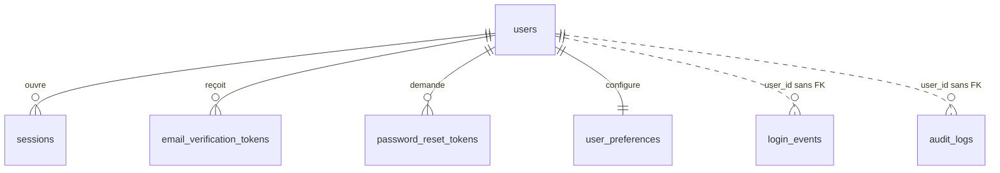

**Enums**

| Enum | Valeurs |
|---|---|
| `user_role` | `USER`, `ADMIN` |
| `user_status` | `ACTIVE`, `SUSPENDED`, `PENDING_DELETION` |
| `session_revoke_reason` | `LOGOUT`, `LOGOUT_ALL`, `PASSWORD_CHANGED`, `EMAIL_CHANGED`, `ADMIN_ACTION`, `ACCOUNT_DELETION`, `SECURITY` |
| `email_token_purpose` | `VERIFY_SIGNUP`, `CHANGE_EMAIL` |
| `login_event_type` | `LOGIN_SUCCEEDED`, `LOGIN_FAILED`, `LOGOUT`, `SESSION_REVOKED`, `PASSWORD_CHANGED`, `PASSWORD_RESET_REQUESTED`, `PASSWORD_RESET_COMPLETED`, `EMAIL_VERIFIED`, `EMAIL_CHANGED`, `REAUTH_SUCCEEDED`, `REAUTH_FAILED`, `ACCOUNT_LOCKED`, `MFA_SUCCEEDED`, `MFA_FAILED` (les deux derniers utilisés à partir de PHASE-13) |
| `audit_actor_type` | `USER`, `ADMIN`, `SYSTEM`, `AUTOMATION`, `AI`, `API_KEY`, `INTEGRATION` |
| `audit_outcome` | `SUCCESS`, `FAILURE`, `DENIED` |
| `ui_theme` | `SYSTEM`, `LIGHT`, `DARK` |

#### `users` — profil propre (pas de `user_id`) — PHASE-01

| Colonne | Type | Null | Défaut | Description |
|---|---|---|---|---|
| `id` | uuid | non | — | PK, UUIDv7. |
| `email` | citext | non | — | E-mail normalisé (trim, NFKC), unique. |
| `password_hash` | varchar(255) | non | — | Chaîne PHC argon2id (ADR-006). Jamais sérialisée. |
| `display_name` | varchar(80) | non | — | Nom affiché. |
| `first_name` | varchar(80) | oui | — | |
| `last_name` | varchar(80) | oui | — | |
| `role` | user_role | non | `'USER'` | ADR-002. |
| `status` | user_status | non | `'ACTIVE'` | |
| `email_verified_at` | timestamptz | oui | — | NULL = e-mail non vérifié (fonctions limitées, cf. SECURITY.md). |
| `password_changed_at` | timestamptz | non | `now()` | Invalide les sessions antérieures. |
| `failed_login_count` | int | non | `0` | Remis à 0 au succès. |
| `locked_until` | timestamptz | oui | — | Verrouillage progressif. |
| `last_login_at` | timestamptz | oui | — | |
| `created_at`, `updated_at` | timestamptz | non | `now()` | |

- Contraintes : `UNIQUE (email)` ; `ck_users__email_format CHECK (position('@' in email) > 1)` ; `ck_users__failed_login_count CHECK (failed_login_count >= 0)`.
- **Un seul ADMIN** (propriétaire de la plateforme, ADR-002) : `ux_users__single_admin ON users ((true)) WHERE role = 'ADMIN'`.
- Pas de colonne `mfa_enabled` : dérivé de `user_mfa_factors` (PHASE-13).
- Index : `users_email_key` (connexion) ; `ix_users__status_created (status, created_at)` (console admin, PHASE-17).

#### `sessions` — [A] + colonnes mutables — PHASE-01

| Colonne | Type | Null | Défaut | Description |
|---|---|---|---|---|
| `token_hash` | bytea | non | — | SHA-256 du jeton opaque de 256 bits (ADR-006). |
| `last_seen_at` | timestamptz | non | `now()` | Mis à jour au plus une fois par minute. |
| `idle_expires_at` | timestamptz | non | — | `last_seen_at + 7 j`. |
| `absolute_expires_at` | timestamptz | non | — | `created_at + 30 j`. |
| `reauth_at` | timestamptz | oui | — | Dernière ré-authentification par mot de passe. |
| `mfa_verified_at` | timestamptz | oui | — | **Ajoutée en PHASE-13.** |
| `revoked_at` | timestamptz | oui | — | |
| `revoke_reason` | session_revoke_reason | oui | — | |
| `ip` | inet | oui | — | IP de création (affichage « mes appareils »). |
| `user_agent_label` | varchar(200) | oui | — | Libellé réduit (« Chrome sur Android »), jamais l'en-tête brut. |

- FK : `user_id → users(id)` simple, **CASC**.
- Contraintes : `UNIQUE (token_hash)` ; `ck_sessions__token_hash_len CHECK (octet_length(token_hash) = 32)` ; `ck_sessions__expiry CHECK (idle_expires_at <= absolute_expires_at AND absolute_expires_at > created_at)` ; `ck_sessions__revocation CHECK ((revoked_at IS NULL) = (revoke_reason IS NULL))`.
- Index : `sessions_token_hash_key` (résolution à chaque requête) ; `ix_sessions__user_active (user_id) WHERE revoked_at IS NULL` (liste des appareils, révocation globale) ; `ix_sessions__absolute_expires (absolute_expires_at)` (purge des sessions expirées).

#### `email_verification_tokens` — [A] — PHASE-01

| Colonne | Type | Null | Défaut | Description |
|---|---|---|---|---|
| `token_hash` | bytea | non | — | SHA-256 du jeton à usage unique. |
| `purpose` | email_token_purpose | non | — | |
| `target_email` | citext | non | — | E-mail à vérifier (nouvelle adresse pour `CHANGE_EMAIL`). |
| `expires_at` | timestamptz | non | — | 24 h. |
| `consumed_at` | timestamptz | oui | — | |

- FK : `user_id → users(id)` simple, **CASC**.
- Contraintes : `UNIQUE (token_hash)` ; `ck_..._token_hash_len` (32 octets) ; `ck_..._expiry CHECK (expires_at > created_at)`.
- **Un seul jeton actif** par utilisateur et usage : `ux_email_verification_tokens__active (user_id, purpose) WHERE consumed_at IS NULL` (l'application supprime l'ancien avant d'émettre).
- Index : `token_hash` (consommation) ; `ix_..._expires (expires_at)` (purge).

#### `password_reset_tokens` — [A] — PHASE-01

| Colonne | Type | Null | Défaut | Description |
|---|---|---|---|---|
| `token_hash` | bytea | non | — | SHA-256. |
| `expires_at` | timestamptz | non | — | 30 min (ADR-006). |
| `consumed_at` | timestamptz | oui | — | |
| `requested_ip` | inet | oui | — | Tronquée. |

- FK : `user_id → users(id)` simple, **CASC**.
- Contraintes : `UNIQUE (token_hash)` ; longueur 32 ; `ck_password_reset_tokens__ttl CHECK (expires_at > created_at AND expires_at <= created_at + interval '30 minutes')`.
- `ux_password_reset_tokens__active (user_id) WHERE consumed_at IS NULL`.
- Index : `token_hash` ; `ix_..._expires (expires_at)`.

#### `user_preferences` — PK = `user_id` (1-1) — PHASE-01

| Colonne | Type | Null | Défaut | Description |
|---|---|---|---|---|
| `user_id` | uuid | non | — | PK et FK `users(id)` simple **CASC**. |
| `locale` | varchar(10) | non | `'fr'` | |
| `timezone` | varchar(64) | non | `'Africa/Dakar'` | IANA (ADR-023). |
| `default_currency` | char(3) | non | `'XOF'` | **FK `currencies(code)` ajoutée en PHASE-05** (la table n'existe pas avant). Avant : `ck_user_preferences__currency_format CHECK (default_currency ~ '^[A-Z]{3}$')`. |
| `date_format` | varchar(20) | non | `'dd/MM/yyyy'` | |
| `week_starts_on` | smallint | non | `1` | 1 = lundi … 7 = dimanche. `CHECK BETWEEN 1 AND 7`. |
| `theme` | ui_theme | non | `'SYSTEM'` | |
| `enabled_modules` | text[] | non | tous les modules utilisateur | ADR-024. Clés : `ideas`, `tasks`, `projects`, `notes`, `finance`, `debts`, `calendar`, `documents`, `pro`, `goals`, `habits`, `learning`, `journal`, `automations`, `integrations`, `ai`. Validé par Zod ; ne gouverne jamais la zone Dev. |
| `quiet_hours_start` | time | oui | — | **PHASE-08.** Heures silencieuses (heure locale). |
| `quiet_hours_end` | time | oui | — | **PHASE-08.** `CHECK ((quiet_hours_start IS NULL) = (quiet_hours_end IS NULL))`. |
| `ai_enabled` | boolean | non | `false` | **PHASE-16.** Opt-in explicite (cahier §4.23). |
| `created_at`, `updated_at` | timestamptz | non | `now()` | |

- Ligne créée dans la même transaction SQL que `users`.

#### `login_events` — [A], **sans FK**, append-only — PHASE-01

| Colonne | Type | Null | Défaut | Description |
|---|---|---|---|---|
| `user_id` | uuid | oui | — | Pas de FK : la trace survit à la révocation et couvre les tentatives sur un e-mail inconnu (NULL). |
| `email_hmac` | bytea | oui | — | HMAC-SHA256 de l'e-mail saisi (clé en variable d'environnement) : détection de force brute sans stocker l'e-mail. |
| `event_type` | login_event_type | non | — | |
| `failure_code` | varchar(40) | oui | — | Code stable (`INVALID_CREDENTIALS`, `LOCKED`…). |
| `session_id` | uuid | oui | — | Pas de FK. |
| `ip` | inet | oui | — | Complète, rétention 180 jours. |
| `user_agent_label` | varchar(200) | oui | — | |
| `occurred_at` | timestamptz | non | `now()` | |

- Droits : `orbit_app` = `SELECT, INSERT` uniquement ; `trg_login_events__append_only` (BEFORE UPDATE OR DELETE) lève une exception sauf pour `orbit_maintenance`.
- Index : `ix_login_events__user_time (user_id, occurred_at DESC)` (historique de connexion) ; `ix_login_events__email_hmac_time (email_hmac, occurred_at DESC) WHERE email_hmac IS NOT NULL` (comptage des échecs) ; `ix_login_events__time_brin USING brin (occurred_at)` (purge à 180 jours).

#### `audit_logs` — [A], **sans FK**, append-only — PHASE-01

| Colonne | Type | Null | Défaut | Description |
|---|---|---|---|---|
| `user_id` | uuid | oui | — | Propriétaire de la donnée concernée. NULL pour un événement plateforme. Pas de FK (survit à la suppression de l'entité). |
| `actor_type` | audit_actor_type | non | — | |
| `actor_user_id` | uuid | oui | — | Pas de FK. |
| `action` | varchar(80) | non | — | `<module>.<entité>.<verbe>` : `finance.transaction.cancelled`. Catalogue dans `packages/contracts/audit`. |
| `entity_type` | varchar(60) | oui | — | Nom de table. **Exception assumée à ADR-018** : un journal n'est pas un lien, il ne doit pas bloquer ni suivre les suppressions. |
| `entity_id` | uuid | oui | — | |
| `outcome` | audit_outcome | non | `'SUCCESS'` | `DENIED` pour les accès croisés (ADR-007 §7). |
| `request_id` | varchar(64) | oui | — | |
| `correlation_id` | varchar(64) | oui | — | Job ou webhook d'origine. |
| `ip` | inet | oui | — | Tronquée. |
| `metadata` | jsonb | non | `'{}'` | Champs modifiés (avant/après) **filtrés** : jamais de secret, jeton, mot de passe, contenu de note ou de document. |
| `occurred_at` | timestamptz | non | `now()` | |

- Contraintes : `ck_audit_logs__metadata_size CHECK (pg_column_size(metadata) <= 8192)` ; `ck_audit_logs__entity CHECK ((entity_type IS NULL) = (entity_id IS NULL))`.
- Droits : comme `login_events` (`SELECT, INSERT` pour `orbit_app`, déclencheur `trg_audit_logs__append_only`).
- Index : `ix_audit_logs__user_time (user_id, occurred_at DESC)` (activité récente) ; `ix_audit_logs__entity (user_id, entity_type, entity_id, occurred_at DESC)` (historique d'une entité : échéances de tâche, statut de contrat) ; `ix_audit_logs__time_brin USING brin (occurred_at)` (rétention).
- Volumétrie : partitionnement mensuel par `occurred_at` à réévaluer en PHASE-17 (seuil : 10 millions de lignes).

### M02 : Shell, design system, capture rapide (PHASE-02)

Aucune table. La file de capture hors ligne vit en IndexedDB côté navigateur (ADR-016) ; à la synchronisation, chaque élément envoie une clé d'idempotence (`idempotency_keys`, M04 ; avant PHASE-05, les endpoints de capture d'idées, notes et tâches dédoublonnent par `client_capture_id`, cf. M03).

### M03 : Organisation — idées, projets, tâches, tags, notes (PHASE-04)

Migration : `0002_phase04_organization`.

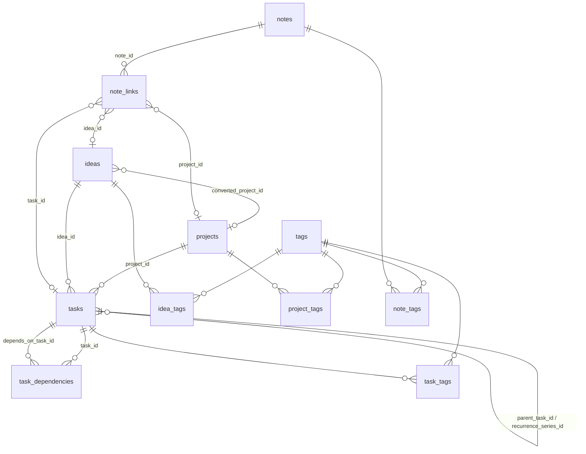

**Enums**

| Enum | Valeurs |
|---|---|
| `idea_status` | `INBOX`, `TO_REVIEW`, `EVALUATED`, `SELECTED`, `IN_PROGRESS`, `REALIZED`, `ABANDONED` |
| `project_type` | `FREELANCE`, `PERSONAL_PRODUCT`, `LEARNING`, `INTERNAL` |
| `project_status` | `PLANNED`, `ACTIVE`, `ON_HOLD`, `COMPLETED`, `ABANDONED` |
| `task_status` | `TODO`, `IN_PROGRESS`, `BLOCKED`, `DONE`, `CANCELLED` |
| `note_kind` | `NOTE`, `MEETING`, `REFERENCE`, `CHECKLIST`, `LOG` |
| `content_format` | `MARKDOWN`, `PLAIN` |

Colonne transverse de capture (idées, tâches, notes) : `client_capture_id uuid NULL` + `ux_<table>__client_capture (user_id, client_capture_id) WHERE client_capture_id IS NOT NULL`. Elle rend idempotente la synchronisation de la file hors ligne (ADR-016) avant l'arrivée de `idempotency_keys` (PHASE-05).

#### `ideas` — [B] + `deleted_at` — PHASE-04

| Colonne | Type | Null | Défaut | Description |
|---|---|---|---|---|
| `title` | varchar(200) | non | — | |
| `description` | text | oui | — | ≤ 20 000 caractères (CHECK). |
| `status` | idea_status | non | `'INBOX'` | |
| `priority` | priority_level | oui | — | NULL autorisé à la capture rapide. |
| `domain` | varchar(60) | oui | — | Domaine libre (« tech », « commerce »…). |
| `potential_score` | smallint | oui | — | 1 à 10. |
| `captured_at` | timestamptz | non | `now()` | Tri par défaut. |
| `source` | capture_source | non | `'MANUAL'` | |
| `source_ref` | varchar(255) | oui | — | Identifiant externe (message Gmail, WhatsApp). |
| `client_capture_id` | uuid | oui | — | Voir ci-dessus. |
| `converted_project_id` | uuid | oui | — | → `projects` **SN**. L'idée est conservée après conversion. |
| `decision_note` | text | oui | — | Évaluation et décision documentée. |
| `deleted_at` | timestamptz | oui | — | Corbeille. |

- Contraintes : `ck_ideas__potential_score CHECK (potential_score BETWEEN 1 AND 10)` ; `ck_ideas__description_len`.
- Index : `ix_ideas__user_captured (user_id, captured_at DESC) WHERE deleted_at IS NULL` (liste par défaut) ; `ix_ideas__user_status (user_id, status, captured_at DESC) WHERE deleted_at IS NULL` (filtres) ; `ix_ideas__fts` (titre + description) ; `ix_ideas__title_trgm` (détection de doublons suggérée) ; `ix_ideas__converted_project (user_id, converted_project_id) WHERE converted_project_id IS NOT NULL`.

#### `projects` — [B] + `archived_at` + `deleted_at` — PHASE-04

| Colonne | Type | Null | Défaut | Description |
|---|---|---|---|---|
| `name` | varchar(120) | non | — | |
| `slug` | citext | non | — | `^[a-z0-9]+(-[a-z0-9]+)*$`, ≤ 80 caractères. |
| `description` | text | oui | — | |
| `type` | project_type | non | `'PERSONAL_PRODUCT'` | |
| `status` | project_status | non | `'PLANNED'` | |
| `priority` | priority_level | oui | — | |
| `starts_on` | date | oui | — | |
| `target_on` | date | oui | — | |
| `completed_on` | date | oui | — | Date de fin réelle. |
| `color` | varchar(7) | oui | — | `#RRGGBB`. |
| `budget_minor` | bigint | oui | — | **PHASE-05.** Budget prévu ≠ dépense réalisée (cahier §4.5). |
| `budget_currency` | char(3) | oui | — | **PHASE-05.** FK `currencies(code)`. |
| `client_id` | uuid | oui | — | **PHASE-10.** → `clients` **SN**. |
| `archived_at` | timestamptz | oui | — | |
| `deleted_at` | timestamptz | oui | — | Corbeille ; refusée si des transactions validées le référencent (règle applicative, la FK NA bloquant de toute façon la purge). |

- Contraintes : `ux_projects__slug (user_id, slug) WHERE deleted_at IS NULL` ; `ck_projects__slug_format` ; `ck_projects__dates CHECK (target_on IS NULL OR starts_on IS NULL OR target_on >= starts_on)` ; `ck_projects__completed CHECK ((status = 'COMPLETED') = (completed_on IS NOT NULL))` ; (PHASE-05) `ck_projects__budget CHECK ((budget_minor IS NULL) = (budget_currency IS NULL) AND (budget_minor IS NULL OR budget_minor >= 0))`.
- La progression et la rentabilité ne sont **pas stockées** : dérivées des tâches et du registre (cahier §4.5).
- Index : `ix_projects__user_status (user_id, status) WHERE deleted_at IS NULL AND archived_at IS NULL` (Kanban, widget « projets actifs ») ; `ux_projects__slug` (résolution par slug) ; `ix_projects__fts` (nom + description) ; (PHASE-10) `ix_projects__client (user_id, client_id) WHERE client_id IS NOT NULL` (fiche client).

#### `tasks` — [B] + `deleted_at` + récurrence (§1.8) — PHASE-04

| Colonne | Type | Null | Défaut | Description |
|---|---|---|---|---|
| `title` | varchar(300) | non | — | |
| `description` | text | oui | — | |
| `status` | task_status | non | `'TODO'` | |
| `priority` | priority_level | oui | — | |
| `project_id` | uuid | oui | — | → `projects` **SN**. |
| `idea_id` | uuid | oui | — | → `ideas` **SN**. |
| `parent_task_id` | uuid | oui | — | → `tasks` **CASC** (sous-tâche : dépendant pur). Un seul niveau (règle applicative). |
| `starts_on` | date | oui | — | |
| `due_date` | date | oui | — | Vues « Aujourd'hui », « Cette semaine », « Sans échéance ». |
| `due_at` | timestamptz | oui | — | Heure précise facultative. |
| `completed_at` | timestamptz | oui | — | |
| `estimated_minutes` | int | oui | — | |
| `actual_minutes` | int | oui | — | |
| `recurrence_rule` … `next_occurrence_at` | — | oui | — | Bloc §1.8, porté **uniquement par la tâche maîtresse** de la série. |
| `recurrence_series_id` | uuid | oui | — | → `tasks` **SN**. Occurrence générée : pointe vers la maîtresse. |
| `occurrence_date` | date | oui | — | Date de l'occurrence générée. |
| `source` | capture_source | non | `'MANUAL'` | `AUTOMATION`, `RECURRENCE`, `AI` identifient les tâches automatiques (cahier §4.15). |
| `source_ref` | varchar(255) | oui | — | |
| `client_capture_id` | uuid | oui | — | |
| `kanban_rank` | varchar(64) | oui | — | Indexation fractionnaire pour l'ordre Kanban. |
| `client_id` | uuid | oui | — | **PHASE-10.** → `clients` **SN**. |
| `deleted_at` | timestamptz | oui | — | |

- Contraintes :
  - `ck_tasks__done CHECK ((status = 'DONE') = (completed_at IS NOT NULL))` ;
  - `ck_tasks__due CHECK (due_at IS NULL OR due_date IS NOT NULL)` (l'application dérive `due_date` de `due_at` dans le fuseau de l'utilisateur) ;
  - `ck_tasks__not_own_parent CHECK (parent_task_id IS NULL OR parent_task_id <> id)` ;
  - `ck_tasks__series CHECK ((recurrence_series_id IS NULL) = (occurrence_date IS NULL) AND (recurrence_rule IS NULL OR recurrence_series_id IS NULL))` ;
  - `ck_tasks__minutes CHECK (coalesce(estimated_minutes,0) >= 0 AND coalesce(actual_minutes,0) >= 0)` ;
  - `ck_tasks__recurrence_complete`, `ck_tasks__recurrence_syntax` (§1.8) ;
  - `ux_tasks__series_occurrence (user_id, recurrence_series_id, occurrence_date) WHERE recurrence_series_id IS NOT NULL` (génération idempotente : une occurrence par date).
- « En retard » = `due_date < aujourd'hui(fuseau) AND status NOT IN ('DONE','CANCELLED')`, jamais stocké.
- Index : `ix_tasks__user_status_due (user_id, status, due_date) WHERE deleted_at IS NULL` (Aujourd'hui, En retard, Cette semaine) ; `ix_tasks__project (user_id, project_id, status) WHERE project_id IS NOT NULL AND deleted_at IS NULL` (Kanban projet) ; `ix_tasks__parent (user_id, parent_task_id) WHERE parent_task_id IS NOT NULL` ; `ix_tasks__next_occurrence (next_occurrence_at) WHERE recurrence_rule IS NOT NULL AND deleted_at IS NULL` (générateur) ; `ix_tasks__fts`.

#### `task_dependencies` — [J] — PHASE-04

| Colonne | Type | Null | Défaut | Description |
|---|---|---|---|---|
| `task_id` | uuid | non | — | → `tasks` **CASC**. Tâche bloquée. |
| `depends_on_task_id` | uuid | non | — | → `tasks` **CASC**. Tâche bloquante. |

- PK `(user_id, task_id, depends_on_task_id)` ; `ck_task_dependencies__not_self CHECK (task_id <> depends_on_task_id)`.
- **Absence de cycle garantie par la base** : `trg_task_dependencies__no_cycle` (BEFORE INSERT OR UPDATE) prend `pg_advisory_xact_lock(hashtextextended('task_deps:' || user_id, 0))` puis rejette (`SQLSTATE 23514`) si `task_id` est atteignable depuis `depends_on_task_id` (CTE récursive). L'application traduit en 422 `DEPENDENCY_CYCLE`.
- Index : `(user_id, depends_on_task_id)` (« ce que cette tâche bloque »).

#### `tags` — [B] — PHASE-04

| Colonne | Type | Null | Défaut | Description |
|---|---|---|---|---|
| `name` | citext | non | — | ≤ 40 caractères. |
| `color` | varchar(7) | oui | — | `#RRGGBB`. |

- Contraintes : `UNIQUE (user_id, name)` ; `ck_tags__name_len` ; `ck_tags__color CHECK (color ~ '^#[0-9A-Fa-f]{6}$')`.
- Index : l'unique `(user_id, name)` sert l'autocomplétion par préfixe.

#### `idea_tags`, `task_tags`, `project_tags`, `note_tags` — [J] — PHASE-04

| Table | Colonnes | PK | Index inverse |
|---|---|---|---|
| `idea_tags` | `idea_id` → ideas CASC, `tag_id` → tags CASC | `(user_id, idea_id, tag_id)` | `(user_id, tag_id)` |
| `task_tags` | `task_id` → tasks CASC, `tag_id` → tags CASC | `(user_id, task_id, tag_id)` | `(user_id, tag_id)` |
| `project_tags` | `project_id` → projects CASC, `tag_id` → tags CASC | `(user_id, project_id, tag_id)` | `(user_id, tag_id)` |
| `note_tags` | `note_id` → notes CASC, `tag_id` → tags CASC | `(user_id, note_id, tag_id)` | `(user_id, tag_id)` |

L'index inverse sert le filtre « éléments portant le tag X ».

#### `notes` — [B] + `archived_at` + `deleted_at` — PHASE-04

| Colonne | Type | Null | Défaut | Description |
|---|---|---|---|---|
| `title` | varchar(200) | oui | — | Facultatif (note rapide). |
| `content` | text | non | `''` | ≤ 200 000 caractères (CHECK). Donnée non fiable : rendu Markdown assaini, jamais d'HTML brut. |
| `content_format` | content_format | non | `'MARKDOWN'` | |
| `kind` | note_kind | non | `'NOTE'` | |
| `source` | capture_source | non | `'MANUAL'` | |
| `source_ref` | varchar(255) | oui | — | |
| `client_capture_id` | uuid | oui | — | |
| `pinned_at` | timestamptz | oui | — | |
| `archived_at` | timestamptz | oui | — | |
| `deleted_at` | timestamptz | oui | — | |

- Index : `ix_notes__user_updated (user_id, updated_at DESC) WHERE deleted_at IS NULL` (liste) ; `ix_notes__pinned (user_id, pinned_at DESC) WHERE pinned_at IS NOT NULL AND deleted_at IS NULL` ; `ix_notes__fts` (titre + contenu).

#### `note_links` — [A] — PHASE-04, cibles ajoutées ensuite

| Colonne | Type | Null | Phase | Cible (toutes **CASC**) |
|---|---|---|---|---|
| `note_id` | uuid | non | 04 | `notes` |
| `idea_id` | uuid | oui | 04 | `ideas` |
| `project_id` | uuid | oui | 04 | `projects` |
| `task_id` | uuid | oui | 04 | `tasks` |
| `transaction_id` | uuid | oui | 05 | `transactions` |
| `counterparty_id` | uuid | oui | 05 | `counterparties` |
| `debt_id` | uuid | oui | 06 | `debts` |
| `calendar_event_id` | uuid | oui | 09 | `calendar_events` |
| `client_id`, `contact_id`, `contract_id`, `invoice_id` | uuid | oui | 10 | `clients`, `contacts`, `contracts`, `invoices` |
| `goal_id`, `learning_item_id` | uuid | oui | 11 | `goals`, `learning_items` |
| `application_id`, `domain_id`, `server_id` | uuid | oui | 12 | `applications`, `domains`, `servers` |

- `ck_note_links__one_target CHECK (num_nonnulls(<toutes les cibles sauf note_id>) = 1)`, réécrit à chaque phase qui ajoute une cible (§2.3).
- Par cible `<t>` : `ux_note_links__<t> (user_id, <t>_id, note_id) WHERE <t>_id IS NOT NULL` (pas de doublon + « notes liées à cette entité »).
- Index : `ix_note_links__note (user_id, note_id)` (« entités liées à cette note »).
- Supprimer une cible supprime le lien, jamais la note.

### M04 : Finance, cœur (PHASE-05)

Migrations : `0003_phase05_finance_core` (DDL + `currencies` + FK `user_preferences.default_currency` + colonnes budget de `projects` + cibles `note_links`), `0004_phase05_backfill_system_categories` (DML : catégories système des comptes existants).

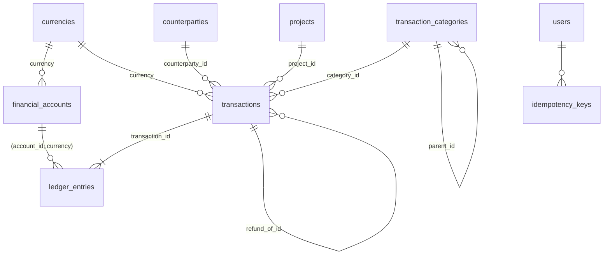

**Enums**

| Enum | Valeurs |
|---|---|
| `account_type` | `CASH`, `MOBILE_MONEY`, `BANK`, `PAYMENT_ACCOUNT`, `OTHER` |
| `category_kind` | `INCOME`, `EXPENSE` |
| `counterparty_kind` | `PERSON`, `ORGANIZATION` |
| `transaction_type` | `INCOME`, `EXPENSE`, `TRANSFER`, `BORROWING`, `LOAN`, `REFUND`, `ADJUSTMENT` |
| `transaction_status` | `PENDING`, `VALIDATED`, `CANCELLED` |
| `economic_class` | `INCOME_OPERATING`, `INCOME_OTHER`, `GIFT_RECEIVED`, `LOAN_COLLECTION`, `EXPENSE_OPERATING`, `EXPENSE_FEE`, `GIFT_GIVEN`, `DEBT_REPAYMENT`, `INTERNAL_TRANSFER`, `DEBT_DRAWDOWN`, `LOAN_DISBURSEMENT`, `REFUND_RECEIVED`, `REFUND_ISSUED`, `BALANCE_ADJUSTMENT` |
| `transaction_source` | `MANUAL`, `RECURRENCE`, `AUTOMATION`, `AI`, `IMPORT`, `INTEGRATION` |
| `fx_rate_source` | `MANUAL` (saisi par l'utilisateur), `PROVIDER_STATEMENT` (taux appliqué par l'opérateur ou la banque, lu sur le relevé), `FIXED_PEG` (parité légale fixe, ex. XOF/EUR 655,957) |
| `entry_direction` | `DEBIT`, `CREDIT` |
| `idempotency_status` | `IN_PROGRESS`, `COMPLETED` |

**Matrice `type` → `economic_class` autorisées** (`ck_transactions__economic_class`), et forme des écritures (déclencheur `trg_transactions__entries_shape`, ci-dessous) :

| `type` | `economic_class` autorisées | Écritures exigées |
|---|---|---|
| `INCOME` | `INCOME_OPERATING`, `INCOME_OTHER`, `GIFT_RECEIVED`, `LOAN_COLLECTION` | 1 CREDIT |
| `EXPENSE` | `EXPENSE_OPERATING`, `EXPENSE_FEE`, `GIFT_GIVEN`, `DEBT_REPAYMENT` | 1 DEBIT |
| `TRANSFER` | `INTERNAL_TRANSFER` | 1 DEBIT + 1 CREDIT, comptes distincts |
| `BORROWING` | `DEBT_DRAWDOWN` | 1 CREDIT |
| `LOAN` | `LOAN_DISBURSEMENT` | 1 DEBIT |
| `REFUND` | `REFUND_RECEIVED` (CREDIT), `REFUND_ISSUED` (DEBIT) | 1 écriture |
| `ADJUSTMENT` | `BALANCE_ADJUSTMENT` | 1 écriture, sens libre |

Ainsi un cadeau reçu (`INCOME`/`GIFT_RECEIVED`), un remboursement de dette (`EXPENSE`/`DEBT_REPAYMENT`) ou un prêt récupéré (`INCOME`/`LOAN_COLLECTION`) se distinguent d'un revenu ou d'une charge opérationnels (cahier §4.10, §6.2). Les rapports se fondent sur `economic_class`, jamais sur `type` seul (`FINANCE_RULES.md`).

#### `currencies` — [G] — PHASE-05

| Colonne | Type | Null | Défaut | Description |
|---|---|---|---|---|
| `code` | char(3) | non | — | PK, ISO 4217. `CHECK (code ~ '^[A-Z]{3}$')`. |
| `numeric_code` | smallint | non | — | ISO 4217 numérique. |
| `exponent` | smallint | non | — | `CHECK BETWEEN 0 AND 4`. XOF = 0. |
| `symbol` | varchar(8) | non | — | |
| `name_fr` | varchar(60) | non | — | |
| `is_active` | boolean | non | `true` | Proposée dans les listes. |
| `created_at`, `updated_at` | timestamptz | non | `now()` | |

- Lecture seule pour `orbit_app` (`GRANT SELECT`). Seed §2.4.1. L'`exponent` d'une devise utilisée n'est jamais modifié.

#### `financial_accounts` — [B] + `archived_at` — PHASE-05

| Colonne | Type | Null | Défaut | Description |
|---|---|---|---|---|
| `name` | varchar(80) | non | — | « Wave perso », « Espèces ». |
| `type` | account_type | non | — | |
| `provider` | varchar(60) | oui | — | Wave, Orange Money, Free Money, banque… |
| `currency` | char(3) | non | — | FK `currencies(code)` NA. **Immuable.** |
| `opening_balance_minor` | bigint | non | `0` | Solde initial. **Immuable dès la première écriture** (correction = transaction `ADJUSTMENT`). |
| `opened_on` | date | non | — | |
| `allow_overdraft` | boolean | non | `false` | Hypothèse H3. |
| `overdraft_limit_minor` | bigint | oui | — | NULL = découvert illimité si autorisé. |
| `include_in_net_worth` | boolean | non | `true` | |
| `color` | varchar(7) | oui | — | |
| `icon` | varchar(40) | oui | — | |
| `sort_order` | int | non | `0` | |
| `notes` | text | oui | — | |
| `archived_at` | timestamptz | oui | — | Un compte n'est jamais supprimé s'il porte des écritures. |

- Contraintes : `UNIQUE (user_id, id, currency)` (cible de la FK de `ledger_entries`) ; `ux_financial_accounts__name (user_id, name) WHERE archived_at IS NULL` ; `ck_financial_accounts__opening CHECK (opening_balance_minor >= 0 OR allow_overdraft)` ; `ck_financial_accounts__overdraft CHECK (overdraft_limit_minor IS NULL OR (allow_overdraft AND overdraft_limit_minor > 0))`.
- `trg_financial_accounts__guard` (BEFORE UPDATE) : refuse tout changement de `currency`, et de `opening_balance_minor` si une écriture existe.
- Solde **jamais stocké** : `opening_balance_minor + Σ CREDIT − Σ DEBIT` des écritures dont la transaction est `VALIDATED` (ADR-009).
- Index : `ix_financial_accounts__active (user_id, sort_order) WHERE archived_at IS NULL` (liste des comptes, widget trésorerie).

#### `transaction_categories` — [B] + `archived_at` — PHASE-05

| Colonne | Type | Null | Défaut | Description |
|---|---|---|---|---|
| `name` | varchar(60) | non | — | |
| `kind` | category_kind | non | — | |
| `parent_id` | uuid | oui | — | → `transaction_categories` NA. Deux niveaux maximum (règle applicative). |
| `default_economic_class` | economic_class | non | — | Proposée à la saisie. |
| `is_system` | boolean | non | `false` | |
| `system_key` | varchar(80) | oui | — | Clé stable du seed (§2.4.2). |
| `color` | varchar(7) | oui | — | |
| `icon` | varchar(40) | oui | — | |
| `sort_order` | int | non | `0` | |
| `archived_at` | timestamptz | oui | — | Masquage ; jamais de suppression d'une catégorie utilisée. |

- Contraintes : `ux_transaction_categories__name UNIQUE NULLS NOT DISTINCT (user_id, parent_id, name)` ; `UNIQUE (user_id, system_key)` ; `ck_transaction_categories__system CHECK (is_system = (system_key IS NOT NULL))` ; `ck_transaction_categories__class` (`kind = 'INCOME'` ⇒ classe ∈ {`INCOME_OPERATING`, `INCOME_OTHER`, `GIFT_RECEIVED`, `LOAN_COLLECTION`} ; `kind = 'EXPENSE'` ⇒ classe ∈ {`EXPENSE_OPERATING`, `EXPENSE_FEE`, `GIFT_GIVEN`, `DEBT_REPAYMENT`}) ; `ck_..._not_own_parent`.
- Index : `ix_transaction_categories__kind (user_id, kind, sort_order) WHERE archived_at IS NULL` (sélecteur de catégorie).

#### `counterparties` — [B] + `archived_at` — PHASE-05

| Colonne | Type | Null | Défaut | Description |
|---|---|---|---|---|
| `name` | varchar(120) | non | — | « Tonton Modou », « Senelec ». |
| `kind` | counterparty_kind | non | `'PERSON'` | |
| `phone` | varchar(20) | oui | — | E.164. |
| `email` | citext | oui | — | |
| `notes` | text | oui | — | |
| `archived_at` | timestamptz | oui | — | |

- Index : `ix_counterparties__name_trgm` (autocomplétion) ; `ix_counterparties__active (user_id, name) WHERE archived_at IS NULL`.

#### `transactions` — [B] — PHASE-05 (colonnes de lien ajoutées en 06 et 10)

| Colonne | Type | Null | Défaut | Description |
|---|---|---|---|---|
| `type` | transaction_type | non | — | |
| `status` | transaction_status | non | — | Pas de défaut : l'appelant choisit. |
| `economic_class` | economic_class | non | — | Traitement économique (cadeau, remboursement de dette…). |
| `amount_minor` | bigint | non | — | Montant de l'en-tête, > 0. Transfert : montant **débité** (côté source). |
| `currency` | char(3) | non | — | FK `currencies(code)`. Transfert : devise du compte source. |
| `occurred_at` | timestamptz | non | — | Instant de l'opération. |
| `value_date` | date | non | — | Date civile de rattachement (soldes à date, périodes de rapport). Par défaut : date locale de `occurred_at`. |
| `description` | varchar(255) | oui | — | |
| `notes` | text | oui | — | |
| `category_id` | uuid | oui | — | → `transaction_categories` NA. |
| `counterparty_id` | uuid | oui | — | → `counterparties` NA. |
| `project_id` | uuid | oui | — | → `projects` NA. |
| `parent_transaction_id` | uuid | oui | — | → `transactions` NA. Transaction de **frais** rattachée à l'opération d'origine. |
| `refund_of_id` | uuid | oui | — | FK composite `(user_id, refund_of_id, currency) → transactions(user_id, id, currency)` NA : remboursement dans la devise d'origine. |
| `debt_id` | uuid | oui | — | **PHASE-06.** → `debts` NA. Dette ou créance **créée** par cette transaction (`BORROWING`, `LOAN`). Les remboursements passent par `debt_repayments`. |
| `rate` | numeric(20,10) | oui | — | Taux de conversion (transfert multi-devises). |
| `rate_date` | date | oui | — | Date de référence du taux. |
| `rate_source` | fx_rate_source | oui | — | Origine du taux ; le système n'invente jamais de taux (cahier §6.5). |
| `source` | transaction_source | non | `'MANUAL'` | |
| `idempotency_key` | varchar(128) | oui | — | Événement externe ou occurrence récurrente (`recurring:<occurrence_id>`). |
| `external_reference` | varchar(128) | oui | — | Référence Wave/OM/banque (non unique : sert à suggérer des doublons). |
| `validated_at` | timestamptz | oui | — | |
| `cancelled_at` | timestamptz | oui | — | |
| `cancelled_by` | uuid | oui | — | FK `users(id)` simple NA. |
| `cancel_reason` | varchar(500) | oui | — | Obligatoire à l'annulation. |

- Contraintes :
  - `UNIQUE (user_id, id, currency)` (cible des FK d'imputation et de `refund_of_id`) ;
  - `ck_transactions__amount_positive CHECK (amount_minor > 0)` ;
  - `ck_transactions__economic_class` (matrice ci-dessus) ;
  - `ck_transactions__validated CHECK (status <> 'VALIDATED' OR validated_at IS NOT NULL)` ;
  - `ck_transactions__cancelled CHECK ((status = 'CANCELLED') = (cancelled_at IS NOT NULL) AND (cancelled_at IS NULL OR (cancelled_by IS NOT NULL AND cancel_reason IS NOT NULL)))` ;
  - `ck_transactions__fee CHECK (parent_transaction_id IS NULL OR (type = 'EXPENSE' AND economic_class = 'EXPENSE_FEE' AND parent_transaction_id <> id))` ;
  - `ck_transactions__refund CHECK ((type = 'REFUND') = (refund_of_id IS NOT NULL) AND (refund_of_id IS NULL OR refund_of_id <> id))` ;
  - `ck_transactions__rate CHECK ((rate IS NULL) = (rate_date IS NULL) AND (rate IS NULL) = (rate_source IS NULL) AND (rate IS NULL OR (rate > 0 AND type = 'TRANSFER')))` ;
  - (PHASE-06) `ck_transactions__debt_link CHECK (debt_id IS NULL OR type IN ('BORROWING','LOAN'))` ;
  - `ux_transactions__idempotency (user_id, idempotency_key) WHERE idempotency_key IS NOT NULL`.
- Déclencheurs :
  - `trg_transactions__guard` (BEFORE UPDATE OR DELETE) : transitions permises `PENDING→VALIDATED`, `PENDING→CANCELLED`, `VALIDATED→CANCELLED` ; aucune sortie de `CANCELLED` ; dès que `OLD.status <> 'PENDING'`, les colonnes `type`, `economic_class`, `amount_minor`, `currency`, `occurred_at`, `value_date`, `rate*`, `parent_transaction_id`, `refund_of_id` sont figées ; **DELETE interdit** (sauf `orbit_maintenance` lors d'une purge de compte). Corriger une transaction validée = l'annuler et en saisir une nouvelle, ou saisir un `ADJUSTMENT`.
  - `trg_transactions__entries_shape` : **CONSTRAINT TRIGGER DEFERRABLE INITIALLY DEFERRED**, sur `transactions` (INSERT, UPDATE) et `ledger_entries` (INSERT, DELETE). À la validation de la transaction SQL, pour chaque en-tête touché : nombre et sens des écritures conformes à la matrice ; écriture unique de même montant et même devise que l'en-tête ; transfert : un DEBIT égal à l'en-tête, un CREDIT, comptes différents, et soit même devise et montants égaux et `rate IS NULL`, soit devises différentes et `rate IS NOT NULL`. Le montant crédité d'un transfert multi-devises (`round_half_up(debit × rate)`) est vérifié par l'application (`packages/money`).
- **Création d'une transaction validée** : insertion de l'en-tête en `PENDING`, insertion des écritures, puis `UPDATE status = 'VALIDATED'`, dans **une seule transaction SQL** (le repository l'encapsule). Ce séquencement est imposé par `trg_ledger_entries__guard`.
- Index :
  - `ix_transactions__journal (user_id, value_date DESC, id DESC)` (journal paginé par curseur) ;
  - `ix_transactions__status_date (user_id, status, value_date)` (rapports de période, liste « en attente ») ;
  - `ix_transactions__category (user_id, category_id, value_date) WHERE category_id IS NOT NULL` (dépenses par catégorie) ;
  - `ix_transactions__counterparty (user_id, counterparty_id, value_date) WHERE counterparty_id IS NOT NULL` (vue par personne) ;
  - `ix_transactions__project (user_id, project_id) WHERE project_id IS NOT NULL` (rentabilité projet) ;
  - `ix_transactions__parent (user_id, parent_transaction_id) WHERE parent_transaction_id IS NOT NULL` (frais d'une opération) ;
  - `ix_transactions__refund_of (user_id, refund_of_id) WHERE refund_of_id IS NOT NULL` (cumul remboursé) ;
  - `ix_transactions__external_ref (user_id, external_reference) WHERE external_reference IS NOT NULL` (suggestion de doublon) ;
  - (06) `ix_transactions__debt (user_id, debt_id) WHERE debt_id IS NOT NULL` ; (10) `ix_transactions__invoice (user_id, invoice_id) WHERE invoice_id IS NOT NULL` ;
  - `ix_transactions__description_trgm` (recherche globale).

#### `ledger_entries` — [A] — PHASE-05

| Colonne | Type | Null | Défaut | Description |
|---|---|---|---|---|
| `transaction_id` | uuid | non | — | → `transactions` NA. |
| `account_id` | uuid | non | — | FK composite `(user_id, account_id, currency) → financial_accounts(user_id, id, currency)` NA : **la devise d'une écriture est toujours celle de son compte**. |
| `direction` | entry_direction | non | — | |
| `amount_minor` | bigint | non | — | > 0. |
| `currency` | char(3) | non | — | FK `currencies(code)`. |

- Contraintes : `ck_ledger_entries__amount_positive CHECK (amount_minor > 0)` ; `UNIQUE (user_id, transaction_id, direction)` (au plus une écriture par sens et par transaction, cohérent avec la matrice).
- `trg_ledger_entries__guard` (BEFORE INSERT OR UPDATE OR DELETE) : `UPDATE` toujours interdit ; `INSERT` et `DELETE` permis seulement si la transaction parente est `PENDING` (sauf `orbit_maintenance`).
- Index : `ix_ledger_entries__account (user_id, account_id, transaction_id) INCLUDE (direction, amount_minor)` (calcul de solde, relevé de compte) ; l'unique `(user_id, transaction_id, direction)` sert « écritures d'une transaction ».

#### `idempotency_keys` — [A] + colonnes de complétion — PHASE-05

| Colonne | Type | Null | Défaut | Description |
|---|---|---|---|---|
| `scope` | varchar(80) | non | — | Opération : `POST /finance/transactions`. |
| `key` | varchar(128) | non | — | En-tête `Idempotency-Key` fourni par le client. |
| `request_hash` | bytea | non | — | SHA-256 du corps canonique : même clé + corps différent → 422 `IDEMPOTENCY_KEY_REUSED`. |
| `status` | idempotency_status | non | `'IN_PROGRESS'` | |
| `response_status` | smallint | oui | — | |
| `response_body` | jsonb | oui | — | Réponse rejouée (jamais de secret). |
| `resource_id` | uuid | oui | — | |
| `completed_at` | timestamptz | oui | — | |
| `expires_at` | timestamptz | non | — | 7 jours pour la finance, 24 h sinon. |

- FK `user_id → users(id)` simple **CASC** (donnée technique).
- Contraintes : `UNIQUE (user_id, scope, key)` ; `ck_idempotency_keys__completed CHECK ((status = 'COMPLETED') = (completed_at IS NOT NULL))`.
- Index : l'unique (vérification à chaque requête) ; `ix_idempotency_keys__expires (expires_at)` (purge).

### M05 : Dettes, créances, récurrences, prévisions (PHASE-06)

Migration : `0005_phase06_debts_recurring` (+ `transactions.debt_id`, cible `note_links.debt_id`).

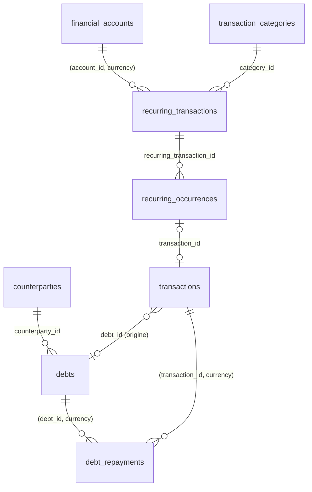

**Enums**

| Enum | Valeurs |
|---|---|
| `debt_type` | `PAYABLE` (je dois), `RECEIVABLE` (on me doit) |
| `debt_status` | `OPEN`, `CANCELLED`, `WRITTEN_OFF` — **cycle de vie seulement** |
| `recurring_status` | `ACTIVE`, `PAUSED`, `ENDED` |
| `recurring_generation_mode` | `CONFIRM` (l'occurrence attend une confirmation), `AUTO_PENDING` (crée une transaction `PENDING` à l'échéance) |
| `occurrence_status` | `EXPECTED`, `CONFIRMED`, `SKIPPED` |

**État de règlement dérivé** (jamais stocké, comme le retard) : `remaining = principal_minor − Σ debt_repayments.amount_minor` (transactions `VALIDATED` uniquement) ; `UNPAID` si rien n'est imputé, `PARTIALLY_SETTLED` si `0 < remaining < principal`, `SETTLED` si `remaining = 0`. Raison : l'annulation d'une transaction de remboursement doit rouvrir la dette sans mise à jour croisée. Le retard (ADR-020) : `due_date < aujourd'hui AND remaining > 0 AND status = 'OPEN'`.

#### `debts` — [B] — PHASE-06

| Colonne | Type | Null | Défaut | Description |
|---|---|---|---|---|
| `type` | debt_type | non | — | |
| `counterparty_id` | uuid | non | — | → `counterparties` NA. |
| `title` | varchar(160) | non | — | |
| `description` | text | oui | — | Motif. |
| `principal_minor` | bigint | non | — | Montant initial, > 0. |
| `currency` | char(3) | non | — | FK `currencies(code)`. |
| `opened_on` | date | non | — | |
| `due_date` | date | oui | — | |
| `status` | debt_status | non | `'OPEN'` | |
| `cancelled_at` | timestamptz | oui | — | |
| `written_off_at` | timestamptz | oui | — | Radiation (créance abandonnée, dette remise). |
| `closing_reason` | varchar(500) | oui | — | Obligatoire pour `CANCELLED` et `WRITTEN_OFF`. |
| `notes` | text | oui | — | |

- Contraintes : `UNIQUE (user_id, id, currency)` ; `ck_debts__principal_positive` ; `ck_debts__due CHECK (due_date IS NULL OR due_date >= opened_on)` ; `ck_debts__closing CHECK ((status = 'CANCELLED') = (cancelled_at IS NOT NULL) AND (status = 'WRITTEN_OFF') = (written_off_at IS NOT NULL) AND (status = 'OPEN' OR closing_reason IS NOT NULL))`.
- Intérêts, pénalités, échéanciers : hors schéma (cahier §4.11).
- Index : `ix_debts__open (user_id, type, due_date) WHERE status = 'OPEN'` (dettes à payer, créances à recevoir, échéances) ; `ix_debts__counterparty (user_id, counterparty_id)` (vue par personne).

#### `debt_repayments` — [A] (table d'imputation) — PHASE-06

| Colonne | Type | Null | Défaut | Description |
|---|---|---|---|---|
| `debt_id` | uuid | non | — | FK `(user_id, debt_id, currency) → debts(user_id, id, currency)` NA. |
| `transaction_id` | uuid | non | — | FK `(user_id, transaction_id, currency) → transactions(user_id, id, currency)` NA. |
| `amount_minor` | bigint | non | — | Part de la transaction imputée à cette dette, > 0. |
| `currency` | char(3) | non | — | Identique à la dette **et** à la transaction (garanti par les deux FK). |
| `notes` | varchar(500) | oui | — | |

- Contraintes : `UNIQUE (user_id, debt_id, transaction_id)` ; `ck_debt_repayments__amount_positive`.
- `trg_debt_repayments__guard` (BEFORE INSERT OR UPDATE) :
  1. verrouille la transaction (`SELECT ... FOR UPDATE`) ;
  2. refuse si elle est `CANCELLED` ;
  3. refuse si la classe ne correspond pas : dette `PAYABLE` ⇒ `DEBT_REPAYMENT` ; `RECEIVABLE` ⇒ `LOAN_COLLECTION` ;
  4. appelle `orbit_assert_imputation_within_amount(user_id, transaction_id)` : **Σ `debt_repayments` + Σ `invoice_payments` (à partir de PHASE-10) de la transaction ≤ `transactions.amount_minor`**.
- Le refus d'un remboursement supérieur au restant dû (sauf avance ou trop-perçu explicite) est **applicatif**, sous verrou `SELECT ... FOR UPDATE` de la dette.
- Désimputer = supprimer la ligne (audité). Pas de suppression en cascade.
- Index : `ix_debt_repayments__debt (user_id, debt_id) INCLUDE (amount_minor, transaction_id)` (restant dû, historique des versements) ; `ix_debt_repayments__transaction (user_id, transaction_id)` (contrôle d'imputation).

#### `recurring_transactions` — [B] + récurrence (§1.8, **obligatoire**) — PHASE-06

| Colonne | Type | Null | Défaut | Description |
|---|---|---|---|---|
| `name` | varchar(120) | non | — | « Loyer », « Netflix », « Woyofal ». |
| `type` | transaction_type | non | — | `INCOME`, `EXPENSE` ou `TRANSFER` uniquement. |
| `economic_class` | economic_class | non | — | Même matrice que `transactions`. |
| `amount_minor` | bigint | non | — | Montant attendu, > 0. |
| `currency` | char(3) | non | — | |
| `account_id` | uuid | non | — | FK `(user_id, account_id, currency) → financial_accounts(user_id, id, currency)` NA. Compte débité (dépense, transfert) ou crédité (revenu). |
| `destination_account_id` | uuid | oui | — | → `financial_accounts` NA. Transfert uniquement. |
| `category_id` | uuid | oui | — | → `transaction_categories` NA. |
| `counterparty_id` | uuid | oui | — | → `counterparties` NA. |
| `project_id` | uuid | oui | — | → `projects` NA. |
| `generation_mode` | recurring_generation_mode | non | `'CONFIRM'` | Jamais de validation automatique d'une écriture financière. |
| `reminder_days_before` | smallint | non | `1` | 0 à 30. |
| `status` | recurring_status | non | `'ACTIVE'` | |
| `recurrence_rule`, `recurrence_anchor_on`, `recurrence_timezone` | — | **non** | — | Bloc §1.8. |
| `recurrence_local_time` | time | oui | — | |
| `next_occurrence_at` | timestamptz | oui | — | Dérivé. |
| `generated_until` | date | oui | — | Horizon jusqu'où les occurrences existent (90 jours glissants). |
| `notes` | text | oui | — | |

- Contraintes : `ck_recurring_transactions__type CHECK (type IN ('INCOME','EXPENSE','TRANSFER'))` ; matrice `economic_class` ; `ck_..._transfer CHECK ((type = 'TRANSFER') = (destination_account_id IS NOT NULL) AND destination_account_id IS DISTINCT FROM account_id)` ; `ck_..._amount_positive` ; `ck_..._recurrence_syntax` ; `ck_..._reminder_days`.
- Index : `ix_recurring_transactions__next (next_occurrence_at) WHERE status = 'ACTIVE'` (générateur d'occurrences, job PHASE-08 ; avant PHASE-08, génération paresseuse à la lecture) ; `ix_recurring_transactions__status (user_id, status)` (liste).

#### `recurring_occurrences` — [B] — PHASE-06

| Colonne | Type | Null | Défaut | Description |
|---|---|---|---|---|
| `recurring_transaction_id` | uuid | non | — | → `recurring_transactions` NA. |
| `due_on` | date | non | — | Échéance locale. |
| `expected_amount_minor` | bigint | non | — | Copie modifiable pour cette seule occurrence, > 0. |
| `currency` | char(3) | non | — | |
| `status` | occurrence_status | non | `'EXPECTED'` | « En retard » dérivé : `EXPECTED AND due_on < aujourd'hui`. |
| `transaction_id` | uuid | oui | — | → `transactions` NA. Transaction réelle (créée avec `idempotency_key = 'recurring:<id>'`). |
| `confirmed_at` | timestamptz | oui | — | |
| `skipped_at` | timestamptz | oui | — | |

- Contraintes : `UNIQUE (user_id, recurring_transaction_id, due_on)` (génération idempotente, cahier §4.13) ; `ux_recurring_occurrences__transaction (user_id, transaction_id) WHERE transaction_id IS NOT NULL` (une transaction ne réalise qu'une occurrence) ; `ck_..._confirmed CHECK ((status = 'CONFIRMED') = (confirmed_at IS NOT NULL) AND (status <> 'CONFIRMED' OR transaction_id IS NOT NULL))` ; `ck_..._skipped CHECK ((status = 'SKIPPED') = (skipped_at IS NOT NULL))`.
- Les prévisions (soldes projetés) lisent les occurrences `EXPECTED` : elles restent **séparées** du réalisé (cahier §4.13).
- Index : `ix_recurring_occurrences__expected (user_id, due_on) WHERE status = 'EXPECTED'` (prévisions, échéances, retard) ; l'unique sert l'historique d'une récurrence.

### M06 : Dashboard, recherche globale, exports (PHASE-07)

Migration : `0006_phase07_exports`. Le dashboard et la recherche n'ont pas de table (agrégats calculés, index §1.11 ; les index plein texte des modules précédents sont créés par leurs propres migrations).

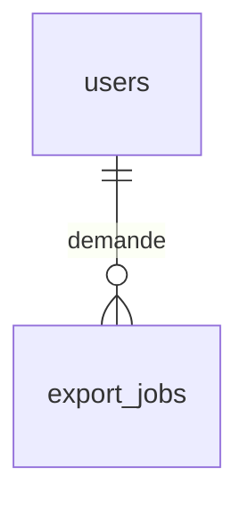

| Enum | Valeurs |
|---|---|
| `export_kind` | `FINANCE_TRANSACTIONS`, `FINANCE_FULL`, `ORGANIZATION`, `FULL_ACCOUNT` (PHASE-17) |
| `export_format` | `CSV`, `JSON`, `ZIP` |
| `export_status` | `QUEUED`, `RUNNING`, `SUCCEEDED`, `FAILED`, `EXPIRED` |

#### `export_jobs` — [B] — PHASE-07

| Colonne | Type | Null | Défaut | Description |
|---|---|---|---|---|
| `kind` | export_kind | non | — | |
| `format` | export_format | non | — | |
| `parameters` | jsonb | non | `'{}'` | Période, comptes, filtres (schéma Zod versionné). |
| `includes_sensitive` | boolean | non | `false` | Export sensible : ré-authentification exigée (ADR-006). Les secrets du coffre sont **toujours** exclus. |
| `status` | export_status | non | `'QUEUED'` | |
| `storage_key` | varchar(300) | oui | — | Fichier produit (StoragePort, à partir de PHASE-09). NULL en PHASE-07 : export **synchrone** en flux (ADR-012 : pas de job avant PHASE-08). |
| `byte_size` | bigint | oui | — | |
| `row_count` | int | oui | — | |
| `checksum_sha256` | bytea | oui | — | |
| `started_at`, `completed_at` | timestamptz | oui | — | |
| `expires_at` | timestamptz | oui | — | Fichier supprimé après 7 jours. |
| `error_code` | varchar(60) | oui | — | |

- Contraintes : `UNIQUE (storage_key)` ; `ck_export_jobs__done CHECK (status NOT IN ('SUCCEEDED','FAILED') OR completed_at IS NOT NULL)`.
- Index : `ix_export_jobs__user (user_id, created_at DESC)` (historique des exports) ; `ix_export_jobs__expires (expires_at) WHERE storage_key IS NOT NULL` (purge des fichiers).

### M07 : Asynchrone, rappels, notifications (PHASE-08)

Migration : `0007_phase08_async_notifications` (+ `user_preferences.quiet_hours_*`).

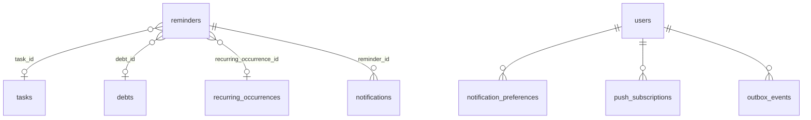

| Enum | Valeurs |
|---|---|
| `notification_channel` | `IN_APP`, `EMAIL`, `PUSH` |
| `reminder_status` | `PENDING`, `SENT`, `FAILED`, `CANCELLED`, `SKIPPED` |
| `reminder_origin` | `MANUAL`, `AUTO` |
| `notification_type` | `REMINDER`, `TASK_DUE`, `TASK_OVERDUE`, `DEBT_DUE`, `RECURRING_DUE`, `INVOICE_OVERDUE` (10), `DOCUMENT_INFECTED` (09), `RENEWAL_DUE` (12), `SYNC_FAILED` (14), `AUTOMATION_FAILED` (15), `AI_PROPOSAL` (16), `EXPORT_READY`, `SECURITY_EVENT` |
| `notification_severity` | `INFO`, `WARNING`, `CRITICAL` |

#### `reminders` — [B] — PHASE-08, cibles ajoutées ensuite

| Colonne | Type | Null | Défaut | Description |
|---|---|---|---|---|
| `title` | varchar(200) | oui | — | Libellé personnalisé ; sinon dérivé de la cible. |
| `remind_at` | timestamptz | non | — | Instant d'envoi. |
| `offset_minutes` | int | oui | — | Décalage relatif à l'échéance de la cible ; permet de recalculer `remind_at` quand l'échéance bouge. |
| `channel` | notification_channel | non | `'IN_APP'` | |
| `status` | reminder_status | non | `'PENDING'` | |
| `origin` | reminder_origin | non | `'MANUAL'` | |
| `dedup_key` | varchar(160) | oui | — | Rappels automatiques : `debt:<id>:due-1d`. |
| `attempts` | smallint | non | `0` | ≤ 5. |
| `last_attempt_at`, `sent_at` | timestamptz | oui | — | |
| `last_error_code` | varchar(60) | oui | — | |
| **Cibles** (une seule non nulle, toutes **CASC**) | uuid | oui | — | `task_id` (08), `debt_id` (08), `recurring_occurrence_id` (08), `calendar_event_id` (09), `invoice_id`, `contract_id`, `client_id` (10), `habit_id`, `goal_id` (11), `domain_id`, `server_id`, `service_subscription_id` (12) |

- Contraintes : `ck_reminders__one_target CHECK (num_nonnulls(<cibles>) = 1)` ; `ux_reminders__dedup (user_id, dedup_key) WHERE dedup_key IS NOT NULL` (pas de doublon de rappel automatique) ; `ck_reminders__attempts CHECK (attempts BETWEEN 0 AND 5)` ; `ck_reminders__sent CHECK ((status = 'SENT') = (sent_at IS NOT NULL))`.
- Un rappel sans cible n'existe pas : un « rappel libre » est une tâche avec rappel.
- Index : `ix_reminders__due (remind_at) WHERE status = 'PENDING'` (répartiteur, rattrapage après indisponibilité) ; par cible `ix_reminders__<t> (user_id, <t>_id) WHERE <t>_id IS NOT NULL` (annulation des rappels d'une entité).

#### `notifications` — [A] + `read_at` — PHASE-08

| Colonne | Type | Null | Défaut | Description |
|---|---|---|---|---|
| `type` | notification_type | non | — | |
| `severity` | notification_severity | non | `'INFO'` | |
| `title` | varchar(160) | non | — | Minimum de données sensibles (cahier §4.19). |
| `body` | varchar(500) | oui | — | Jamais de secret, de montant pour les canaux non sécurisés (e-mail, push : libellé générique). |
| `link_path` | varchar(300) | oui | — | Route relative de l'interface (`/finance/debts/<id>`), `CHECK (link_path LIKE '/%')`. |
| `reminder_id` | uuid | oui | — | → `reminders` **SN**. |
| `dedup_key` | varchar(160) | oui | — | |
| `read_at` | timestamptz | oui | — | |
| `emailed_at`, `pushed_at` | timestamptz | oui | — | Traçabilité de livraison. |

- Contraintes : `ux_notifications__dedup (user_id, dedup_key) WHERE dedup_key IS NOT NULL`.
- Rétention : 90 jours après lecture (job).
- Index : `ix_notifications__unread (user_id, created_at DESC) WHERE read_at IS NULL` (badge, centre de notifications) ; `ix_notifications__user (user_id, created_at DESC)`.

#### `notification_preferences` — [B] — PHASE-08

| Colonne | Type | Null | Défaut | Description |
|---|---|---|---|---|
| `type` | notification_type | non | — | |
| `channel` | notification_channel | non | — | |
| `enabled` | boolean | non | — | Ligne absente = défaut défini dans le code. `SECURITY_EVENT` + `IN_APP` ne peut pas être désactivé (règle applicative). |

- Contraintes : `UNIQUE (user_id, type, channel)` (sert aussi la lecture). FK `user_id` simple **CASC**.

#### `outbox_events` — [A] — PHASE-08

| Colonne | Type | Null | Défaut | Description |
|---|---|---|---|---|
| `aggregate_type` | varchar(60) | non | — | Table d'origine. Comme `audit_logs`, référence non contrainte assumée (événement, pas lien). |
| `aggregate_id` | uuid | non | — | |
| `event_type` | varchar(80) | non | — | `finance.transaction.validated`. |
| `event_version` | smallint | non | `1` | |
| `payload` | jsonb | non | — | Identifiants et données minimales ; jamais de secret (ADR-012). |
| `occurred_at` | timestamptz | non | `now()` | |
| `published_at` | timestamptz | oui | — | |
| `attempts` | smallint | non | `0` | |
| `next_attempt_at` | timestamptz | non | `now()` | Backoff. |
| `last_error_code` | varchar(60) | oui | — | |

- Écrite dans **la même transaction SQL** que la donnée (ADR-012). FK `user_id` simple **CASC**.
- Index : `ix_outbox_events__pending (next_attempt_at) WHERE published_at IS NULL` (relais) ; `ix_outbox_events__published (published_at) WHERE published_at IS NOT NULL` (purge à 7 jours).

#### `push_subscriptions` — [B] — PHASE-08

| Colonne | Type | Null | Défaut | Description |
|---|---|---|---|---|
| `endpoint` | text | non | — | URL du service push (unique globalement). |
| `p256dh` | varchar(200) | non | — | Clé publique du navigateur. |
| `auth` | varchar(100) | non | — | Secret d'authentification Web Push (jamais journalisé). |
| `user_agent_label` | varchar(200) | oui | — | |
| `last_success_at` | timestamptz | oui | — | |
| `failure_count` | smallint | non | `0` | Révocation automatique après 5 échecs ou réponse 404/410. |
| `revoked_at` | timestamptz | oui | — | |

- Contraintes : `UNIQUE (endpoint)`. FK `user_id` simple **CASC**.
- Index : `ix_push_subscriptions__active (user_id) WHERE revoked_at IS NULL`.

### M08 : Calendrier interne et documents (PHASE-09)

Migration : `0008_phase09_calendar_documents` (+ `reminders.calendar_event_id`, cibles `note_links.calendar_event_id`). Aligné sur `phases/PHASE-09-calendrier-documents.md` §4.

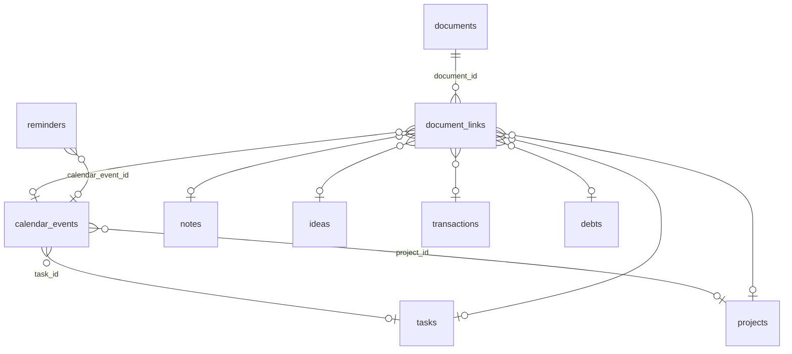

| Enum | Valeurs |
|---|---|
| `event_status` | `CONFIRMED`, `TENTATIVE`, `CANCELLED` |
| `event_source` | `INTERNAL`, `GOOGLE` (réservé PHASE-14) |
| `scan_status` | `PENDING`, `CLEAN`, `INFECTED`, `SKIPPED` |

#### `calendar_events` — [B] + `deleted_at` + récurrence (§1.8) — PHASE-09

| Colonne | Type | Null | Défaut | Description |
|---|---|---|---|---|
| `title` | varchar(200) | non | — | |
| `description` | text | oui | — | |
| `is_all_day` | boolean | non | `false` | |
| `start_at`, `end_at` | timestamptz | oui | — | Événement horaire (UTC). |
| `start_date`, `end_date` | date | oui | — | Journée entière, `end_date` inclusive. |
| `timezone` | varchar(64) | non | — | IANA ; défaut = fuseau de l'utilisateur. |
| `location` | varchar(255) | oui | — | |
| `status` | event_status | non | `'CONFIRMED'` | |
| `recurrence_*`, `next_occurrence_at` | — | oui | — | Bloc §1.8 ; `recurrence_anchor_on`/`recurrence_local_time`/`recurrence_timezone` = début de l'événement dans son fuseau. |
| `recurrence_exceptions` | date[] | non | `'{}'` | Occurrences exclues (EXDATE). |
| `source` | event_source | non | `'INTERNAL'` | |
| `project_id` | uuid | oui | — | → `projects` SN. |
| `task_id` | uuid | oui | — | → `tasks` SN. |
| `client_id` | uuid | oui | — | **PHASE-10.** → `clients` SN. |
| `cancelled_at` | timestamptz | oui | — | |
| `deleted_at` | timestamptz | oui | — | |

- Contraintes : `ck_calendar_events__shape CHECK ((is_all_day AND start_date IS NOT NULL AND end_date IS NOT NULL AND start_at IS NULL AND end_at IS NULL) OR (NOT is_all_day AND start_at IS NOT NULL AND end_at IS NOT NULL AND start_date IS NULL AND end_date IS NULL))` ; `ck_calendar_events__order CHECK (end_at >= start_at OR end_date >= start_date)` ; `ck_..._cancelled CHECK ((status = 'CANCELLED') = (cancelled_at IS NOT NULL))` ; `ck_..._recurrence_*` ; `ck_..._recurrence_count` (`COUNT` ≤ 730, applicatif + regex).
- Index : `ix_calendar_events__start_at (user_id, start_at) WHERE deleted_at IS NULL AND NOT is_all_day` ; `ix_calendar_events__start_date (user_id, start_date) WHERE deleted_at IS NULL AND is_all_day` (vues agenda) ; `ix_calendar_events__recurring (user_id) WHERE recurrence_rule IS NOT NULL AND deleted_at IS NULL` (séries à développer sur la fenêtre) ; `ix_calendar_events__fts`.

#### `documents` — [B] + `deleted_at` — PHASE-09

| Colonne | Type | Null | Défaut | Description |
|---|---|---|---|---|
| `original_name` | varchar(255) | non | — | Nom d'affichage. |
| `normalized_name` | varchar(120) | non | — | NFKC, sans séparateur de chemin ni caractère de contrôle. |
| `mime_type` | varchar(100) | non | — | Type **détecté** (magic bytes). |
| `size_bytes` | bigint | non | — | `CHECK (size_bytes > 0 AND size_bytes <= 10485760)`. |
| `storage_key` | varchar(300) | non | — | `users/{userId}/documents/{documentId}`, jamais dérivée du nom, **jamais exposée**. |
| `checksum_sha256` | bytea | non | — | 32 octets. |
| `scan_status` | scan_status | non | `'PENDING'` | |
| `scanned_at` | timestamptz | oui | — | |
| `uploaded_at` | timestamptz | non | `now()` | |
| `deleted_at` | timestamptz | oui | — | Corbeille. |
| `purge_after` | timestamptz | oui | — | `deleted_at + 30 j`. |

- Contraintes : `UNIQUE (storage_key)` ; `ck_documents__checksum_len` ; `ck_documents__trash CHECK ((deleted_at IS NULL) = (purge_after IS NULL))`.
- Index : `ix_documents__user (user_id, uploaded_at DESC) WHERE deleted_at IS NULL` (liste) ; `ix_documents__purge (purge_after) WHERE deleted_at IS NOT NULL` (purge quotidienne) ; `ix_documents__checksum (user_id, checksum_sha256)` (avertissement de doublon) ; `ix_documents__name_trgm (f_unaccent(lower(normalized_name)) gin_trgm_ops)` ; `Σ size_bytes` par utilisateur via `ix_documents__user` (plafond de stockage).

#### `document_links` — [A] — PHASE-09, cibles ajoutées ensuite

| Colonne | Type | Null | Phase | Cible (toutes **CASC**) |
|---|---|---|---|---|
| `document_id` | uuid | non | 09 | `documents` |
| `note_id`, `task_id`, `project_id`, `idea_id` | uuid | oui | 09 | M03 |
| `transaction_id`, `debt_id` | uuid | oui | 09 | M04, M05 |
| `calendar_event_id` | uuid | oui | 09 | `calendar_events` |
| `client_id`, `contract_id`, `invoice_id` | uuid | oui | 10 | M09 |
| `goal_id`, `learning_item_id`, `journal_entry_id` | uuid | oui | 11 | M10 |
| `application_id`, `domain_id`, `server_id`, `service_subscription_id` | uuid | oui | 12 | M11 |

- `ck_document_links__one_target CHECK (num_nonnulls(<cibles>) = 1)` ; par cible `ux_document_links__<t> (user_id, <t>_id, document_id) WHERE <t>_id IS NOT NULL` ; `ix_document_links__document (user_id, document_id)`.
- Supprimer une entité supprime ses liens, **jamais** le document.

### M09 : Pro — clients, contacts, contrats, factures (PHASE-10)

Migration : `0009_phase10_pro` (+ `projects.client_id`, `tasks.client_id`, `calendar_events.client_id`, cibles de `note_links`, `document_links`, `reminders` ; mise à jour de `orbit_assert_imputation_within_amount`).

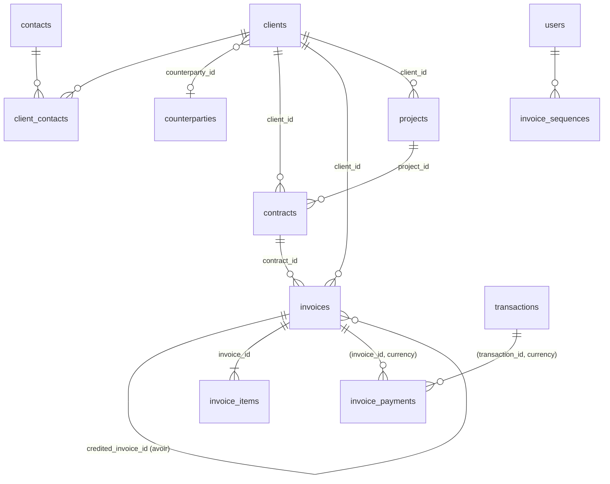

| Enum | Valeurs |
|---|---|
| `client_kind` | `PERSON`, `COMPANY` |
| `client_status` | `PROSPECT`, `ACTIVE`, `INACTIVE` |
| `contract_status` | `DRAFT`, `SENT`, `SIGNED`, `ACTIVE`, `COMPLETED`, `TERMINATED`, `CANCELLED` |
| `invoice_kind` | `INVOICE`, `CREDIT_NOTE` (avoir) |
| `invoice_status` | `DRAFT`, `ISSUED`, `CANCELLED` — **cycle de vie seulement** |

**État de paiement dérivé** (jamais stocké) : `paid = Σ invoice_payments` (transactions `VALIDATED`) ; `credited = Σ total_minor` des avoirs `ISSUED` liés ; `balance = total − paid − credited`. Affichage : `PARTIALLY_PAID` si `0 < paid + credited < total`, `PAID` si `balance = 0`, `OVERDUE` si `due_date < aujourd'hui AND balance > 0 AND status = 'ISSUED'` (ADR-020). La priorité retard / paiement partiel est fixée par `FINANCE_RULES.md`.

#### `clients` — [B] + `archived_at` — PHASE-10

| Colonne | Type | Null | Défaut | Description |
|---|---|---|---|---|
| `kind` | client_kind | non | — | |
| `name` | varchar(160) | non | — | Nom ou raison sociale. |
| `legal_name` | varchar(200) | oui | — | |
| `email` | citext | oui | — | |
| `phone` | varchar(20) | oui | — | E.164. |
| `address_line` | varchar(255) | oui | — | |
| `city` | varchar(100) | oui | — | |
| `country_code` | char(2) | non | `'SN'` | ISO 3166-1. |
| `tax_id` | varchar(40) | oui | — | NINEA ou équivalent. |
| `status` | client_status | non | `'ACTIVE'` | |
| `counterparty_id` | uuid | oui | — | → `counterparties` SN. Contrepartie financière associée (paiements). |
| `notes` | text | oui | — | |
| `archived_at` | timestamptz | oui | — | Reste consultable dans l'historique. |

- Contraintes : `ux_clients__counterparty (user_id, counterparty_id) WHERE counterparty_id IS NOT NULL` ; `ck_clients__country CHECK (country_code ~ '^[A-Z]{2}$')`.
- Index : `ix_clients__active (user_id, status, name) WHERE archived_at IS NULL` ; `ix_clients__name_trgm` ; `ix_clients__fts`.

#### `contacts` — [B] + `archived_at` — PHASE-10

| Colonne | Type | Null | Défaut | Description |
|---|---|---|---|---|
| `first_name` | varchar(80) | non | — | |
| `last_name` | varchar(80) | oui | — | |
| `email` | citext | oui | — | |
| `phone` | varchar(20) | oui | — | |
| `job_title` | varchar(100) | oui | — | |
| `notes` | text | oui | — | |
| `archived_at` | timestamptz | oui | — | |

- Index : `ix_contacts__name_trgm (f_unaccent(lower(first_name || ' ' || coalesce(last_name,''))) gin_trgm_ops)`.

#### `client_contacts` — [J] — PHASE-10

| Colonne | Type | Null | Défaut | Description |
|---|---|---|---|---|
| `client_id` | uuid | non | — | → `clients` CASC. |
| `contact_id` | uuid | non | — | → `contacts` CASC. |
| `relationship_role` | varchar(60) | oui | — | « Gérant », « Comptable ». |
| `is_primary` | boolean | non | `false` | |

- PK `(user_id, client_id, contact_id)` ; `ux_client_contacts__primary (user_id, client_id) WHERE is_primary` (un seul contact principal) ; index `(user_id, contact_id)`.

#### `contracts` — [B] — PHASE-10

| Colonne | Type | Null | Défaut | Description |
|---|---|---|---|---|
| `client_id` | uuid | non | — | → `clients` NA. |
| `project_id` | uuid | oui | — | → `projects` SN. |
| `reference` | varchar(40) | non | — | Unique par utilisateur. |
| `title` | varchar(200) | non | — | |
| `description` | text | oui | — | |
| `amount_minor` | bigint | oui | — | ≥ 0. |
| `currency` | char(3) | oui | — | |
| `starts_on`, `ends_on` | date | oui | — | |
| `signed_on` | date | oui | — | |
| `status` | contract_status | non | `'DRAFT'` | Historique de statut : `audit_logs`. |
| `notes` | text | oui | — | |

- Contraintes : `UNIQUE (user_id, reference)` ; `ck_contracts__amount CHECK ((amount_minor IS NULL) = (currency IS NULL) AND coalesce(amount_minor,0) >= 0)` ; `ck_contracts__dates CHECK (ends_on IS NULL OR starts_on IS NULL OR ends_on >= starts_on)`.
- Document du contrat : `document_links.contract_id` (pas de colonne `document_id`). Jalons : hors schéma.
- Index : `ix_contracts__client (user_id, client_id)` ; `ix_contracts__status_end (user_id, status, ends_on)` (contrats à échéance).

#### `invoices` — [B] — PHASE-10

| Colonne | Type | Null | Défaut | Description |
|---|---|---|---|---|
| `kind` | invoice_kind | non | `'INVOICE'` | |
| `client_id` | uuid | non | — | → `clients` NA. |
| `project_id` | uuid | oui | — | → `projects` NA. |
| `contract_id` | uuid | oui | — | → `contracts` NA. |
| `credited_invoice_id` | uuid | oui | — | FK `(user_id, credited_invoice_id, currency) → invoices(user_id, id, currency)` NA. Avoir : facture d'origine. |
| `number` | varchar(40) | oui | — | Attribué à l'émission (`FAC-2026-0001`, `AV-2026-0001`). |
| `series_year` | smallint | oui | — | |
| `sequence_number` | int | oui | — | |
| `status` | invoice_status | non | `'DRAFT'` | |
| `issue_date` | date | oui | — | |
| `due_date` | date | oui | — | |
| `currency` | char(3) | non | — | |
| `subtotal_minor` | bigint | non | `0` | Σ lignes HT, calculé serveur. |
| `tax_minor` | bigint | non | `0` | Σ taxes des lignes. |
| `total_minor` | bigint | non | `0` | `subtotal + tax`. |
| `client_snapshot` | jsonb | oui | — | Identité et adresse du client figées à l'émission. |
| `notes`, `terms` | text | oui | — | |
| `issued_at` | timestamptz | oui | — | |
| `cancelled_at` | timestamptz | oui | — | |
| `cancel_reason` | varchar(500) | oui | — | |

- Contraintes :
  - `UNIQUE (user_id, id, currency)` ; `UNIQUE (user_id, number)` ; `UNIQUE (user_id, kind, series_year, sequence_number)` ;
  - `ck_invoices__amounts CHECK (subtotal_minor >= 0 AND tax_minor >= 0 AND total_minor = subtotal_minor + tax_minor)` ;
  - `ck_invoices__issued CHECK (status = 'DRAFT' OR (number IS NOT NULL AND issue_date IS NOT NULL AND due_date IS NOT NULL AND issued_at IS NOT NULL AND client_snapshot IS NOT NULL))` ;
  - `ck_invoices__due CHECK (due_date IS NULL OR issue_date IS NULL OR due_date >= issue_date)` ;
  - `ck_invoices__credit_note CHECK ((kind = 'CREDIT_NOTE') = (credited_invoice_id IS NOT NULL))` ;
  - `ck_invoices__cancelled CHECK ((status = 'CANCELLED') = (cancelled_at IS NOT NULL) AND (cancelled_at IS NULL OR cancel_reason IS NOT NULL))`.
- `trg_invoices__guard` (BEFORE UPDATE OR DELETE) : transitions `DRAFT→ISSUED`, `ISSUED→CANCELLED` ; dès l'émission, client, devise, numéro, dates, montants et snapshot sont figés (cahier §4.4) ; `DELETE` permis **uniquement** en `DRAFT` ; au passage à `ISSUED`, vérifie `subtotal/tax/total = Σ invoice_items`. L'annulation d'une facture portant des paiements valides est refusée (rembourser ou émettre un avoir d'abord : règle applicative).
- Index : `ix_invoices__open (user_id, due_date) WHERE status = 'ISSUED'` (impayées, en retard, widget) ; `ix_invoices__client (user_id, client_id, issue_date DESC)` (fiche client) ; `ix_invoices__project (user_id, project_id) WHERE project_id IS NOT NULL` ; `ix_invoices__contract (user_id, contract_id) WHERE contract_id IS NOT NULL` ; `ix_invoices__credited (user_id, credited_invoice_id) WHERE credited_invoice_id IS NOT NULL`.

#### `invoice_items` — [B] — PHASE-10

| Colonne | Type | Null | Défaut | Description |
|---|---|---|---|---|
| `invoice_id` | uuid | non | — | → `invoices` **CASC** (dépendant pur ; seule une facture `DRAFT` est supprimable). |
| `position` | smallint | non | — | Ordre d'affichage. |
| `description` | varchar(500) | non | — | |
| `quantity` | numeric(12,3) | non | — | > 0. |
| `unit_price_minor` | bigint | non | — | ≥ 0. |
| `tax_rate` | numeric(7,4) | non | `0` | Pourcentage (TVA Sénégal 18 % = `18.0000`). |
| `line_subtotal_minor` | bigint | non | — | `round_half_up(quantity × unit_price)`. |
| `line_tax_minor` | bigint | non | — | `round_half_up(line_subtotal × tax_rate / 100)`. |
| `line_total_minor` | bigint | non | — | |

- Contraintes : `UNIQUE (user_id, invoice_id, position)` ; `ck_invoice_items__quantity CHECK (quantity > 0)` ; `ck_..._tax_rate CHECK (tax_rate BETWEEN 0 AND 100)` ; `ck_..._amounts CHECK (unit_price_minor >= 0 AND line_subtotal_minor >= 0 AND line_tax_minor >= 0 AND line_total_minor = line_subtotal_minor + line_tax_minor)`.
- `trg_invoice_items__guard` : `INSERT/UPDATE/DELETE` refusés si la facture n'est pas `DRAFT`. L'arrondi par ligne (half-up, ADR-008) est calculé par `packages/money` ; la base vérifie la cohérence additive, pas l'arrondi.
- Index : l'unique `(user_id, invoice_id, position)` sert le chargement des lignes.

#### `invoice_payments` — [A] (table d'imputation) — PHASE-10

| Colonne | Type | Null | Défaut | Description |
|---|---|---|---|---|
| `invoice_id` | uuid | non | — | FK `(user_id, invoice_id, currency) → invoices(user_id, id, currency)` NA. |
| `transaction_id` | uuid | non | — | FK `(user_id, transaction_id, currency) → transactions(user_id, id, currency)` NA. |
| `amount_minor` | bigint | non | — | > 0. |
| `currency` | char(3) | non | — | Identique à la facture et à la transaction. |
| `notes` | varchar(500) | oui | — | |

- Contraintes : `UNIQUE (user_id, invoice_id, transaction_id)` ; `ck_invoice_payments__amount_positive`.
- `trg_invoice_payments__guard` (BEFORE INSERT OR UPDATE) : facture `ISSUED` de type `INVOICE` ; transaction non `CANCELLED`, de type `INCOME` ; puis `orbit_assert_imputation_within_amount` (Σ `debt_repayments` + Σ `invoice_payments` ≤ montant de la transaction). Un paiement réparti sur plusieurs factures = plusieurs lignes (cahier §4.12).
- Le trop-perçu sur une facture est refusé par l'application, sauf traitement explicite.
- Index : `ix_invoice_payments__invoice (user_id, invoice_id) INCLUDE (amount_minor, transaction_id)` (montant payé, solde) ; `ix_invoice_payments__transaction (user_id, transaction_id)`.

#### `invoice_sequences` — PK `(user_id, kind, series_year)` — PHASE-10

| Colonne | Type | Null | Défaut | Description |
|---|---|---|---|---|
| `user_id` | uuid | non | — | FK `users(id)` simple CASC. |
| `kind` | invoice_kind | non | — | Séries distinctes factures / avoirs. |
| `series_year` | smallint | non | — | Remise à 1 chaque année. |
| `prefix` | varchar(20) | non | `'FAC'` / `'AV'` | |
| `next_value` | int | non | `1` | `CHECK (next_value >= 1)`. |
| `updated_at` | timestamptz | non | `now()` | |

- Numérotation **sans trou** : dans la transaction d'émission, `INSERT ... ON CONFLICT DO NOTHING` puis `UPDATE invoice_sequences SET next_value = next_value + 1 WHERE ... RETURNING next_value - 1` (verrou de ligne). Une facture émise n'est jamais supprimée, donc aucun numéro ne se perd.

### M10 : Objectifs, habitudes, apprentissage, journal (PHASE-11)

Migration : `0010_phase11_growth` (+ cibles `note_links`, `document_links`, `reminders`).

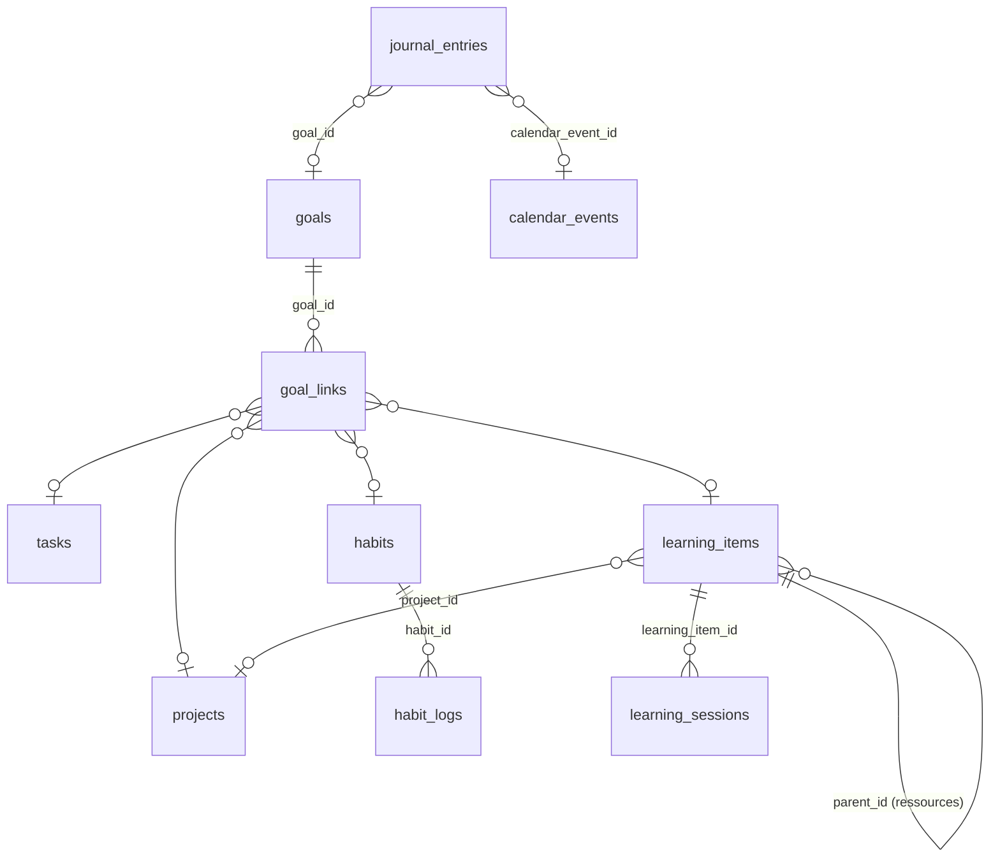

| Enum | Valeurs |
|---|---|
| `goal_period` | `WEEK`, `MONTH`, `QUARTER`, `YEAR`, `CUSTOM` |
| `goal_progress_mode` | `MANUAL`, `LINKED_TASKS`, `LINKED_HABITS`, `VALUE` |
| `goal_status` | `ACTIVE`, `ACHIEVED`, `ABANDONED` |
| `habit_kind` | `CHECK` (fait / pas fait), `QUANTITY` (valeur mesurée) |
| `habit_status` | `ACTIVE`, `PAUSED` |
| `habit_log_status` | `DONE`, `SKIPPED`, `MISSED` |
| `learning_kind` | `SKILL`, `TECHNOLOGY`, `COURSE`, `BOOK`, `ARTICLE`, `VIDEO`, `OTHER` |
| `learning_status` | `PLANNED`, `IN_PROGRESS`, `PAUSED`, `COMPLETED`, `ABANDONED` |

#### `goals` — [B] + `archived_at` — PHASE-11

| Colonne | Type | Null | Défaut | Description |
|---|---|---|---|---|
| `title` | varchar(200) | non | — | |
| `description` | text | oui | — | |
| `period_type` | goal_period | non | — | |
| `starts_on` | date | non | — | |
| `target_on` | date | oui | — | |
| `progress_mode` | goal_progress_mode | non | `'MANUAL'` | |
| `target_value` | numeric(14,3) | oui | — | Quantité cible (pas un montant). |
| `current_value` | numeric(14,3) | oui | — | Saisie manuelle (`VALUE`). |
| `unit` | varchar(30) | oui | — | « km », « livres ». |
| `target_amount_minor` | bigint | oui | — | Objectif d'épargne : montant cible. |
| `target_currency` | char(3) | oui | — | FK `currencies(code)`. |
| `progress_percent` | smallint | oui | — | Uniquement en `MANUAL` (0–100). Sinon dérivé. |
| `status` | goal_status | non | `'ACTIVE'` | |
| `achieved_on` | date | oui | — | |
| `review` | text | oui | — | Bilan. |
| `archived_at` | timestamptz | oui | — | |

- Contraintes : `ck_goals__dates` ; `ck_goals__amount CHECK ((target_amount_minor IS NULL) = (target_currency IS NULL) AND coalesce(target_amount_minor,0) >= 0)` ; `ck_goals__percent CHECK (progress_percent BETWEEN 0 AND 100)` ; `ck_goals__achieved CHECK ((status = 'ACHIEVED') = (achieved_on IS NOT NULL))`.
- Index : `ix_goals__active (user_id, status, target_on) WHERE archived_at IS NULL`.

#### `goal_links` — [A] — PHASE-11

| Colonne | Type | Null | Description |
|---|---|---|---|
| `goal_id` | uuid | non | → `goals` CASC. |
| `project_id`, `task_id`, `habit_id`, `learning_item_id` | uuid | oui | Cibles, toutes CASC. |
| `weight` | smallint | non | `1` ; pondération dans la progression dérivée (1–100). |

- `ck_goal_links__one_target CHECK (num_nonnulls(project_id, task_id, habit_id, learning_item_id) = 1)` ; par cible `ux_goal_links__<t> (user_id, <t>_id, goal_id) WHERE <t>_id IS NOT NULL` ; `ix_goal_links__goal (user_id, goal_id)`.

#### `habits` — [B] + `archived_at` + récurrence (§1.8, **obligatoire**) — PHASE-11

| Colonne | Type | Null | Défaut | Description |
|---|---|---|---|---|
| `name` | varchar(120) | non | — | |
| `description` | text | oui | — | |
| `kind` | habit_kind | non | `'CHECK'` | |
| `target_value` | numeric(14,3) | oui | — | Pour `QUANTITY`. |
| `unit` | varchar(30) | oui | — | |
| `color`, `icon` | varchar | oui | — | |
| `status` | habit_status | non | `'ACTIVE'` | |
| `recurrence_rule`, `recurrence_anchor_on`, `recurrence_timezone` | — | **non** | — | Fréquence (`FREQ=DAILY`, `FREQ=WEEKLY;BYDAY=MO,WE,FR`) ; l'ancre est la date de début. |
| `recurrence_local_time` | time | oui | — | Heure de rappel. |
| `next_occurrence_at` | timestamptz | oui | — | Dérivé. |
| `archived_at` | timestamptz | oui | — | |

- Contraintes : `ck_habits__quantity CHECK (kind = 'CHECK' OR target_value > 0)` ; `ck_habits__recurrence_syntax`.
- Indicateurs de régularité (séries, taux) : dérivés de `habit_logs`, jamais stockés.
- Index : `ix_habits__active (user_id, status) WHERE archived_at IS NULL` ; `ix_habits__next (next_occurrence_at) WHERE status = 'ACTIVE' AND archived_at IS NULL` (rappels).

#### `habit_logs` — [B] — PHASE-11

| Colonne | Type | Null | Défaut | Description |
|---|---|---|---|---|
| `habit_id` | uuid | non | — | → `habits` CASC. |
| `log_date` | date | non | — | Jour local. |
| `status` | habit_log_status | non | `'DONE'` | |
| `value` | numeric(14,3) | oui | — | `QUANTITY`. |
| `note` | varchar(500) | oui | — | |

- Contraintes : `UNIQUE (user_id, habit_id, log_date)` (un enregistrement par jour, saisie idempotente hors ligne) ; `ck_habit_logs__value CHECK (value IS NULL OR value >= 0)`.
- Index : l'unique sert l'historique d'une habitude ; `ix_habit_logs__date (user_id, log_date)` (vue « aujourd'hui »).

#### `learning_items` — [B] + `archived_at` — PHASE-11

| Colonne | Type | Null | Défaut | Description |
|---|---|---|---|---|
| `title` | varchar(200) | non | — | Compétence, technologie ou ressource. |
| `kind` | learning_kind | non | — | |
| `parent_id` | uuid | oui | — | → `learning_items` SN. Ressource rattachée à une compétence. |
| `url` | varchar(2048) | oui | — | `CHECK (url ~ '^https?://')`. |
| `current_level` | smallint | oui | — | 0–5. |
| `target_level` | smallint | oui | — | 0–5. |
| `status` | learning_status | non | `'PLANNED'` | |
| `next_steps` | text | oui | — | |
| `project_id` | uuid | oui | — | → `projects` SN. Exercice ou projet d'application. |
| `started_on`, `completed_on` | date | oui | — | |
| `archived_at` | timestamptz | oui | — | |

- Preuves de réalisation : `document_links.learning_item_id`.
- Contraintes : `ck_learning_items__levels CHECK (current_level BETWEEN 0 AND 5 AND target_level BETWEEN 0 AND 5)` ; `ck_..._not_own_parent`.
- Index : `ix_learning_items__status (user_id, status) WHERE archived_at IS NULL` ; `ix_learning_items__parent (user_id, parent_id) WHERE parent_id IS NOT NULL`.

#### `learning_sessions` — [B] — PHASE-11

| Colonne | Type | Null | Défaut | Description |
|---|---|---|---|---|
| `learning_item_id` | uuid | non | — | → `learning_items` CASC. |
| `session_date` | date | non | — | |
| `started_at` | timestamptz | oui | — | |
| `duration_minutes` | int | non | — | `CHECK BETWEEN 1 AND 1440`. |
| `notes` | text | oui | — | |

- Index : `ix_learning_sessions__item (user_id, learning_item_id, session_date DESC)` ; `ix_learning_sessions__date (user_id, session_date)` (temps d'apprentissage par période).

#### `journal_entries` — [B] + `deleted_at` — PHASE-11

| Colonne | Type | Null | Défaut | Description |
|---|---|---|---|---|
| `entry_date` | date | non | — | Date locale. |
| `content` | text | non | — | ≤ 100 000 caractères. Donnée intime : jamais transmise à l'IA sans action explicite. |
| `mood` | smallint | oui | — | 1–5. |
| `energy` | smallint | oui | — | 1–5. |
| `goal_id` | uuid | oui | — | → `goals` SN. |
| `calendar_event_id` | uuid | oui | — | → `calendar_events` SN. |
| `deleted_at` | timestamptz | oui | — | |

- Contraintes : `ux_journal_entries__date (user_id, entry_date) WHERE deleted_at IS NULL` (une entrée par jour) ; `ck_journal_entries__scales CHECK (mood BETWEEN 1 AND 5 AND energy BETWEEN 1 AND 5)`.
- Index : l'unique sert la navigation par date ; `ix_journal_entries__fts` (contenu).

### M11 : Zone Dev — inventaire technique (PHASE-12, **ADMIN**)

Migration : `0011_phase12_dev_inventory` (+ cibles `note_links`, `document_links`, `reminders`). Les lignes appartiennent à l'utilisateur ADMIN (`user_id`), avec le même cloisonnement (ADR-002) ; l'accès est réglé par le rôle, pas par `enabled_modules`.

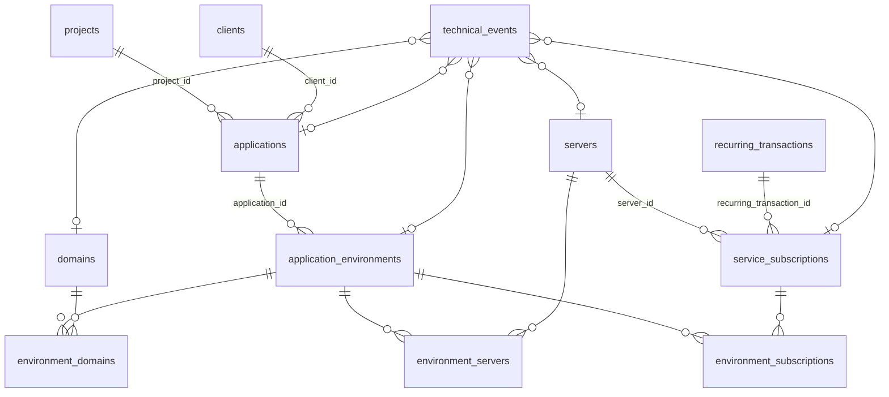

| Enum | Valeurs |
|---|---|
| `application_status` | `IDEA`, `DEVELOPMENT`, `LIVE`, `MAINTENANCE`, `RETIRED` |
| `environment_kind` | `DEVELOPMENT`, `STAGING`, `PRODUCTION`, `CUSTOM` |
| `environment_status` | `ACTIVE`, `STOPPED`, `ARCHIVED` |
| `domain_status` | `ACTIVE`, `EXPIRED`, `TRANSFERRED_OUT`, `RELEASED` |
| `server_status` | `PROVISIONING`, `ACTIVE`, `STOPPED`, `DECOMMISSIONED` |
| `billing_period` | `MONTHLY`, `QUARTERLY`, `YEARLY`, `ONE_TIME`, `USAGE_BASED` |
| `service_category` | `HOSTING`, `DOMAIN_DNS`, `EMAIL`, `SAAS`, `API`, `MONITORING`, `STORAGE`, `OTHER` |
| `subscription_status` | `TRIAL`, `ACTIVE`, `PAUSED`, `CANCELLED` |
| `environment_domain_role` | `PRIMARY`, `ALIAS`, `API`, `ASSETS`, `OTHER` |
| `technical_event_kind` | `DEPLOYMENT`, `MIGRATION`, `INCIDENT`, `RENEWAL`, `BACKUP_VERIFIED`, `RESTORE_TEST`, `CONFIG_CHANGE`, `INTERVENTION` |
| `technical_outcome` | `SUCCESS`, `PARTIAL`, `FAILURE`, `UNKNOWN` |

> Les abonnements et serveurs gardent une **périodicité de facturation** simple (`billing_period` + prochaine échéance) : ce n'est pas une récurrence d'agenda. Le paiement réel passe par le registre (`recurring_transactions`, lien `recurring_transaction_id`), qui porte la représentation §1.8. Coût prévu (ici) ≠ coût payé (registre), cahier §4.7.

#### `applications` — [B] + `archived_at` — PHASE-12

| Colonne | Type | Null | Défaut | Description |
|---|---|---|---|---|
| `name` | varchar(120) | non | — | |
| `slug` | citext | non | — | Unique (actives). |
| `description` | text | oui | — | |
| `project_id` | uuid | oui | — | → `projects` SN. |
| `client_id` | uuid | oui | — | → `clients` SN. |
| `repository_url` | varchar(2048) | oui | — | `^https?://` ; jamais rendue comme contenu actif. |
| `documentation_url` | varchar(2048) | oui | — | |
| `status` | application_status | non | `'DEVELOPMENT'` | |
| `technologies` | text[] | non | `'{}'` | |
| `launched_on` | date | oui | — | |
| `deployment_notes` | text | oui | — | Sans secret (le coffre sert à cela). |
| `archived_at` | timestamptz | oui | — | |

- Contraintes : `ux_applications__slug (user_id, slug) WHERE archived_at IS NULL`.
- Index : `ix_applications__status (user_id, status) WHERE archived_at IS NULL` ; `ix_applications__fts`.

#### `application_environments` — [B] — PHASE-12

| Colonne | Type | Null | Défaut | Description |
|---|---|---|---|---|
| `application_id` | uuid | non | — | → `applications` CASC. |
| `name` | varchar(60) | non | — | |
| `kind` | environment_kind | non | — | |
| `base_url` | varchar(2048) | oui | — | `^https?://`. |
| `status` | environment_status | non | `'ACTIVE'` | Arrêté ≠ supprimé (reste visible). |
| `last_deployed_at` | timestamptz | oui | — | |
| `notes` | text | oui | — | |

- Contraintes : `UNIQUE (user_id, application_id, name)`.
- Index : l'unique sert la liste des environnements d'une application.

#### `domains` — [B] + `archived_at` — PHASE-12

| Colonne | Type | Null | Défaut | Description |
|---|---|---|---|---|
| `name` | citext | non | — | FQDN en minuscules, `CHECK (name ~ '^([a-z0-9-]+\.)+[a-z]{2,}$')`. |
| `registrar` | varchar(100) | oui | — | |
| `registered_on` | date | oui | — | |
| `expires_on` | date | oui | — | |
| `auto_renew` | boolean | oui | — | **Tri-état** : NULL = inconnu. |
| `auto_renew_confirmed_at` | timestamptz | oui | — | Pas d'affirmation « renouvellement actif » sans confirmation (cahier §4.7). |
| `annual_cost_minor` | bigint | oui | — | Coût prévu. |
| `currency` | char(3) | oui | — | |
| `dns_provider` | varchar(100) | oui | — | |
| `dns_notes` | text | oui | — | |
| `status` | domain_status | non | `'ACTIVE'` | « Expire bientôt » dérivé. |
| `reminder_days_before` | smallint | non | `30` | |
| `notes` | text | oui | — | |
| `archived_at` | timestamptz | oui | — | |

- Contraintes : `ux_domains__name (user_id, name) WHERE archived_at IS NULL` ; `ck_domains__auto_renew CHECK (auto_renew IS NULL OR auto_renew_confirmed_at IS NOT NULL)` ; `ck_domains__cost CHECK ((annual_cost_minor IS NULL) = (currency IS NULL) AND coalesce(annual_cost_minor,0) >= 0)` ; `ck_domains__dates`.
- Index : `ix_domains__expiry (user_id, expires_on) WHERE status = 'ACTIVE' AND archived_at IS NULL` (domaines à renouveler) ; `ix_domains__name_trgm`.

#### `servers` — [B] + `archived_at` — PHASE-12

| Colonne | Type | Null | Défaut | Description |
|---|---|---|---|---|
| `name` | varchar(120) | non | — | |
| `provider` | varchar(60) | non | — | |
| `provider_resource_id` | varchar(120) | oui | — | |
| `hostname` | varchar(253) | oui | — | Information sensible : jamais dans une notification ni un prompt IA. |
| `ipv4` | inet | oui | — | `CHECK (family(ipv4) = 4)`. |
| `ipv6` | inet | oui | — | `CHECK (family(ipv6) = 6)`. |
| `region` | varchar(60) | oui | — | |
| `operating_system` | varchar(80) | oui | — | |
| `cpu_cores` | smallint | oui | — | > 0. |
| `ram_mb` | int | oui | — | > 0. |
| `storage_gb` | int | oui | — | > 0. |
| `cost_minor` | bigint | oui | — | Coût prévu par période. |
| `currency` | char(3) | oui | — | |
| `billing_period` | billing_period | oui | — | |
| `next_renewal_on` | date | oui | — | |
| `status` | server_status | non | `'ACTIVE'` | |
| `backup_procedure`, `restore_procedure` | text | oui | — | |
| `notes` | text | oui | — | |
| `archived_at` | timestamptz | oui | — | |

- Contraintes : `ux_servers__provider_resource (user_id, provider, provider_resource_id) WHERE provider_resource_id IS NOT NULL` ; `ck_servers__cost` (paire montant/devise, ≥ 0) ; `ck_servers__specs`.
- Index : `ix_servers__renewal (user_id, next_renewal_on) WHERE status IN ('ACTIVE','STOPPED')` (échéances) ; `ix_servers__status (user_id, status)`.

#### `service_subscriptions` — [B] + `archived_at` — PHASE-12

| Colonne | Type | Null | Défaut | Description |
|---|---|---|---|---|
| `provider` | varchar(100) | non | — | |
| `service_name` | varchar(120) | non | — | |
| `category` | service_category | non | — | |
| `billing_period` | billing_period | non | — | |
| `amount_minor` | bigint | non | — | Coût prévu, ≥ 0. |
| `currency` | char(3) | non | — | |
| `next_billing_on` | date | oui | — | |
| `status` | subscription_status | non | `'ACTIVE'` | |
| `cancelled_on` | date | oui | — | |
| `server_id` | uuid | oui | — | → `servers` SN. |
| `recurring_transaction_id` | uuid | oui | — | → `recurring_transactions` SN. Lien vers le paiement réel. |
| `notes` | text | oui | — | |
| `archived_at` | timestamptz | oui | — | |

- Contraintes : `ck_service_subscriptions__amount CHECK (amount_minor >= 0)` ; `ck_..._cancelled CHECK ((status = 'CANCELLED') = (cancelled_on IS NOT NULL))`.
- Index : `ix_service_subscriptions__billing (user_id, next_billing_on) WHERE status IN ('TRIAL','ACTIVE')` (widget « abonnements à échéance ») ; `ix_service_subscriptions__server (user_id, server_id) WHERE server_id IS NOT NULL`.

#### `environment_domains`, `environment_servers`, `environment_subscriptions` — [J] — PHASE-12

| Table | Colonnes | PK | Index inverse |
|---|---|---|---|
| `environment_domains` | `environment_id` → application_environments CASC, `domain_id` → domains CASC, `role environment_domain_role NOT NULL DEFAULT 'PRIMARY'` | `(user_id, environment_id, domain_id)` | `(user_id, domain_id)` |
| `environment_servers` | `environment_id` CASC, `server_id` → servers CASC, `role varchar(60)` | `(user_id, environment_id, server_id)` | `(user_id, server_id)` |
| `environment_subscriptions` | `environment_id` CASC, `service_subscription_id` → service_subscriptions CASC | `(user_id, environment_id, service_subscription_id)` | `(user_id, service_subscription_id)` |

Remplacent `environment_resources` polymorphe du cahier (ADR-018). L'index inverse sert « quels environnements utilisent ce serveur / ce domaine ».

#### `technical_events` — [B] — PHASE-12

| Colonne | Type | Null | Défaut | Description |
|---|---|---|---|---|
| `kind` | technical_event_kind | non | — | |
| `occurred_at` | timestamptz | non | — | |
| `title` | varchar(200) | non | — | |
| `description` | text | oui | — | Intervention et résultat, sans secret. |
| `outcome` | technical_outcome | non | `'UNKNOWN'` | |
| `application_id`, `environment_id`, `domain_id`, `server_id`, `service_subscription_id` | uuid | oui | — | Cible unique, toutes CASC. |

- Contraintes : `ck_technical_events__one_target CHECK (num_nonnulls(application_id, environment_id, domain_id, server_id, service_subscription_id) = 1)`.
- Index : `ix_technical_events__time (user_id, occurred_at DESC)` (historique) ; par cible `ix_technical_events__<t> (user_id, <t>_id, occurred_at DESC) WHERE <t>_id IS NOT NULL` (historique d'une ressource).

### M12 : Coffre-fort et MFA TOTP (PHASE-13)

Migration : `0012_phase13_vault_mfa` (+ `sessions.mfa_verified_at`). Cryptographie : ADR-019 et `SECURITY.md`. **Aucune colonne chiffrée n'est indexée, journalisée, exportée ou sérialisée par défaut.**

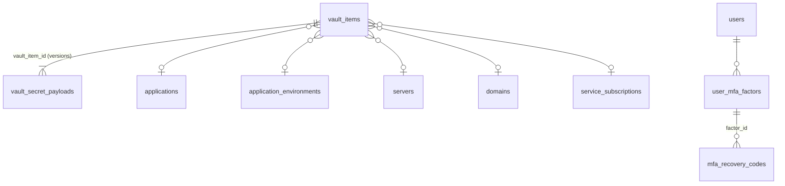

| Enum | Valeurs |
|---|---|
| `vault_secret_type` | `PASSWORD`, `SSH_PRIVATE_KEY`, `API_TOKEN`, `CLOUD_ACCESS_KEY`, `CERTIFICATE`, `CREDENTIAL_PAIR`, `OTHER` |
| `mfa_factor_kind` | `TOTP` |

Colonnes d'enveloppe chiffrée (même bloc dans `vault_secret_payloads`, `user_mfa_factors`, `integration_tokens`) :

| Colonne | Type | Description |
|---|---|---|
| `ciphertext` | bytea | Donnée chiffrée XChaCha20-Poly1305 (tag inclus). |
| `nonce` | bytea | 24 octets, `CHECK (octet_length(nonce) = 24)`. |
| `wrapped_dek` | bytea | DEK chiffrée par la KEK. |
| `dek_nonce` | bytea | 24 octets. |
| `kek_version` | smallint | Version de la KEK (rotation). |
| `format_version` | smallint | Format du paquet, défaut `1`. |

AAD = `user_id ‖ <id de la ligne propriétaire> ‖ kek_version ‖ format_version` (ADR-019) : non stockée, recalculée.

#### `vault_items` — [B] + `archived_at` — PHASE-13 (**ADMIN**)

| Colonne | Type | Null | Défaut | Description |
|---|---|---|---|---|
| `title` | varchar(200) | non | — | |
| `secret_type` | vault_secret_type | non | — | |
| `username` | varchar(255) | oui | — | Identifiant non secret. |
| `url` | varchar(2048) | oui | — | |
| `application_id`, `environment_id`, `server_id`, `domain_id`, `service_subscription_id` | uuid | oui | — | Ressource associée **facultative**, au plus une, toutes SN. |
| `expires_at` | timestamptz | oui | — | |
| `last_rotated_at` | timestamptz | oui | — | |
| `last_revealed_at` | timestamptz | oui | — | |
| `notes_public` | varchar(2000) | oui | — | Notes **non sensibles**. |
| `archived_at` | timestamptz | oui | — | |

- Contraintes : `ck_vault_items__at_most_one_resource CHECK (num_nonnulls(application_id, environment_id, server_id, domain_id, service_subscription_id) <= 1)` (lien facultatif, d'où `<= 1` et non `= 1`).
- Révélations, créations, rotations, suppressions : `audit_logs` (remplace `vault_access_logs` du cahier).
- Index : `ix_vault_items__user (user_id, title) WHERE archived_at IS NULL` ; `ix_vault_items__expiry (user_id, expires_at) WHERE expires_at IS NOT NULL` ; par ressource `(user_id, <t>_id) WHERE <t>_id IS NOT NULL`.

#### `vault_secret_payloads` — [A] — PHASE-13

| Colonne | Type | Null | Défaut | Description |
|---|---|---|---|---|
| `vault_item_id` | uuid | non | — | → `vault_items` **CASC** (supprimer l'item détruit toutes ses versions chiffrées). |
| `version` | int | non | — | 1, 2, 3… à chaque rotation. |
| enveloppe chiffrée | — | non | — | Bloc ci-dessus. `CHECK (octet_length(ciphertext) <= 65536)`. |
| `superseded_at` | timestamptz | oui | — | Version remplacée (conservée 30 jours, puis purgée). |

- Séparée de `vault_items` pour (1) lister les métadonnées sans jamais charger de chiffré, (2) garder l'historique de rotation.
- Contraintes : `UNIQUE (user_id, vault_item_id, version)` ; `ux_vault_secret_payloads__current (user_id, vault_item_id) WHERE superseded_at IS NULL` (une seule version courante).
- Index : `ix_vault_secret_payloads__kek (kek_version)` (re-chiffrement lors d'une rotation de KEK).
- Droits : `orbit_app` n'accède à cette table que via le repository du coffre (règle de lint : aucun autre module n'importe le modèle).

#### `user_mfa_factors` — [B] — PHASE-13 (tous)

| Colonne | Type | Null | Défaut | Description |
|---|---|---|---|---|
| `kind` | mfa_factor_kind | non | `'TOTP'` | |
| `label` | varchar(60) | oui | — | |
| enveloppe chiffrée | — | non | — | Secret TOTP chiffré (bloc ci-dessus). |
| `confirmed_at` | timestamptz | oui | — | NULL = enrôlement en cours. |
| `last_used_at` | timestamptz | oui | — | |
| `last_used_step` | bigint | oui | — | Dernier pas TOTP accepté : anti-rejeu. |
| `disabled_at` | timestamptz | oui | — | |

- FK `user_id` simple **CASC**.
- Contraintes : `ux_user_mfa_factors__active (user_id, kind) WHERE disabled_at IS NULL` (un facteur TOTP actif ou en cours d'enrôlement).
- « MFA activée » = facteur `confirmed_at IS NOT NULL AND disabled_at IS NULL` (dérivé).

#### `mfa_recovery_codes` — [A] — PHASE-13

| Colonne | Type | Null | Défaut | Description |
|---|---|---|---|---|
| `factor_id` | uuid | non | — | → `user_mfa_factors` CASC. |
| `code_hash` | bytea | non | — | HMAC-SHA256 (poivre serveur) du code à forte entropie. |
| `used_at` | timestamptz | oui | — | Usage unique. |

- Contraintes : `UNIQUE (user_id, code_hash)` ; longueur 32.
- Régénération : suppression des anciens codes du facteur, insertion de 10 nouveaux, dans une transaction.
- Index : `ix_mfa_recovery_codes__unused (user_id) WHERE used_at IS NULL`.

### M13 : Intégrations — Google, webhooks, clés d'API, n8n (PHASE-14)

Migration : `0013_phase14_integrations`. Détails fonctionnels : `INTEGRATIONS.md`.

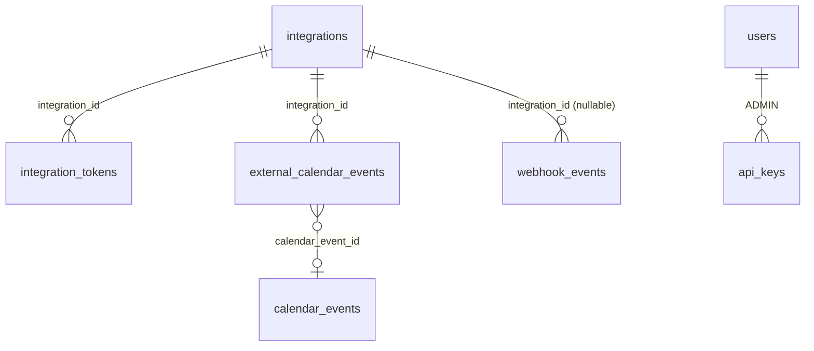

| Enum | Valeurs |
|---|---|
| `integration_provider` | `GOOGLE`, `WHATSAPP`, `N8N` |
| `integration_status` | `PENDING`, `ACTIVE`, `ERROR`, `REVOKED`, `EXPIRED` |
| `integration_token_kind` | `ACCESS`, `REFRESH`, `WEBHOOK_SECRET` |
| `webhook_status` | `RECEIVED`, `PROCESSED`, `IGNORED`, `FAILED`, `REJECTED` |

#### `integrations` — [B] — PHASE-14

| Colonne | Type | Null | Défaut | Description |
|---|---|---|---|---|
| `provider` | integration_provider | non | — | |
| `status` | integration_status | non | `'PENDING'` | |
| `external_account_id` | varchar(255) | non | — | `sub` Google, numéro WhatsApp E.164 vérifié, identifiant d'instance n8n. |
| `external_account_label` | varchar(255) | oui | — | Adresse affichée. |
| `scopes` | text[] | non | `'{}'` | Scopes accordés (minimaux). |
| `settings` | jsonb | non | `'{}'` | Calendriers suivis, options. |
| `sync_state` | jsonb | non | `'{}'` | `syncToken`, `historyId`, canaux push. |
| `connected_at` | timestamptz | oui | — | |
| `revoked_at` | timestamptz | oui | — | |
| `last_sync_at`, `last_success_at` | timestamptz | oui | — | |
| `last_error_code` | varchar(60) | oui | — | |
| `consecutive_failures` | smallint | non | `0` | Passage en `ERROR` au-delà d'un seuil. |

- Contraintes : `UNIQUE (user_id, provider, external_account_id)` ; **un numéro WhatsApp ne pointe que vers un utilisateur** : `ux_integrations__whatsapp_sender (external_account_id) WHERE provider = 'WHATSAPP' AND status = 'ACTIVE'` (index global, seule unicité inter-utilisateurs du schéma avec `users.email`, `sessions.token_hash`, `push_subscriptions.endpoint`, `api_keys.prefix`).
- Index : `ix_integrations__sync (status, last_sync_at) WHERE status = 'ACTIVE'` (réconciliation périodique) ; l'unique sert « mes intégrations ».

#### `integration_tokens` — [B] — PHASE-14

| Colonne | Type | Null | Défaut | Description |
|---|---|---|---|---|
| `integration_id` | uuid | non | — | → `integrations` **CASC** (déconnexion = destruction des jetons). |
| `token_kind` | integration_token_kind | non | — | |
| enveloppe chiffrée | — | non | — | Bloc M12. Jamais de jeton en clair (cahier §5.9). |
| `expires_at` | timestamptz | oui | — | |
| `rotated_at` | timestamptz | oui | — | |

- Contraintes : `UNIQUE (user_id, integration_id, token_kind)`.
- Index : `ix_integration_tokens__expiry (expires_at) WHERE token_kind = 'ACCESS'` (rafraîchissement anticipé).

#### `external_calendar_events` — [B] — PHASE-14

| Colonne | Type | Null | Défaut | Description |
|---|---|---|---|---|
| `integration_id` | uuid | non | — | → `integrations` CASC. |
| `external_calendar_id` | varchar(255) | non | — | |
| `external_event_id` | varchar(1024) | non | — | Identifiant stable du fournisseur. |
| `ical_uid` | varchar(1024) | oui | — | |
| `etag` | varchar(255) | oui | — | Détection de modification. |
| `title` | varchar(500) | oui | — | Donnée non fiable. |
| `location` | varchar(500) | oui | — | |
| `is_all_day` | boolean | non | `false` | |
| `start_at`, `end_at` | timestamptz | oui | — | |
| `start_date`, `end_date` | date | oui | — | |
| `timezone` | varchar(64) | oui | — | |
| `status` | event_status | non | `'CONFIRMED'` | Événement annulé côté fournisseur = `CANCELLED`. |
| `external_updated_at` | timestamptz | oui | — | |
| `last_synced_at` | timestamptz | non | `now()` | |
| `calendar_event_id` | uuid | oui | — | → `calendar_events` SN. Copie interne si l'utilisateur l'importe (synchronisation bidirectionnelle ultérieure). |
| `deleted_externally_at` | timestamptz | oui | — | |

- Contraintes : `UNIQUE (user_id, integration_id, external_calendar_id, external_event_id)` (déduplication, cahier §5.10) ; même `CHECK` de forme que `calendar_events`.
- Remplace les colonnes `provider`/`external_event_id` de `calendar_events` du cahier : l'agenda fusionne les deux tables à la lecture.
- Index : `ix_external_calendar_events__start (user_id, start_at)` ; `ix_external_calendar_events__start_date (user_id, start_date) WHERE is_all_day`.

#### `webhook_events` — [A], `user_id` **nullable** — PHASE-14

| Colonne | Type | Null | Défaut | Description |
|---|---|---|---|---|
| `user_id` | uuid | **oui** | — | Résolu après vérification de signature et rattachement (numéro WhatsApp → intégration). NULL = événement non rattachable : jamais exposé par une route utilisateur. **Exception justifiée** à « `user_id` partout ». |
| `provider` | integration_provider | non | — | |
| `integration_id` | uuid | oui | — | → `integrations` SN (FK composite, vérifiée seulement si `user_id` est renseigné). |
| `external_event_id` | varchar(255) | non | — | Identifiant fourni par l'émetteur (idempotence). |
| `signature_valid` | boolean | non | — | Signature invalide = `REJECTED`, aucun traitement. |
| `status` | webhook_status | non | `'RECEIVED'` | |
| `payload` | jsonb | oui | — | Charge assainie ; mise à NULL après 30 jours. |
| `payload_sha256` | bytea | non | — | |
| `received_at` | timestamptz | non | `now()` | |
| `processed_at` | timestamptz | oui | — | |
| `attempts` | smallint | non | `0` | |
| `error_code` | varchar(60) | oui | — | |

- Contraintes : `UNIQUE (provider, external_event_id)` (idempotence globale : les identifiants sont ceux du fournisseur).
- Index : `ix_webhook_events__pending (received_at) WHERE status IN ('RECEIVED','FAILED')` (traitement, reprise) ; `ix_webhook_events__purge (received_at) WHERE payload IS NOT NULL` (rétention).

#### `api_keys` — [B] — PHASE-14 (**ADMIN**)

| Colonne | Type | Null | Défaut | Description |
|---|---|---|---|---|
| `name` | varchar(80) | non | — | « n8n production ». |
| `prefix` | varchar(16) | non | — | Partie publique (`orb_7Hk2…`), affichable, unique globalement. |
| `key_hash` | bytea | non | — | SHA-256 de la clé complète (256 bits d'entropie : pas besoin d'argon2). Clé montrée une seule fois. |
| `scopes` | text[] | non | — | Portées explicites (`ideas:write`, `tasks:write`…), `CHECK (cardinality(scopes) > 0)`. Aucune portée « finance:validate ». |
| `expires_at` | timestamptz | oui | — | |
| `last_used_at` | timestamptz | oui | — | |
| `last_used_ip` | inet | oui | — | |
| `revoked_at` | timestamptz | oui | — | |

- Contraintes : `UNIQUE (prefix)` ; `UNIQUE (key_hash)` ; longueur 32.
- Index : `api_keys_prefix_key` (authentification : recherche par préfixe, puis comparaison à temps constant du hash) ; `ix_api_keys__active (user_id) WHERE revoked_at IS NULL`.

### M14 : Automatisations (PHASE-15)

Migration : `0014_phase15_automations`.

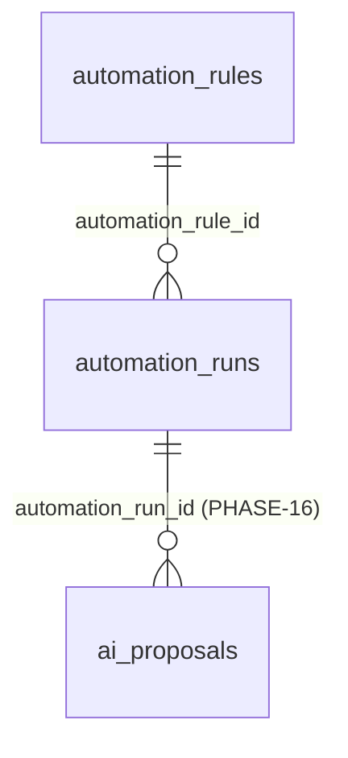

| Enum | Valeurs |
|---|---|
| `automation_trigger` | `SCHEDULE`, `DATE_APPROACHING`, `ENTITY_CREATED`, `ENTITY_UPDATED`, `WEBHOOK_RECEIVED`, `CALENDAR_EVENT`, `MANUAL` |
| `automation_run_status` | `QUEUED`, `RUNNING`, `AWAITING_CONFIRMATION`, `SUCCEEDED`, `FAILED`, `CANCELLED`, `DEAD_LETTER` |

#### `automation_rules` — [B] + `archived_at` + récurrence (§1.8, pour `SCHEDULE`) — PHASE-15

| Colonne | Type | Null | Défaut | Description |
|---|---|---|---|---|
| `name` | varchar(120) | non | — | |
| `description` | text | oui | — | |
| `trigger_type` | automation_trigger | non | — | |
| `trigger_config` | jsonb | non | `'{}'` | Paramètres du déclencheur (entité observée, délai avant échéance…). |
| `conditions` | jsonb | non | `'[]'` | Liste de conditions du DSL. |
| `actions` | jsonb | non | — | Liste d'actions : `CREATE_TASK`, `CREATE_REMINDER`, `NOTIFY`, `DRAFT_EMAIL`, `CALL_INTEGRATION`, `SUMMARIZE`, `PROPOSE_TRANSACTION`. Aucune action ne valide une transaction. |
| `dsl_version` | smallint | non | `1` | Version du schéma Zod du DSL. |
| `is_enabled` | boolean | non | `false` | Désactivée = plus aucune nouvelle exécution. |
| `version` | int | non | `1` | Incrémentée à chaque modification ; copiée dans chaque exécution. |
| `recurrence_*`, `next_occurrence_at` | — | oui | — | Bloc §1.8, uniquement pour `SCHEDULE`. |
| `max_runs_per_day` | smallint | non | `50` | Garde-fou anti-emballement. |
| `last_run_at` | timestamptz | oui | — | |
| `archived_at` | timestamptz | oui | — | |

- Contraintes : `ck_automation_rules__schedule CHECK ((trigger_type = 'SCHEDULE') = (recurrence_rule IS NOT NULL))` ; `ck_automation_rules__actions CHECK (jsonb_typeof(actions) = 'array' AND jsonb_array_length(actions) BETWEEN 1 AND 10)` ; `ck_..._recurrence_*`.
- Index : `ix_automation_rules__schedule (next_occurrence_at) WHERE is_enabled AND trigger_type = 'SCHEDULE' AND archived_at IS NULL` (planificateur) ; `ix_automation_rules__trigger (user_id, trigger_type) WHERE is_enabled AND archived_at IS NULL` (correspondance d'événement).

#### `automation_runs` — [B] — PHASE-15

| Colonne | Type | Null | Défaut | Description |
|---|---|---|---|---|
| `automation_rule_id` | uuid | non | — | → `automation_rules` CASC. |
| `rule_version` | int | non | — | Version de la règle exécutée. |
| `trigger_ref` | varchar(255) | oui | — | Événement déclencheur (`task:<id>:created`, occurrence planifiée). |
| `idempotency_key` | varchar(160) | non | — | `<rule_id>:<trigger_ref>` : un événement ne déclenche qu'une exécution. |
| `status` | automation_run_status | non | `'QUEUED'` | |
| `attempt` | smallint | non | `0` | |
| `max_attempts` | smallint | non | `3` | Jamais de retry infini. |
| `scheduled_at` | timestamptz | non | `now()` | |
| `started_at`, `finished_at` | timestamptz | oui | — | |
| `action_results` | jsonb | non | `'[]'` | Statut par action (idempotence par action). |
| `result_summary` | varchar(1000) | oui | — | |
| `error_code` | varchar(60) | oui | — | Jamais de secret ni de message brut d'un tiers. |

- Contraintes : `UNIQUE (user_id, automation_rule_id, idempotency_key)` ; `ck_automation_runs__attempts CHECK (attempt BETWEEN 0 AND max_attempts AND max_attempts BETWEEN 1 AND 10)`.
- Index : `ix_automation_runs__rule (user_id, automation_rule_id, created_at DESC)` (historique) ; `ix_automation_runs__failed (user_id, finished_at DESC) WHERE status IN ('FAILED','DEAD_LETTER')` (widget « automatisations en échec »).

### M15 : IA et capture multicanale (PHASE-16)

Migration : `0015_phase16_ai_capture` (+ `user_preferences.ai_enabled`).

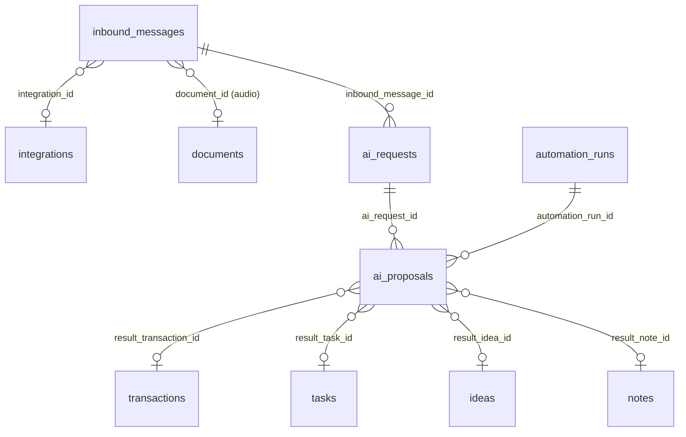

| Enum | Valeurs |
|---|---|
| `ai_feature` | `CHAT`, `WEEKLY_SUMMARY`, `CATEGORIZE_TRANSACTION`, `EXTRACT_IDEA`, `SUMMARIZE_NOTES`, `DRAFT_TASK`, `DRAFT_REPLY`, `DETECT_DEADLINES`, `PARSE_INBOUND` |
| `ai_request_status` | `PENDING`, `SUCCEEDED`, `FAILED`, `REFUSED` |
| `ai_proposal_kind` | `CREATE_TRANSACTION`, `CATEGORIZE_TRANSACTION`, `CREATE_TASK`, `CREATE_IDEA`, `CREATE_NOTE`, `CREATE_REMINDER`, `CREATE_CALENDAR_EVENT`, `DRAFT_EMAIL` |
| `ai_proposal_status` | `PROPOSED`, `ACCEPTED`, `REJECTED`, `EXPIRED`, `APPLIED`, `FAILED` |
| `inbound_channel` | `WHATSAPP`, `EMAIL`, `VOICE_NOTE` |
| `inbound_content_kind` | `TEXT`, `AUDIO`, `IMAGE` |
| `inbound_status` | `RECEIVED`, `PROCESSING`, `PROCESSED`, `IGNORED`, `FAILED` |

#### `inbound_messages` — [B] — PHASE-16

| Colonne | Type | Null | Défaut | Description |
|---|---|---|---|---|
| `channel` | inbound_channel | non | — | |
| `integration_id` | uuid | oui | — | → `integrations` SN. |
| `external_message_id` | varchar(255) | non | — | |
| `sender_ref` | varchar(255) | oui | — | Numéro E.164 ou adresse de l'expéditeur vérifié. |
| `received_at` | timestamptz | non | — | |
| `content_kind` | inbound_content_kind | non | — | |
| `text_content` | text | oui | — | ≤ 10 000 caractères. **Jamais exécuté comme commande** (cahier §4.21). |
| `transcript` | text | oui | — | Transcription de note vocale (étape dédiée, avec consentement). |
| `document_id` | uuid | oui | — | → `documents` SN. Fichier audio ou image. |
| `status` | inbound_status | non | `'RECEIVED'` | |
| `processed_at` | timestamptz | oui | — | |
| `error_code` | varchar(60) | oui | — | |
| `purge_after` | timestamptz | non | — | Rétention 90 jours du contenu. |

- Contraintes : `UNIQUE (user_id, channel, external_message_id)`.
- Index : `ix_inbound_messages__user (user_id, received_at DESC)` ; `ix_inbound_messages__pending (received_at) WHERE status IN ('RECEIVED','FAILED')` ; `ix_inbound_messages__purge (purge_after)`.

#### `ai_requests` — [B] — PHASE-16

| Colonne | Type | Null | Défaut | Description |
|---|---|---|---|---|
| `feature` | ai_feature | non | — | |
| `model` | varchar(80) | non | — | Identifiant du modèle Claude utilisé (ADR-025). |
| `status` | ai_request_status | non | `'PENDING'` | |
| `inbound_message_id` | uuid | oui | — | → `inbound_messages` SN. |
| `input_tokens`, `output_tokens` | int | oui | — | |
| `estimated_cost_microusd` | bigint | oui | — | Métrique interne d'exploitation en millionièmes de dollar, **pas un montant utilisateur** : exception assumée à la paire `_minor` + `currency`. |
| `latency_ms` | int | oui | — | |
| `prompt_redacted` | text | oui | — | Prompt **expurgé** (aucun secret, aucune donnée de coffre), conservé pour le débogage. |
| `response_redacted` | text | oui | — | |
| `purge_after` | timestamptz | non | — | 30 jours : le contenu est mis à NULL, les métriques restent. |
| `error_code` | varchar(60) | oui | — | |

- Index : `ix_ai_requests__user (user_id, created_at DESC)` ; `ix_ai_requests__purge (purge_after) WHERE prompt_redacted IS NOT NULL OR response_redacted IS NOT NULL`.

#### `ai_proposals` — [B] — PHASE-16

| Colonne | Type | Null | Défaut | Description |
|---|---|---|---|---|
| `ai_request_id` | uuid | oui | — | → `ai_requests` NA. |
| `automation_run_id` | uuid | oui | — | → `automation_runs` SN. Proposition issue d'une automatisation. |
| `kind` | ai_proposal_kind | non | — | |
| `is_financial` | boolean | non | — | Dérivé de `kind`, figé par CHECK. |
| `payload` | jsonb | non | — | Commande proposée, validée par le schéma Zod de la commande cible. |
| `payload_schema_version` | smallint | non | `1` | |
| `status` | ai_proposal_status | non | `'PROPOSED'` | |
| `decided_at` | timestamptz | oui | — | Décision **de l'utilisateur**. |
| `applied_at` | timestamptz | oui | — | |
| `expires_at` | timestamptz | non | — | 7 jours. |
| `result_transaction_id` | uuid | oui | — | → `transactions` NA (créée en `PENDING` ou validée après confirmation). |
| `result_task_id`, `result_idea_id`, `result_note_id` | uuid | oui | — | → cibles SN. |
| `error_code` | varchar(60) | oui | — | |

- Contraintes :
  - `ck_ai_proposals__origin CHECK (num_nonnulls(ai_request_id, automation_run_id) >= 1)` ;
  - `ck_ai_proposals__financial CHECK (is_financial = (kind IN ('CREATE_TRANSACTION','CATEGORIZE_TRANSACTION')))` ;
  - **Confirmation obligatoire de toute écriture financière** (ADR-025) : `ck_ai_proposals__financial_confirmed CHECK (NOT is_financial OR status NOT IN ('ACCEPTED','APPLIED') OR decided_at IS NOT NULL)` ;
  - `ck_ai_proposals__applied CHECK ((status = 'APPLIED') = (applied_at IS NOT NULL))` ;
  - `ck_ai_proposals__one_result CHECK (num_nonnulls(result_transaction_id, result_task_id, result_idea_id, result_note_id) <= 1)`.
- Index : `ix_ai_proposals__inbox (user_id, created_at DESC) WHERE status = 'PROPOSED'` (propositions à traiter) ; `ix_ai_proposals__expiry (expires_at) WHERE status = 'PROPOSED'` (expiration).

### M16 : Administration SaaS, quotas, suppression et export de compte (PHASE-17)

Migration : `0016_phase17_platform_admin` (+ fonctions `orbit_purge_user`, `orbit_purge_expired_logs`).

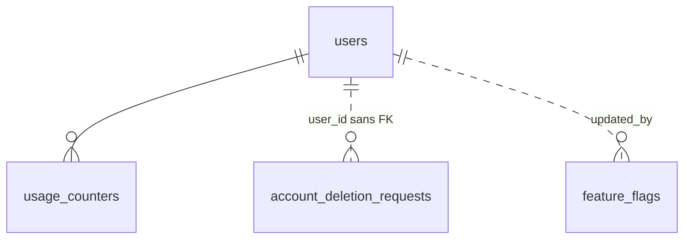

| Enum | Valeurs |
|---|---|
| `usage_metric` | `STORAGE_BYTES`, `DOCUMENTS_COUNT`, `AI_REQUESTS`, `AI_TOKENS`, `EXPORTS`, `TRANSACTIONS`, `INBOUND_MESSAGES` |
| `deletion_request_status` | `PENDING`, `CANCELLED`, `PROCESSING`, `COMPLETED`, `FAILED` |

#### `usage_counters` — PK `(user_id, metric, period_start)` — PHASE-17

| Colonne | Type | Null | Défaut | Description |
|---|---|---|---|---|
| `user_id` | uuid | non | — | FK `users(id)` simple CASC. |
| `metric` | usage_metric | non | — | |
| `period_start` | date | non | — | 1er jour du mois (compteurs) ; jauges (`STORAGE_BYTES`) recalculées sur le mois courant. |
| `value` | bigint | non | `0` | `CHECK (value >= 0)`. |
| `updated_at` | timestamptz | non | `now()` | |

- Incrément atomique : `INSERT ... ON CONFLICT (user_id, metric, period_start) DO UPDATE SET value = usage_counters.value + EXCLUDED.value`.
- Les **limites** de quota vivent dans la configuration (pas de plan payant, hypothèse H2).
- La console ADMIN ne lit que des agrégats (ADR-002). Index : la PK.

#### `account_deletion_requests` — [B] **sans FK sur `user_id`** — PHASE-17

| Colonne | Type | Null | Défaut | Description |
|---|---|---|---|---|
| `user_id` | uuid | non | — | **Pas de FK** : la demande survit à la suppression du compte (preuve de traitement). |
| `email_hmac` | bytea | non | — | HMAC de l'e-mail : preuve sans conserver de donnée personnelle. |
| `status` | deletion_request_status | non | `'PENDING'` | |
| `requested_at` | timestamptz | non | `now()` | Après ré-authentification. |
| `scheduled_for` | timestamptz | non | — | `requested_at + 30 j` (délai de rétractation). |
| `cancelled_at` | timestamptz | oui | — | |
| `processing_started_at`, `completed_at` | timestamptz | oui | — | |
| `export_job_id` | uuid | oui | — | Export proposé avant suppression (pas de FK : supprimé avec le compte). |
| `reason` | varchar(500) | oui | — | Facultatif. |
| `error_code` | varchar(60) | oui | — | |

- Contraintes : `ux_account_deletion_requests__active (user_id) WHERE status IN ('PENDING','PROCESSING')`.
- Index : `ix_account_deletion_requests__due (scheduled_for) WHERE status = 'PENDING'` (job de suppression).
- Exécution : `users.status = 'PENDING_DELETION'` à la demande (sessions révoquées) ; à l'échéance, `orbit_purge_user(user_id)` (rôle `orbit_maintenance`, `SECURITY DEFINER`) supprime **toutes** les lignes de l'utilisateur dans l'ordre inverse des dépendances (liens et imputations, puis écritures et transactions, puis référentiels, puis `users`), purge les objets de stockage, puis passe la demande à `COMPLETED`. Les déclencheurs de garde (`trg_transactions__guard`, `trg_ledger_entries__guard`, append-only) laissent passer ce seul rôle.

#### `feature_flags` — [G] — PHASE-17

| Colonne | Type | Null | Défaut | Description |
|---|---|---|---|---|
| `key` | varchar(80) | non | — | PK, `CHECK (key ~ '^[a-z0-9_.]+$')`. |
| `description` | varchar(300) | non | — | |
| `enabled` | boolean | non | `false` | |
| `rollout_percentage` | smallint | non | `100` | 0–100, hachage stable de `user_id`. |
| `allowed_roles` | user_role[] | non | `'{}'` | Vide = tous les rôles. |
| `updated_by` | uuid | oui | — | FK `users(id)` simple, `ON DELETE SET NULL`. |
| `created_at`, `updated_at` | timestamptz | non | `now()` | |

- Écriture réservée à la console ADMIN ; lecture mise en cache par l'API.

---

## 4. Matrice de suppression et d'archivage

Légende : **Interdite** = aucune suppression physique applicative (seule `orbit_purge_user` le peut) ; **Corbeille** = `deleted_at` + purge à 30 jours ; **Archive** = `archived_at`, ligne conservée ; **Physique** = `DELETE` applicatif autorisé.

| Table | Stratégie applicative | Conditions et effets | FK entrantes à la suppression |
|---|---|---|---|
| `users` | Interdite (demande de suppression M16) | `orbit_purge_user` après 30 j | — |
| `sessions`, `*_tokens`, `user_preferences` | Physique | Expiration, révocation, purge | — |
| `login_events`, `audit_logs` | Interdite (append-only) | Rétention : 180 j (`login_events`) ; durée de vie du compte (`audit_logs`) | — |
| `ideas`, `tasks`, `notes` | Corbeille | Purge : liens (`*_tags`, `note_links`, `document_links`, `goal_links`, `reminders`) en CASC ; références facultatives (`converted_project_id`, `idea_id`…) en SN | CASC / SN |
| `projects` | Archive ou corbeille | Corbeille refusée si des transactions, factures ou contrats le référencent (NA) | NA (financier), SN (organisation) |
| `task_dependencies`, `*_tags` | Physique | — | — |
| `tags` | Physique | Liaisons CASC | CASC |
| `note_links`, `document_links`, `goal_links` | Physique | Jamais la note ni le document | — |
| `currencies` | Interdite | Désactivation (`is_active`) | NA |
| `financial_accounts` | Archive | Suppression physique seulement si aucune écriture ; sinon NA | NA |
| `transaction_categories`, `counterparties` | Archive | Physique seulement si inutilisée (NA) ; catégorie système : jamais | NA |
| `transactions`, `ledger_entries` | **Interdite** | Annulation (`CANCELLED`) ; correction par `ADJUSTMENT` | NA |
| `debt_repayments`, `invoice_payments` | Physique (désimputation auditée) | La transaction reste | — |
| `debts` | Interdite | `CANCELLED` ou `WRITTEN_OFF` | NA |
| `recurring_transactions` | Fin (`ENDED`) ; physique si aucune occurrence `CONFIRMED` | Occurrences supprimées par l'application avant | NA |
| `recurring_occurrences` | `SKIPPED` ; physique si `EXPECTED` sans transaction | — | NA |
| `idempotency_keys`, `outbox_events`, `webhook_events` | Physique (purge) | Rétention technique | — |
| `export_jobs` | Physique (purge du fichier à 7 j, ligne conservée 90 j) | — | — |
| `reminders`, `notifications`, `notification_preferences`, `push_subscriptions` | Physique | Rappels : `CANCELLED` de préférence (traçabilité) | — |
| `calendar_events` | Corbeille ; `CANCELLED` pour l'annulation | Liens CASC, rappels CASC | CASC / SN |
| `documents` | Corbeille | Purge objet + ligne ; liens CASC | CASC / SN |
| `clients`, `contacts` | Archive | Physique si aucun contrat ni facture (NA) | NA / SN |
| `client_contacts` | Physique | — | — |
| `contracts` | `CANCELLED` / `TERMINATED` ; physique si `DRAFT` sans facture | — | NA |
| `invoices` | Physique **seulement** en `DRAFT` ; sinon `CANCELLED` | Lignes CASC | NA |
| `invoice_items` | Physique (facture `DRAFT`) | — | — |
| `invoice_sequences` | Interdite | — | — |
| `goals`, `habits`, `learning_items` | Archive ; physique autorisée | Liens et journaux CASC | CASC / SN |
| `habit_logs`, `learning_sessions` | Physique | — | — |
| `journal_entries` | Corbeille | — | — |
| `applications`, `domains`, `servers`, `service_subscriptions` | Archive ; physique autorisée (ADMIN) | Environnements, liaisons, événements techniques CASC ; coffre SN | CASC / SN |
| `application_environments` | `ARCHIVED` ; physique autorisée | Liaisons CASC | CASC |
| `technical_events` | Physique | — | — |
| `vault_items` | Archive ; physique = destruction cryptographique (payloads CASC) | Auditée | CASC |
| `vault_secret_payloads` | Purge des versions remplacées à 30 j | — | — |
| `user_mfa_factors`, `mfa_recovery_codes` | Désactivation ; physique | Ré-authentification + TOTP | CASC |
| `integrations` | `REVOKED` puis physique | Jetons CASC (révocation chez le fournisseur avant) | CASC / SN |
| `external_calendar_events` | Physique (synchronisation) | — | — |
| `api_keys` | Révocation (`revoked_at`) | — | — |
| `automation_rules` | Archive ; physique autorisée | Exécutions CASC ; propositions SN | CASC / SN |
| `automation_runs` | Physique (rétention 180 j) | — | SN |
| `inbound_messages`, `ai_requests` | Contenu purgé (`purge_after`), ligne conservée | — | SN |
| `ai_proposals` | `EXPIRED` ; physique autorisée | — | — |
| `usage_counters` | Physique (rétention 24 mois) | — | — |
| `account_deletion_requests` | Conservée sans donnée personnelle | — | — |
| `feature_flags` | Physique (ADMIN) | — | — |

---

## 5. Invariants

### 5.1 Garantis par la base de données

| # | Invariant | Mécanisme |
|---|---|---|
| D1 | Une ligne ne référence jamais la donnée d'un autre utilisateur. | FK composites `(user_id, x_id) → (user_id, id)` (ADR-007). |
| D2 | La devise d'une écriture est celle de son compte. | FK `(user_id, account_id, currency) → financial_accounts(user_id, id, currency)`. |
| D3 | Une imputation (dette, facture) est dans la devise de la transaction **et** de la dette ou facture. | Double FK composite incluant `currency`. |
| D4 | Σ imputations d'une transaction ≤ son montant. | `orbit_assert_imputation_within_amount` (déclencheurs `debt_repayments`, `invoice_payments`, verrou de ligne). |
| D5 | Montants de mouvement strictement positifs ; aucun flottant. | `CHECK (> 0)`, types `bigint`/`numeric`. |
| D6 | Forme des écritures conforme au type de transaction (1 ou 2 écritures, sens, montants, comptes distincts, taux exigé si devises différentes). | `trg_transactions__entries_shape` (contrainte différée). |
| D7 | Cohérence `type` ↔ `economic_class`, frais, remboursement, taux, annulation. | `CHECK` de `transactions`. |
| D8 | Une transaction validée ou annulée n'est ni supprimée ni modifiée sur ses champs financiers ; transitions de statut bornées. | `trg_transactions__guard`, `trg_ledger_entries__guard`. |
| D9 | Le solde initial et la devise d'un compte ne changent plus après la première écriture. | `trg_financial_accounts__guard`. |
| D10 | Une facture émise est figée ; ses lignes aussi ; totaux = Σ lignes à l'émission ; numéro unique et séquentiel. | `trg_invoices__guard`, `trg_invoice_items__guard`, `UNIQUE`, `invoice_sequences`. |
| D11 | Pas de doublon d'événement : idempotence des transactions, occurrences récurrentes, webhooks, exécutions d'automatisation, rappels et notifications automatiques, messages entrants. | Index uniques (partiels). |
| D12 | Un lien (`note_links`, `document_links`, `goal_links`, `reminders`, `technical_events`) vise exactement une cible. | `CHECK (num_nonnulls(...) = 1)`. |
| D13 | Pas de dépendance circulaire entre tâches. | `trg_task_dependencies__no_cycle`. |
| D14 | Journaux d'audit et de connexion append-only. | `GRANT SELECT, INSERT` + déclencheurs. |
| D15 | Unicités métier : e-mail, slug, nom de tag, nom de compte actif, référence de contrat, une entrée de journal par jour, un log d'habitude par jour, un seul ADMIN, un seul TOTP actif. | `UNIQUE` / index uniques partiels. |
| D16 | Une proposition IA financière n'est jamais appliquée sans décision de l'utilisateur. | `ck_ai_proposals__financial_confirmed`. |
| D17 | Jetons stockés uniquement en empreinte de 32 octets. | `CHECK (octet_length(...) = 32)`. |
| D18 | Cohérences de dates et de forme (fin ≥ début, journée entière vs horaire, statut ↔ horodatage). | `CHECK`. |

### 5.2 Garantis par l'application (testés, ADR-021)

| # | Invariant | Où |
|---|---|---|
| A1 | `user_id` jamais fourni par le client ; filtrage systématique ; 404 sur accès croisé. | Extension `tenantScope`, tests d'isolation générés. |
| A2 | Découvert refusé par défaut : le solde après opération respecte `allow_overdraft` / `overdraft_limit_minor`. | Service finance, verrou `SELECT ... FOR UPDATE` du compte. |
| A3 | Remboursement ≤ restant dû d'une dette ; paiement ≤ solde d'une facture (sauf avance, trop-perçu ou correction explicites). | Services dettes et factures, verrou de la dette ou facture. |
| A4 | Montant crédité d'un transfert multi-devises = `round_half_up(débit × rate)` ; arrondi des lignes de facture. | `packages/money`. |
| A5 | Calculs dérivés : soldes, restant dû, état de paiement, retard, progression, séries d'habitudes, prévisions. | Services de domaine purs (`FINANCE_RULES.md`). |
| A6 | Validation sémantique des règles de récurrence et calcul de `next_occurrence_at` (DST). | `packages/contracts/common/recurrence`. |
| A7 | Catégorie de même `kind` que la transaction ; sous-catégorie de même `kind` que son parent ; deux niveaux maximum. | Service finance. |
| A8 | Une sous-tâche n'a qu'un niveau ; une tâche maîtresse récurrente génère ses occurrences sans modifier les anciennes. | Service tâches. |
| A9 | Aucun secret dans `metadata`, `payload`, `prompt_redacted`, notifications, logs. | Filtres de sérialisation, redaction pino, tests de sécurité. |
| A10 | `enabled_modules` contient des clés connues ; la zone Dev dépend du rôle. | Zod + guard `@Roles('ADMIN')`. |
| A11 | Rotation de KEK, re-chiffrement, AAD correcte. | Module coffre (SECURITY.md). |
| A12 | Corbeille refusée pour un projet référencé par le financier ; annulation d'une facture payée refusée. | Services projets et factures. |
| A13 | Révocation des sessions au changement de mot de passe ou d'e-mail. | Service d'authentification. |
| A14 | Quotas et limites de débit. | Garde de quotas (PHASE-17), rate limiting. |

---

## 6. Écarts avec le cahier et points ouverts

### 6.1 Écarts assumés avec `PRODUCT_SPEC.md` §5

| Cahier | Ici | Raison |
|---|---|---|
| `workspaces`, `workspace_members`, `workspace_id` | `user_id` | ADR-001. |
| `transactions.amount` sur une ligne, comptes source/destination | En-tête + `ledger_entries` | ADR-009 (transferts, multi-devises, frais). |
| `transactions.client_id` | Supprimé | Dérivé via `invoice_payments`, `project.client_id` ou `clients.counterparty_id`. |
| `task_links`, `note_links` polymorphes, `environment_resources` | FK nullables + `CHECK num_nonnulls`, tables de liaison explicites | ADR-018. |
| `vault_access_logs` | `audit_logs` | Un seul journal append-only. |
| `vault_items.ciphertext` | `vault_secret_payloads` | Historique de rotation, métadonnées sans chiffré. |
| `calendar_events.provider/external_event_id` | `external_calendar_events` | Séparation interne / externe (PHASE-14). |
| `contracts.document_id` | `document_links.contract_id` | Un seul mécanisme de pièce jointe. |
| `domains.application_id` | `environment_domains` | Un domaine sert un environnement. |
| `debts.status`, `invoices.status` avec états de paiement | Cycle de vie stocké, état de paiement dérivé | Annuler une transaction rouvre la dette ou la facture sans mise à jour croisée. |
| `users.mfa_enabled` | Dérivé de `user_mfa_factors` | Source unique. |
| `daily_journals`, `learning_resources` (tables futures) | `journal_entries`, `learning_items` (`parent_id` pour les ressources) | Noms canoniques PRODUCT_SCOPE §4. |

### 6.2 Tables hors liste canonique

**Aucune.** Les besoins non couverts par PRODUCT_SCOPE §4 sont absorbés par des colonnes (`invoices.kind` pour les avoirs, `clients.counterparty_id`, `tasks.client_id`, `service_subscriptions.recurring_transaction_id`, `learning_items.parent_id`) ou par des tables existantes (`audit_logs` pour l'historique de statut des contrats et des échéances de tâches).

### 6.3 Incohérences détectées dans la documentation (à corriger hors de ce document)

| # | Constat | Résolution proposée ici |
|---|---|---|
| I1 | `currencies` est rattachée à M04 (PHASE-05), mais `user_preferences.default_currency` (PHASE-01) et `projects` (PHASE-04) ont besoin d'une devise. | Colonne avec `CHECK` de format en PHASE-01 ; FK ajoutée en PHASE-05 ; budget de projet ajouté en PHASE-05. |
| I2 | `idempotency_keys` arrive en PHASE-05, alors que la file de capture hors ligne existe dès PHASE-02/04. | `client_capture_id` unique sur `ideas`, `tasks`, `notes`. |
| I3 | `export_jobs` en PHASE-07, mais aucun job avant PHASE-08 (ADR-012) et pas de `StoragePort` avant PHASE-09. | Export synchrone en flux en PHASE-07 (`storage_key` NULL) ; asynchrone ensuite. |
| I4 | `transactions.invoice_id` recoupait `invoice_payments`. | **Résolu par ADR-030** : la colonne n'existe pas, `invoice_payments` fait foi. |
| I5 | `ARCHITECTURE.md`, `DEVELOPMENT_METHOD.md` et `PHASE-00` citent `prisma/schema.prisma` (fichier unique). | Schéma multi-fichiers `apps/api/prisma/schema/` (§2.1). |
| I6 | Noms de migration : `PHASE-00` (`0000_init_extensions`) et `PHASE-09` (`phase09_calendar_documents`) ne suivent pas `NNNN_phaseXX_<slug>`. | Format §2.3 ; les fiches doivent citer le nom complet. |
| I7 | ADR-018 cite `reminders` parmi les liens `num_nonnulls = 1` : un rappel « libre » sans entité est donc impossible. | Assumé : un rappel libre est une tâche avec rappel. À confirmer par le propriétaire. |
| I8 | Cahier §4.15 : liens des tâches vers domaines et factures ; aucune table canonique ne les porte (`task_links` supprimé). | `tasks.project_id`, `idea_id`, `client_id` seulement ; une note ou un document lie le reste. À confirmer. |
| I9 | Cahier §4.4 : jalons de contrat ; cahier §4.12 : avoirs. Aucune table canonique. | Jalons hors schéma ; avoirs via `invoices.kind = 'CREDIT_NOTE'`. |
| I10 | `audit_logs` et `outbox_events` utilisent `entity_type`/`entity_id`, que ADR-018 proscrit pour les liens. | Exception justifiée : journaux sans intégrité référentielle voulue (ils doivent survivre aux suppressions). À acter par une ADR. |
| I11 | Traitement de la tontine non tranché (analyse §3). | Catégories par défaut ; décision dans `FINANCE_RULES.md`. |

### 6.4 Numérotation des migrations

Les numéros `NNNN` cités dans ce document sont **indicatifs** (ordre attendu des phases). Le numéro réel est le suivant disponible au moment de la phase ; le slug `phaseXX_<slug>` est, lui, normatif.
