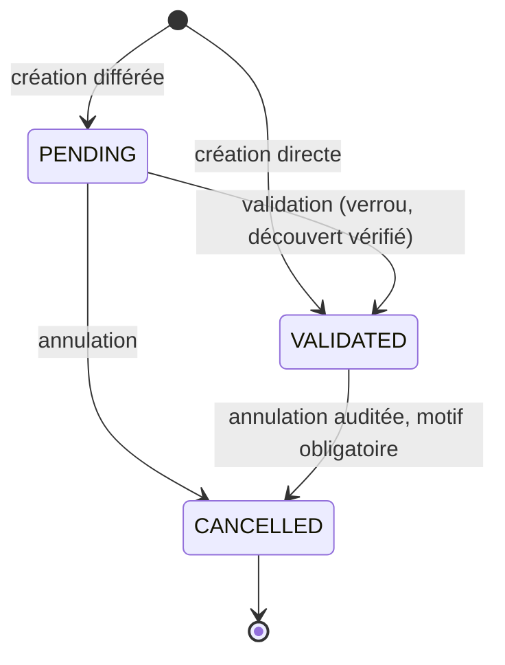
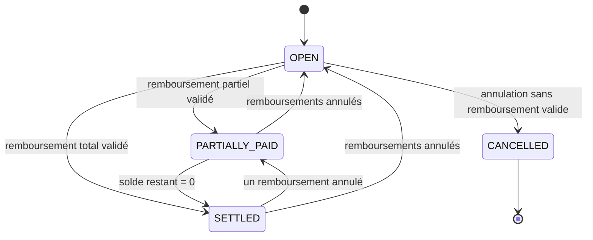
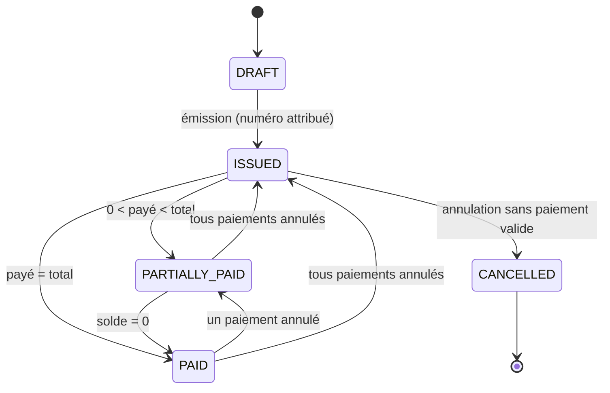

# ORBIT : règles de calcul financier

- **Statut :** référence. Ce document est la source unique des règles de calcul financier. Il détaille `PRODUCT_SPEC.md` §4.9 à §4.13 et §6, et applique ADR-001, 007, 008, 009, 020, 021 et 023 ainsi que l'hypothèse H3 de `DECISIONS.md`.
- **Priorité :** `DECISIONS.md` > `PRODUCT_SCOPE.md` > `FINANCE_RULES.md` > `PRODUCT_SPEC.md`. Dans le cahier, lire `workspace_id` comme `user_id`.
- **Date :** 11 octobre 2026.
- **Responsabilité :** définir ce que vaut chaque montant (solde, revenu, dépense, dette, facture, position nette), quelles transitions sont légales, et fournir les cas chiffrés `FIN-01` à `FIN-40` que les tests citent. Ce document ne définit ni les colonnes (`DATA_MODEL.md`), ni les routes (`API.md`), ni les mécanismes de test (`TESTING.md`).
- **Documents liés :** `DECISIONS.md`, `PRODUCT_SCOPE.md` (§2, §4), `PRODUCT_SPEC.md` (§4.9 à §4.13, §6, §12, Annexe A), `DATA_MODEL.md`, `API.md`, `TESTING.md`, `SECURITY.md`.
- **Phases concernées :** PHASE-05 (comptes, transactions), PHASE-06 (dettes, récurrences), PHASE-07 (rapports), PHASE-10 (factures).

> **Amendement ADR-030.** Pour les dettes et les factures, seul le **cycle de vie** est stocké (factures : `DRAFT`, `ISSUED`, `CANCELLED` ; dettes : `OPEN`, `CANCELLED`). Les états `PARTIALLY_PAID`, `PAID` et le retard cités dans ce document sont des **états calculés** à partir des imputations valides : ce ne sont pas des colonnes. La colonne `transactions.invoice_id` n'existe pas : seule `invoice_payments` impute un paiement. Les calculs et les cas `FIN-xx` restent valables tels quels.

Les mots DOIT, NE DOIT PAS, DOIT REFUSER ont un sens normatif. Toute règle de ce document a au moins un cas `FIN-xx` ou une propriété de `TESTING.md` §10 qui la vérifie.

---

## 1. Glossaire

| Terme | Définition |
|---|---|
| Unité mineure | Plus petite unité de la devise. XOF : 1 FCFA (exposant 0). EUR : 1 centime (exposant 2). |
| `Money` | Valeur `{ minor: bigint, currency }` de `packages/money`. Seule forme d'arithmétique monétaire autorisée. |
| Compte | Endroit où se trouve l'argent (`financial_accounts`). Une seule devise. Types `CASH`, `MOBILE_MONEY`, `BANK`, `PAYMENT_ACCOUNT`, `OTHER`. |
| Écriture | Ligne de `ledger_entries` : un mouvement `DEBIT` ou `CREDIT` sur un compte. `CREDIT` augmente le solde, `DEBIT` le diminue. |
| Transaction | En-tête d'un événement métier (`transactions`). Porte le type, le traitement, le statut. |
| Type | `INCOME`, `EXPENSE`, `TRANSFER`, `BORROWING`, `LOAN`, `REFUND`, `ADJUSTMENT`. |
| Traitement (`treatment`) | Classification économique : `STANDARD`, `GIFT`, `DEBT_REPAYMENT`, `CUSTOMER_CREDIT`. Il décide si un mouvement est un revenu ou une dépense. |
| Solde réalisé | Solde d'un compte ne comptant que les transactions `VALIDATED`. |
| Solde prévisionnel | Solde réalisé plus l'effet des transactions `PENDING`. N'inclut pas les occurrences récurrentes. |
| Projection | Solde prévisionnel plus les occurrences `PLANNED` d'une règle récurrente jusqu'à une date. |
| Revenu | Encaissement `INCOME` de traitement `STANDARD`, net des `REFUND` correspondants. |
| Dépense opérationnelle | Décaissement `EXPENSE` de traitement `STANDARD`, net des `REFUND` correspondants. |
| Dette (`PAYABLE`) | Somme que l'utilisateur doit. |
| Créance (`RECEIVABLE`) | Somme due à l'utilisateur. |
| Principal | Montant initial d'une dette. Immuable. |
| Ajustement de dette | Correction auditée, positive ou négative, du montant dû. Ne modifie jamais le principal. |
| Imputation | Lien entre un montant de transaction et une facture (`invoice_payments`) ou une dette (`debt_repayments`). |
| Crédit client | Trop-perçu sur une facture. Passif, jamais un revenu. |
| Position nette | Voir §16.4. |
| Jour civil utilisateur | Date calendaire dans le fuseau de l'utilisateur (`Africa/Dakar` par défaut). |
| Clé d'idempotence | Valeur fournie par le client (`Idempotency-Key`) ou dérivée (occurrence récurrente, événement externe) qui garantit un effet unique. |

---

## 2. Convention monétaire et arrondi

### 2.1 Représentation

1. Tout montant est un entier en unité mineure : `BIGINT` en base, `bigint` dans le code, **chaîne de chiffres** dans l'API (`"150000"`). Un `number` JSON est refusé.
2. Devises : `currencies.exponent` fait foi. XOF = 0 (« 150 000 FCFA » = `"150000"`). EUR = 2 (« 12,50 € » = `"1250"`). USD = 2.
3. Montant d'une transaction ou d'une écriture : entier **strictement positif**. Le sens est porté par `direction` (écriture) ou par le type (transaction). Seuls les soldes, ajustements de dette et résultats de rapport peuvent être négatifs ou nuls.
4. Bornes : `MAX_AMOUNT_MINOR = 1000000000000000000` (10^18) par transaction. Un solde ou un total hors de l'intervalle `BIGINT` (`-9223372036854775808` à `9223372036854775807`) fait refuser l'opération (`BALANCE_OUT_OF_RANGE`). Les totaux de rapport se calculent en `NUMERIC` côté SQL ou en `bigint` côté code, jamais en `number`.
5. Syntaxe API d'un montant : `^(0|[1-9][0-9]*)$`, éventuellement précédé de `-` pour détecter le signe. Sont refusés : zéro, négatif, séparateur décimal, notation scientifique, espace, `+`, zéros de tête, `number` JSON, `null`.
6. Entrée utilisateur (formulaire) : `packages/money` fournit `parse(texte, currency)`. Un texte ayant plus de décimales que l'exposant de la devise est **refusé** (jamais arrondi silencieusement). Exemple : `"0,5"` en XOF est refusé.
7. Il est interdit d'utiliser `float`, `double`, `Number()` ou `parseFloat` sur un montant. Interdiction vérifiée par lint (voir `TESTING.md` §11).

### 2.2 Arrondi

Il existe **une seule règle : half-up** (au plus proche, la moitié vers le haut, valeurs positives). Elle est implémentée en arithmétique entière :

```
roundHalfUp(n, d) = floor((2n + d) / (2d))     pour n >= 0, d > 0
```

Application :

| Calcul | Formule | Quand arrondir |
|---|---|---|
| Net de ligne de facture | `roundHalfUp(quantity_scaled × unit_price_minor, 10^3)` (`quantity` `NUMERIC(12,3)`) | Une fois par ligne |
| Taxe de ligne | `roundHalfUp(line_net_minor × tax_rate_scaled, 100 × 10^4)` (`tax_rate` `NUMERIC(7,4)`, en %) | Une fois par ligne, **sur le net déjà arrondi** |
| Conversion de devise | `roundHalfUp(src_minor × rate_scaled × 10^e_dest, 10^10 × 10^e_src)` (`rate` `NUMERIC(20,10)`) | Une fois, à la création du transfert |

Règles : aucun arrondi intermédiaire en dehors de ce tableau ; les totaux sont des **sommes** de valeurs déjà arrondies ; un résultat ne se recalcule jamais à partir d'un total.

---

## 3. Comptes et soldes

### 3.1 Compte

- Champs métier : nom, type, fournisseur, devise, `opening_balance`, date d'ouverture, actif/archivé, découvert autorisé, notes.
- **Devise immuable** dès qu'une écriture existe.
- **Solde initial jamais modifié** après création du compte. Une erreur se corrige par `ADJUSTMENT` (§4.4). Toute tentative de modification renvoie 409 `OPENING_BALANCE_IMMUTABLE`.
- Une transaction ne peut pas être antérieure à la date d'ouverture du compte (422 `BEFORE_ACCOUNT_OPENING`). Comparaison sur le jour civil utilisateur.
- Un compte archivé conserve son historique et son solde, compte dans la position nette tant que son solde est non nul, et refuse toute nouvelle transaction (422 `ACCOUNT_ARCHIVED`).

### 3.2 Formules

```
solde_realise(compte)     = opening_balance
                          + Σ amount des écritures CREDIT dont la transaction est VALIDATED
                          − Σ amount des écritures DEBIT  dont la transaction est VALIDATED

solde_previsionnel(compte) = solde_realise
                          + Σ CREDIT des écritures de transactions PENDING
                          − Σ DEBIT  des écritures de transactions PENDING
```

- Les transactions `CANCELLED` ne comptent nulle part. Leurs écritures restent en base.
- Aucune colonne de solde n'est stockée. Si un cache est introduit un jour, il est mis à jour dans la même transaction SQL, sous verrou, et vérifié par la propriété P2 de `TESTING.md`.
- Solde à une date `D` (exclue) : `opening_balance` du compte (s'il est ouvert avant `D`) plus les écritures `VALIDATED` dont le jour civil utilisateur est `< D`.

### 3.3 Découvert (H3)

- **Défaut : découvert refusé.** Chaque compte porte un plafond de découvert (`overdraft_limit_minor`, entier ≥ 0, défaut 0, nom de colonne fixé par `DATA_MODEL.md`).
- Invariant : à tout instant, `solde_realise >= −overdraft_limit_minor`.
- La vérification s'exécute **sous verrou** (§17), après recalcul du solde, pour toute opération qui diminue un solde réalisé :
  - création directe en `VALIDATED` d'une transaction qui débite le compte ;
  - passage `PENDING → VALIDATED` ;
  - frais liés (le total transaction + frais est vérifié ensemble) ;
  - `ADJUSTMENT` de direction `DEBIT` ;
  - **annulation** d'une transaction `VALIDATED` qui avait crédité le compte.
- Échec : 422 `INSUFFICIENT_FUNDS`, avec `available` et `required` en chaînes. Aucun effet n'est persisté.
- Abaisser le plafond sous le découvert actuel : 422 `OVERDRAFT_LIMIT_BELOW_BALANCE`. Le changement de plafond est audité.
- Créer une transaction `PENDING` ne déclenche aucune vérification de solde.

---

## 4. Types et traitements de transaction

### 4.1 Combinaisons autorisées

| Type | Traitements autorisés | Statut à la création | Champs obligatoires (en plus de montant, devise, `occurred_at`) |
|---|---|---|---|
| `INCOME` | `STANDARD`, `GIFT`, `DEBT_REPAYMENT`, `CUSTOMER_CREDIT` | `PENDING` ou `VALIDATED` | compte destination, catégorie (`STANDARD`, `GIFT`) ; `debt_id` (`DEBT_REPAYMENT`) ; `parent_transaction_id` (`CUSTOMER_CREDIT`) |
| `EXPENSE` | `STANDARD`, `DEBT_REPAYMENT` | `PENDING` ou `VALIDATED` | compte source, catégorie (`STANDARD`) ; `debt_id` (`DEBT_REPAYMENT`) |
| `TRANSFER` | `STANDARD` | `PENDING` ou `VALIDATED` | comptes source et destination différents ; taux et date du taux si devises différentes |
| `BORROWING` | `STANDARD` | `VALIDATED` seulement | compte destination, contrepartie |
| `LOAN` | `STANDARD` | `VALIDATED` seulement | compte source, contrepartie |
| `REFUND` | `STANDARD` | `PENDING` ou `VALIDATED` | `refund_of_id` ; compte (destination si l'origine est une `EXPENSE`, source si c'est un `INCOME`) |
| `ADJUSTMENT` | `STANDARD` | `VALIDATED` seulement | un compte, `adjustment_direction` (`CREDIT` ou `DEBIT`), `reason` non vide |

Toute autre combinaison : 422 `TREATMENT_NOT_ALLOWED`. Un statut non autorisé : 422 `STATUS_NOT_ALLOWED`.

Contraintes communes :
- La devise de la transaction est celle du ou des comptes (hors transfert multi-devises, §6). Écart : 422 `CURRENCY_MISMATCH`. Devise absente : 422 `CURRENCY_REQUIRED`. Aucune devise n'est déduite.
- Les catégories ont une nature `INCOME` ou `EXPENSE`. Une catégorie d'une autre nature : 422 `CATEGORY_KIND_MISMATCH`. Les traitements `DEBT_REPAYMENT`, `CUSTOMER_CREDIT` et `GIFT` utilisent des catégories système dédiées.
- La catégorie système « Remboursement reçu » n'est **pas** une catégorie de revenu : un remboursement se saisit par le type `REFUND`.

### 4.2 Table de vérité

`M` est le montant. Effets exprimés par devise. « Dépenses » = dépenses opérationnelles.

| # | Type | Traitement | Compte source | Compte destination | Écritures | Dette / créance | Revenus | Dépenses | Position nette | Rubrique de rapport |
|---|---|---|---|---|---|---|---|---|---|---|
| T1 | `INCOME` | `STANDARD` | n/a | +M | 1 `CREDIT` | n/a | +M | 0 | +M | Revenus |
| T2 | `INCOME` | `GIFT` | n/a | +M | 1 `CREDIT` | n/a | 0 | 0 | +M | Autres entrées |
| T3 | `INCOME` | `DEBT_REPAYMENT` | n/a | +M | 1 `CREDIT` | créance −M | 0 | 0 | 0 | Encaissements de créances |
| T4 | `INCOME` | `CUSTOMER_CREDIT` | n/a | +M | 1 `CREDIT` | crédit client +M | 0 | 0 | 0 | Crédits clients |
| T5 | `EXPENSE` | `STANDARD` | −M | n/a | 1 `DEBIT` | n/a | 0 | +M | −M | Dépenses |
| T6 | `EXPENSE` | `DEBT_REPAYMENT` | −M | n/a | 1 `DEBIT` | dette −M | 0 | 0 | 0 | Remboursements de dettes |
| T7 | `TRANSFER` | `STANDARD` (même devise) | −M | +M | 2 (`DEBIT` + `CREDIT`) | n/a | 0 | 0 | 0 | Mouvements internes |
| T8 | `TRANSFER` | `STANDARD` (devises différentes) | −Ms | +Md | 2, montants et devises distincts | n/a | 0 | 0 | −Ms (dev. S), +Md (dev. D) | Mouvements internes |
| T9 | `BORROWING` | `STANDARD` | n/a | +M | 1 `CREDIT` | dette `PAYABLE` +M | 0 | 0 | 0 | Emprunts reçus |
| T10 | `LOAN` | `STANDARD` | −M | n/a | 1 `DEBIT` | créance `RECEIVABLE` +M | 0 | 0 | 0 | Prêts accordés |
| T11 | `REFUND` d'une `EXPENSE` | `STANDARD` | n/a | +M | 1 `CREDIT` | n/a | 0 | −M dans la catégorie d'origine | +M | Dépenses |
| T12 | `REFUND` d'un `INCOME` | `STANDARD` | −M | n/a | 1 `DEBIT` | n/a | −M dans la catégorie d'origine | 0 | −M | Revenus |
| T13 | `ADJUSTMENT` `CREDIT` | `STANDARD` | n/a | +M | 1 `CREDIT` | n/a | 0 | 0 | +M | Ajustements |
| T14 | `ADJUSTMENT` `DEBIT` | `STANDARD` | −M | n/a | 1 `DEBIT` | n/a | 0 | 0 | −M | Ajustements |

Règles associées :
1. **T3 et T6** : la dette ou la créance liée est de type opposé (T6 : `PAYABLE`, T3 : `RECEIVABLE`), de même devise, et le montant imputé ne dépasse pas le solde restant (§8.4).
2. **T11 et T12** : le `REFUND` contre-passe la **catégorie de la transaction d'origine**, dans la période du `REFUND` (pas rétroactivement). Une catégorie peut donc présenter un net négatif sur une période.
   - L'origine est `VALIDATED`, de type `EXPENSE` ou `INCOME` (traitement `STANDARD`), de même devise.
   - `Σ REFUND non annulés ≤ montant de l'origine` (422 `REFUND_EXCEEDS_ORIGINAL`).
   - Une origine ayant un `REFUND` non annulé ne peut pas être annulée (409 `REFUND_EXISTS`).
3. **T9 et T10** créent la dette ou la créance dans la même transaction SQL (origine `TRANSACTION`, §8.1).
4. **T13 et T14** : motif obligatoire (422 `REASON_REQUIRED`), direction obligatoire, audit `ADJUSTMENT_CREATED`. Ils ne sont jamais des revenus ni des dépenses.
5. **T4** n'est créé que comme enfant d'un paiement de facture en trop-perçu (§9.4).
6. Un `TRANSFER` vers le même compte : 422 `SAME_ACCOUNT_TRANSFER`.

### 4.3 Édition des champs

| Statut | Montant, compte, devise, type, traitement, date | Description, notes, catégorie (même nature), contrepartie, liens | Référence externe |
|---|---|---|---|
| `PENDING` | Modifiables. Les écritures sont réécrites dans la même transaction SQL. | Modifiables | Modifiable |
| `VALIDATED` | **Interdit** : 409 `TRANSACTION_IMMUTABLE`. Annuler puis recréer. | Modifiables, avec audit `TRANSACTION_UPDATED` (valeurs avant/après) | Interdit |
| `CANCELLED` | Interdit | Interdit | Interdit |

### 4.4 Correction de solde

Un écart avec la réalité se corrige par un `ADJUSTMENT` daté du jour, motif obligatoire, sens explicite. Le solde initial et l'historique ne sont pas touchés. Les ajustements sont listés à part dans les rapports.

---

## 5. Machines à états

### 5.1 Transaction



- Transitions légales : `PENDING→VALIDATED`, `PENDING→CANCELLED`, `VALIDATED→CANCELLED`. Toute autre : 409 `INVALID_STATE_TRANSITION`. Pas de retour de `VALIDATED` à `PENDING`. `CANCELLED` est terminal.
- **Annulation d'une `VALIDATED`** : motif (≤ 500 caractères) obligatoire, audit `TRANSACTION_CANCELLED` avec auteur, date, motif. Aucune écriture n'est supprimée.
- **Cascade vers les enfants** (`parent_transaction_id`) : valider ou annuler un parent valide ou annule atomiquement tous ses enfants. Annuler un enfant seul est permis (par exemple des frais saisis par erreur), sauf un enfant de traitement `CUSTOMER_CREDIT` (409 `CHILD_REQUIRES_PARENT`).
- **Effets sur les imputations** : annuler un paiement de facture ou un remboursement de dette met la facture ou la dette à jour (§8, §9). Annuler la transaction d'origine d'une dette (T9, T10) ou d'une facture : voir §8.1 et §9.1.
- **Annuler une transaction qui avait crédité un compte** est soumis au contrôle de découvert (§3.3).

### 5.2 Dette ou créance



Le statut est stocké mais **recalculé dans la même transaction SQL** à chaque mouvement :
- `restant = principal + Σ ajustements − Σ remboursements imputés valides`.
- `SETTLED` si `restant = 0`, `PARTIALLY_PAID` si `0 < restant` et au moins un remboursement valide, sinon `OPEN`.
- `CANCELLED` terminal. Interdit si un remboursement valide existe (409 `DEBT_HAS_REPAYMENTS`).
- Le **retard n'est pas un statut** (ADR-020, §11.2).

### 5.3 Facture



- `PAID` si et seulement si `solde = 0`. Le statut est recalculé dans la même transaction SQL que tout paiement ou annulation de paiement.
- `DRAFT` est modifiable et supprimable (audité). À l'émission, le numéro est attribué via `invoice_sequences` et ne sera jamais réutilisé ; les lignes et totaux deviennent immuables.
- `CANCELLED` terminal, interdit si un paiement valide est imputé (409 `INVOICE_HAS_PAYMENTS`). Un numéro annulé n'est pas recyclé.
- Il n'existe ni avoir ni radiation avant décision (§18, OD-F2).

---

## 6. Transferts et multi-devises

1. Un `TRANSFER` produit **deux écritures** : `DEBIT` du compte source, `CREDIT` du compte destination, chacune dans la devise de son compte.
2. Source et destination sont deux comptes distincts. Même compte : 422 `SAME_ACCOUNT_TRANSFER`.
3. **Même devise** : les deux montants sont égaux. La somme des soldes de cette devise ne change pas.
4. **Devises différentes** : l'utilisateur saisit explicitement `exchange_rate` (unités de la devise destination pour 1 unité de la devise source, `NUMERIC(20,10)`) et `rate_date` (date civile). **Le système n'invente jamais de taux.**
   - Taux ou date absents : 422 `EXCHANGE_RATE_REQUIRED`, rien n'est persisté.
   - Taux ≤ 0 : 422 `EXCHANGE_RATE_INVALID`.
   - Montant destination = `roundHalfUp(src × rate × 10^e_dest / 10^e_src)` (§2.2). L'utilisateur peut fournir `destination_amount` pour refléter ce qu'il a réellement reçu ; il doit alors rester à ±1 unité mineure du calcul (sinon 422 `RATE_AMOUNT_MISMATCH`). Le montant fourni fait foi.
5. La transaction conserve : montant et devise d'origine, montant et devise cible, taux, date du taux. `transactions.currency` et `amount` sont ceux de la source.
6. Les frais de change ou de transfert sont une transaction `EXPENSE` séparée (§7).
7. Aucun gain ou perte de change n'est calculé. Aucun total ne mélange les devises (§16.5).

---

## 7. Frais, dont frais mobile money

1. Un frais est une transaction `EXPENSE` de traitement `STANDARD`, catégorie système « Frais bancaires et mobile money », **liée par `parent_transaction_id`** à l'opération qui l'a causé.
2. Le frais est créé **dans la même transaction SQL** que le parent. Si l'un échoue, rien n'est persisté.
3. Le montant du frais est **saisi par l'utilisateur**. Le système ne calcule aucun barème de fournisseur. Les montants des exemples ci-dessous sont fictifs.
4. Le compte du frais est par défaut le compte source du parent. Sa devise est celle de son compte.
5. Le contrôle de découvert porte sur le total (parent + frais) du même compte (§3.3).
6. Le frais est une dépense opérationnelle (T5), y compris quand le parent est un transfert, un prêt ou un remboursement de dette (le frais n'est pas du principal).
7. Statut : un frais suit son parent à la création. Valider ou annuler le parent valide ou annule les frais (§5.1).

Exemples (voir `FIN-31`, `FIN-32`) :

| Opération | Parent | Frais | Effet sur le compte |
|---|---|---|---|
| Paiement Wave de 25 000 FCFA, frais 250 | `EXPENSE` 25 000 | `EXPENSE` 250 | Wave −25 250 ; dépenses +25 250 |
| Retrait Orange Money vers espèces de 50 000, frais 1 000 | `TRANSFER` 50 000 | `EXPENSE` 1 000 sur Orange Money | Orange Money −51 000 ; espèces +50 000 ; dépenses +1 000 |

---

## 8. Dettes et créances

### 8.1 Création et origine

- Champs : type (`PAYABLE` ou `RECEIVABLE`), contrepartie, titre, principal (> 0), devise, date d'ouverture, échéance (optionnelle, jour civil), notes.
- Origines : `TRANSACTION` (créée par un `BORROWING` ou un `LOAN`, §4.2), `MANUAL` (solde préexistant, aucun mouvement de compte), `ADVANCE_EXCESS` (§8.4).
- Une dette `MANUAL` est autorisée sans transaction d'origine. Elle compte dans la position nette dès sa création.
- **Le principal est immuable.** Une correction passe par un **ajustement de dette** (§8.3).
- Annuler la transaction d'origine d'un `BORROWING` ou d'un `LOAN` : refusé si un remboursement valide existe (409 `DEBT_HAS_REPAYMENTS`), sinon la dette passe à `CANCELLED` dans la même transaction SQL.

### 8.2 Remboursement

- Un remboursement est une transaction `VALIDATED` de traitement `DEBT_REPAYMENT` (T6 pour une dette, T3 pour une créance) reliée à la dette par `debt_repayments`.
- Une transaction n'est imputée qu'à **une seule** dette. Pour rembourser deux dettes, saisir deux transactions.
- La transaction est de même devise que la dette.
- Un remboursement `PENDING` n'est pas compté ; la règle de plafond s'applique à sa validation.
- Annuler le remboursement le retire du calcul (`debt_repayments` reste, marqué par le statut de la transaction) et recalcule le statut de la dette (§5.2).

### 8.3 Ajustement de dette

- Montant signé non nul, motif obligatoire, audit `DEBT_ADJUSTED`.
- Contrainte : `restant >= 0` après ajustement (422 `ADJUSTMENT_EXCEEDS_REMAINING`).
- Le stockage (table dédiée ou autre) est fixé par `DATA_MODEL.md`. `PRODUCT_SCOPE.md` §4 ne liste pas de table pour les ajustements : voir OD-F5.

### 8.4 Sur-remboursement

- **Défaut `REFUSE`** : si le montant à imputer dépasse le restant, 422 `OVERPAYMENT_REFUSED`, rien n'est persisté.
- **Mode `ADVANCE` explicite** (`overpay_mode`) : la dette est soldée par l'imputation du restant ; l'excédent `E` crée une dette **de type opposé**, même contrepartie et même devise, d'origine `ADVANCE_EXCESS`, liée à la dette soldée. La position nette est inchangée.
- Exemple : dette `PAYABLE` restante 70 000, paiement de 80 000 en mode `ADVANCE` : dette soldée, nouvelle `RECEIVABLE` de 10 000, compte −80 000.
- Le montant imputé (`debt_repayments.amount`) peut donc être inférieur au montant de la transaction ; `Σ imputé ≤ montant de la transaction`.

### 8.5 Position nette

Chaque ligne de §4.2 laisse la position nette inchangée sauf T1, T2, T5, T11 à T14 (§16.4). C'est la propriété P4 de `TESTING.md`.

---

## 9. Factures et paiements

### 9.1 Calcul

```
line_net   = roundHalfUp(quantity × unit_price)             (par ligne)
line_tax   = roundHalfUp(line_net × tax_rate / 100)         (par ligne, sur line_net arrondi)
subtotal   = Σ line_net
tax_amount = Σ line_tax
total      = subtotal + tax_amount
payé       = Σ montants imputés dont la transaction est VALIDATED
solde      = total − payé
```

- Aucune taxe n'est calculée sur le total. Un test vérifie `tax_amount == Σ line_tax` (propriété P7).
- Les revenus reconnus sont les **encaissements** (base caisse), toutes taxes comprises. ORBIT ne ventile pas HT et TVA dans les rapports.
- Les factures émises et impayées sont affichées dans « À encaisser » et **n'entrent pas** dans la position nette.
- Annuler une facture : audit `INVOICE_CANCELLED`, sans paiement valide (§5.3).

### 9.2 Paiement

- Un paiement est une transaction `INCOME` `STANDARD`, `VALIDATED`, de même devise que la facture, reliée par `invoice_payments` (imputation).
- `Σ imputé sur une transaction ≤ montant de la transaction` (422 `ALLOCATION_EXCEEDS_TRANSACTION`). Une transaction peut être répartie sur plusieurs factures.
- Une transaction `PENDING` ne s'impute pas (422 `TRANSACTION_NOT_VALIDATED`).
- Devise différente : 422 `CURRENCY_MISMATCH`.
- Un webhook ou une requête rejoué ne crée pas de second paiement (§13).

### 9.3 Annulation d'un paiement

Annuler la transaction retire ses imputations du calcul, recalcule `payé`, `solde` et le statut (`PAID → PARTIALLY_PAID` ou `ISSUED`). Un paiement annulé est audité et reste visible.

### 9.4 Trop-perçu

Deux opérations existent :

| Opération | Effet |
|---|---|
| **Enregistrer un paiement** (crée la transaction et l'imputation) | `overpay_mode = REFUSE` (défaut) : si le montant dépasse le solde, 422 `OVERPAYMENT_REFUSED`. `overpay_mode = CREDIT` : un `INCOME` `STANDARD` du montant du solde est imputé, et un `INCOME` de traitement `CUSTOMER_CREDIT` (T4) de l'excédent est créé comme **enfant** (`parent_transaction_id`), dans la même transaction SQL. |
| **Imputer une transaction existante** | L'imputation ne dépasse jamais le solde (422 `OVERPAYMENT_REFUSED`). La partie non imputée de la transaction reste un revenu `STANDARD`. |

Le crédit client n'est jamais un revenu. Il compte comme passif dans la position nette (§16.4). Son imputation à une autre facture ou son remboursement sont hors périmètre (OD-F2).

---

## 10. Récurrences et prévisions

1. Une règle (`recurring_transactions`) décrit une dépense ou un revenu attendu : type, montant, devise, compte, catégorie, fréquence `MONTHLY` ou `YEARLY`, date d'ancrage, date de fin, actif ou non.
2. Une règle génère des **occurrences** (`recurring_occurrences`) : `PLANNED`, `CONFIRMED` ou `SKIPPED`. Les occurrences sont des prévisions : elles n'ont **ni transaction ni écriture** tant qu'elles ne sont pas confirmées.
3. **Calcul des dates** : à partir de la date d'ancrage, pas de la précédente occurrence. Si le jour n'existe pas dans le mois, on prend le dernier jour du mois (31 → 28, 29, 30). Pas de dérive.
4. **Idempotence** : clé unique `(recurring_id, scheduled_on)`, clé d'idempotence dérivée `rec:{recurring_id}:{scheduled_on}`. Une génération rejouée ne duplique rien. Une confirmation rejouée ne crée qu'une transaction.
5. **Confirmation** : l'utilisateur confirme (montant et date réels modifiables) et une transaction `VALIDATED` est créée, soumise aux contrôles ordinaires (découvert, compte actif). L'occurrence passe à `CONFIRMED` et référence la transaction. Une confirmation auto (`auto_confirm`) est une option **explicite**, désactivée par défaut ; en cas d'échec de contrôle, l'occurrence reste `PLANNED` et l'utilisateur est notifié (PHASE-08).
6. **Horizon** : les occurrences sont matérialisées sur un horizon configurable (défaut 90 jours). La projection peut calculer au-delà sans matérialiser.
7. **Modification d'une règle** : n'agit que sur les occurrences `PLANNED` futures. Les `CONFIRMED` ne sont jamais touchées. Désactiver ou terminer une règle passe les `PLANNED` futures à `SKIPPED`.
8. **Projection jusqu'à `until`** (exclue) : `solde_previsionnel + Σ occurrences PLANNED de scheduled_on < until`, signées selon leur type, par compte. Une occurrence confirmée n'est comptée qu'à travers sa transaction (jamais deux fois).
9. Les prévisions sont absentes du solde réalisé, des revenus et des dépenses.

---

## 11. Annulation, correction, retard

### 11.1 Annulation et correction

| Besoin | Moyen |
|---|---|
| Supprimer une saisie fausse | Annuler (`CANCELLED`), jamais `DELETE`. |
| Corriger un montant, un compte ou une devise d'une `VALIDATED` | Annuler puis recréer. |
| Corriger un solde constaté | `ADJUSTMENT` (§4.4). |
| Corriger une dette | Ajustement de dette (§8.3). |
| Corriger la description ou la catégorie | Édition auditée (§4.3). |

### 11.2 Retard dérivé (ADR-020)

```
is_overdue = due_date < aujourd'hui(fuseau utilisateur)
         ET solde > 0
         ET statut ∈ {ISSUED, PARTIALLY_PAID}      (facture)
                     {OPEN, PARTIALLY_PAID}        (dette, créance)
```

L'échéance du jour même n'est pas en retard. `DRAFT`, `PAID`, `SETTLED`, `CANCELLED` ne sont jamais en retard. Le retard n'est jamais stocké, ni filtré par un statut.

---

## 12. Audit

Actions auditées (`audit_logs`, avec `user_id`, cible, avant/après, motif) : `TRANSACTION_CANCELLED`, `TRANSACTION_UPDATED`, `ADJUSTMENT_CREATED`, `DEBT_ADJUSTED`, `INVOICE_CANCELLED`, `OVERDRAFT_LIMIT_CHANGED`, `ACCOUNT_ARCHIVED`, `CROSS_USER_ACCESS_DENIED` (ADR-007 point 7). Un audit ne contient ni secret ni donnée inutile.

---

## 13. Idempotence

1. Toute mutation financière en `POST` exige l'en-tête `Idempotency-Key` (absent : 422 `IDEMPOTENCY_KEY_REQUIRED`).
2. Portée : `(user_id, clé)`. Deux utilisateurs peuvent utiliser la même clé sans effet l'un sur l'autre.
3. Table `idempotency_keys` : clé, empreinte de la requête (méthode, chemin, corps normalisé), réponse enregistrée, date. Conservation minimale 24 h.
4. Même clé et même empreinte : la réponse d'origine est rejouée (même statut, même corps, en-tête `Idempotency-Replayed: true`). Aucun effet de plus.
5. Même clé et empreinte différente : 409 `IDEMPOTENCY_KEY_REUSED`.
6. Deux requêtes identiques **simultanées** : une seule s'exécute, l'autre attend ou reçoit 409 `IDEMPOTENCY_IN_PROGRESS` (rejouable).
7. Événements externes (webhooks, imports) : unicité `(user_id, external_reference)`, sans limite de durée. Un événement rejoué ne crée pas de second paiement.
8. Occurrences récurrentes : clé dérivée (§10.4).
9. Les opérations composées (frais, crédit client, dette d'origine, cascade) dérivent leurs clés de la clé principale ; elles sont toutes ou aucune.

---

## 14. Concurrence (rappel normatif, détail en §17)

Toute mutation qui lit un solde, un restant ou un solde de facture pour décider prend un verrou `SELECT … FOR UPDATE` avant de lire. Le recalcul et l'écriture se font dans la même transaction SQL.

---

## 15. Catégories

- Catégories système créées à l'inscription : revenus (paiement client, salaire, freelance, cadeau reçu, autre entrée), dépenses (alimentation, transport, logement, abonnement, hébergement, matériel, santé, formation, don, autre dépense, frais bancaires et mobile money), plus les catégories système des traitements `DEBT_REPAYMENT` et `CUSTOMER_CREDIT`.
- Les catégories sont personnalisables par utilisateur. Les catégories système ne sont pas supprimables.
- La classification en revenu ou dépense vient du **type et du traitement**, jamais du seul nom de catégorie.

---

## 16. Reporting

### 16.1 Périodes

- Une période est `[début, fin[` sur le **jour civil du fuseau de l'utilisateur** (défaut `Africa/Dakar`, ADR-023). Début inclus, fin exclue.
- Une transaction appartient à la période où tombe son `occurred_at` converti dans le fuseau de l'utilisateur. Chaque transaction appartient à une seule période d'une partition.
- Conversion : début et fin sont les instants UTC de minuit local. Un jour de changement d'heure dure 23 ou 25 heures. Si minuit local n'existe pas, on prend le premier instant valide.
- Le fuseau utilisé est le fuseau actuel de l'utilisateur au moment du calcul (OD-F4). Le fuseau du processus serveur n'a aucune influence.

### 16.2 Revenus et dépenses

Pour une période, **par devise** (statut `VALIDATED` uniquement) :

```
revenus            = Σ INCOME STANDARD  − Σ REFUND d'un INCOME
autres_entrees     = Σ INCOME GIFT
depenses           = Σ EXPENSE STANDARD − Σ REFUND d'une EXPENSE
resultat           = revenus − depenses
```

Rubriques affichées à part, hors résultat : encaissements de créances (T3), remboursements de dettes (T6), emprunts reçus (T9), prêts accordés (T10), crédits clients (T4), ajustements (T13, T14), mouvements internes (T7, T8).

Un détail par catégorie est fourni. Le `REFUND` est imputé à la catégorie d'origine, dans la période du remboursement.

### 16.3 Trésorerie

Par devise et période : solde d'ouverture, total des `CREDIT`, total des `DEBIT` (toutes transactions `VALIDATED`, tous types), flux net, solde de clôture. Les `PENDING` et les occurrences `PLANNED` sont dans le prévisionnel et la projection, jamais dans le réalisé. Les comptes archivés sont inclus.

### 16.4 Position nette

```
position_nette(devise) = Σ solde_realise des comptes (archivés inclus)
                       + Σ restant des créances ouvertes (OPEN, PARTIALLY_PAID)
                       − Σ restant des dettes ouvertes   (OPEN, PARTIALLY_PAID)
                       − Σ crédits clients ouverts
```

Exclus : factures impayées, `PENDING`, occurrences `PLANNED`, dettes `CANCELLED`.

### 16.5 Devises

Aucun résultat ne mélange les devises. Chaque rapport est un objet **par devise** (`{ "XOF": …, "EUR": … }`), sans total global. Une conversion n'est jamais appliquée implicitement. Toute conversion affichée exigerait une devise de reporting et un taux saisis par l'utilisateur (hors périmètre actuel).

---

## 17. Concurrence

1. Isolation PostgreSQL `READ COMMITTED` avec verrous explicites `SELECT … FOR UPDATE` ; le solde est recalculé **après** l'obtention du verrou.
2. Ressources verrouillées : chaque compte touché, la dette, la facture, la transaction d'origine d'un `REFUND`.
3. **Ordre global de verrouillage**, pour exclure les interblocages : comptes par `id` croissant, puis dettes, puis factures, puis transactions. Tout code qui verrouille plusieurs ressources respecte cet ordre.
4. `lock_timeout` de 5 secondes. Échec : 409 `LOCK_TIMEOUT` (rejouable avec la même clé d'idempotence).
5. Deux opérations concurrentes ne peuvent pas dépasser ensemble un solde, un restant de dette ou un solde de facture (`FIN-27`, `FIN-28`).
6. La ligne d'idempotence est écrite dans la même transaction SQL que l'effet.

---

## 18. Décisions ouvertes (aucune ne bloque PHASE-05 et PHASE-06)

| # | Sujet | Défaut en vigueur |
|---|---|---|
| OD-F1 | Intérêts, pénalités, échéanciers de dette | Hors périmètre. Aucune règle. |
| OD-F2 | Avoirs, remboursement ou imputation d'un crédit client, radiation | Non implémentés. Le crédit client est enregistré et visible. |
| OD-F3 | Conversion vers une devise de reporting | Non implémentée. Un résultat par devise. |
| OD-F4 | Effet d'un changement de fuseau de l'utilisateur sur les périodes passées | Les périodes se recalculent avec le fuseau actuel. |
| OD-F5 | Stockage des ajustements de dette (table absente de `PRODUCT_SCOPE.md` §4) | À trancher dans `DATA_MODEL.md` avant PHASE-06. |
| OD-F6 | Périodicités autres que `MONTHLY` et `YEARLY` | Non supportées. |

---

## 19. Codes d'erreur métier

Tous en 422 sauf mention. Les messages sont stables, les `code` sont repris dans `API.md`.

| Code | Cas |
|---|---|
| `AMOUNT_REQUIRED` | Montant absent ou `null` |
| `INVALID_AMOUNT_FORMAT` | Syntaxe invalide, décimale, notation scientifique, `number` JSON |
| `AMOUNT_NOT_POSITIVE` | Montant nul ou négatif |
| `AMOUNT_OUT_OF_RANGE` | Montant > `MAX_AMOUNT_MINOR` |
| `BALANCE_OUT_OF_RANGE` | Solde hors `BIGINT` |
| `CURRENCY_REQUIRED`, `INVALID_CURRENCY`, `UNKNOWN_CURRENCY`, `CURRENCY_MISMATCH` | Devise absente, mal formée, inconnue, incohérente |
| `INSUFFICIENT_FUNDS` | Découvert refusé |
| `SAME_ACCOUNT_TRANSFER` | Source = destination |
| `EXCHANGE_RATE_REQUIRED`, `EXCHANGE_RATE_INVALID`, `RATE_AMOUNT_MISMATCH` | Taux de change |
| `OVERPAYMENT_REFUSED` | Dette ou facture dépassée |
| `ALLOCATION_EXCEEDS_TRANSACTION` | Imputations > transaction |
| `REFUND_EXCEEDS_ORIGINAL` | Cumul des `REFUND` > origine |
| `ADJUSTMENT_EXCEEDS_REMAINING` | Ajustement de dette rendant le restant négatif |
| `REASON_REQUIRED` | Motif absent |
| `TREATMENT_NOT_ALLOWED`, `STATUS_NOT_ALLOWED`, `CATEGORY_KIND_MISMATCH` | Combinaisons interdites |
| `TRANSACTION_NOT_VALIDATED` | Imputation d'une `PENDING` |
| `BEFORE_ACCOUNT_OPENING`, `ACCOUNT_ARCHIVED` | Règles de compte |
| `OVERDRAFT_LIMIT_BELOW_BALANCE` | Plafond sous le découvert actuel |
| `REFERENCE_NOT_FOUND` | Référence du corps inexistante ou appartenant à un autre utilisateur (indiscernable) |
| `IDEMPOTENCY_KEY_REQUIRED` | En-tête absent |
| 409 `IDEMPOTENCY_KEY_REUSED`, `IDEMPOTENCY_IN_PROGRESS` | Idempotence |
| 409 `INVALID_STATE_TRANSITION`, `TRANSACTION_IMMUTABLE`, `OPENING_BALANCE_IMMUTABLE`, `PRINCIPAL_IMMUTABLE` | États et immutabilité |
| 409 `REFUND_EXISTS`, `DEBT_HAS_REPAYMENTS`, `INVOICE_HAS_PAYMENTS`, `CHILD_REQUIRES_PARENT` | Dépendances |
| 409 `LOCK_TIMEOUT` | Verrou non obtenu |
| 404 `NOT_FOUND` | Ressource absente ou d'un autre utilisateur (ADR-007) |

---

# CAS CHIFFRÉS

Convention commune à tous les cas :
- Utilisateur `U`, fuseau `Africa/Dakar` (UTC+0), devise `XOF` sauf mention. Horloge figée.
- Les montants sont des chaînes en unités mineures ; « 150 000 » s'écrit `"150000"` dans l'API.
- Les jeux de données sont indépendants : chaque cas crée ses comptes (voir `TESTING.md` §6).
- « Solde » désigne le solde réalisé sauf mention. Le premier jeu de colonnes d'un cas est son état initial.
- Un test cite le cas dans le titre : `[FIN-xx]`.

## Cas minimums du §6.6 (FIN-01 à FIN-15)

### FIN-01 : entrée simple
- **Arrange :** compte `Wave` (`MOBILE_MONEY`, XOF, solde initial 100 000). Catégorie « Freelance ».
- **Act :** `POST` `INCOME` `STANDARD` `VALIDATED`, 150 000, destination `Wave`, le 2026-10-05.
- **Assert :** 201 ; 1 écriture `CREDIT` 150 000 sur `Wave` ; solde `Wave` = 250 000 ; revenus d'octobre = 150 000 ; dépenses = 0 ; position nette 100 000 → 250 000.

### FIN-02 : dépense simple
- **Arrange :** compte `Espèces` (`CASH`, XOF, solde initial 50 000). Catégorie « Transport ».
- **Act :** `EXPENSE` `STANDARD` `VALIDATED`, 12 500, source `Espèces`.
- **Assert :** 1 écriture `DEBIT` 12 500 ; solde = 37 500 ; dépenses = 12 500 ; revenus = 0 ; position nette 50 000 → 37 500.

### FIN-03 : transfert interne
- **Arrange :** `Wave` solde initial 200 000 ; `Espèces` solde initial 0.
- **Act :** `TRANSFER` 50 000 de `Wave` vers `Espèces`, `VALIDATED`.
- **Assert :** 2 écritures (`DEBIT` 50 000 `Wave`, `CREDIT` 50 000 `Espèces`) ; `Wave` = 150 000 ; `Espèces` = 50 000 ; Σ des soldes = 200 000 (inchangée) ; revenus = 0 ; dépenses = 0.

### FIN-04 : emprunt reçu
- **Arrange :** compte `Banque` (`BANK`, XOF, solde initial 0). Contrepartie « Moussa ».
- **Act :** `BORROWING` 300 000, destination `Banque`, `VALIDATED`.
- **Assert :** `Banque` = 300 000 ; 1 dette `PAYABLE`, principal 300 000, restant 300 000, statut `OPEN`, origine `TRANSACTION` ; revenus = 0 ; dépenses = 0 ; position nette 0 → 0 (300 000 − 300 000).

### FIN-05 : prêt accordé
- **Arrange :** `Espèces` solde initial 100 000. Contrepartie « Awa ».
- **Act :** `LOAN` 40 000, source `Espèces`, `VALIDATED`.
- **Assert :** `Espèces` = 60 000 ; 1 créance `RECEIVABLE`, restant 40 000, `OPEN` ; revenus = 0 ; dépenses = 0 ; position nette 100 000 → 100 000 (60 000 + 40 000).

### FIN-06 : remboursement partiel d'une dette
- **Arrange :** `Banque` solde initial 150 000. Dette `PAYABLE` 100 000 d'origine `MANUAL`, contrepartie « Moussa » (Annexe A.3). Position nette = 50 000.
- **Act 1 :** `EXPENSE` `DEBT_REPAYMENT` 30 000, source `Banque`, `debt_id` = la dette, `VALIDATED`.
- **Assert 1 :** `Banque` = 120 000 ; dette restant 70 000, `PARTIALLY_PAID` ; dépenses opérationnelles = 0 ; « Remboursements de dettes » = 30 000 ; position nette = 50 000.
- **Act 2 :** second remboursement 70 000.
- **Assert 2 :** restant 0, `SETTLED` ; `Banque` = 50 000 ; 2 lignes `debt_repayments` conservées ; dépenses opérationnelles = 0 ; position nette = 50 000.

### FIN-07 : remboursement partiel d'une créance
- **Arrange :** `Wave` solde initial 10 000. Créance `RECEIVABLE` 80 000 sur « Awa », origine `MANUAL`. Position nette = 90 000.
- **Act :** `INCOME` `DEBT_REPAYMENT` 30 000, destination `Wave`, `debt_id` = la créance, `VALIDATED`.
- **Assert :** `Wave` = 40 000 ; créance restant 50 000, `PARTIALLY_PAID` ; revenus = 0 ; « Encaissements de créances » = 30 000 ; position nette = 90 000.

### FIN-08 : facture payée en plusieurs fois
- **Arrange :** `Wave` solde initial 0. Facture `ISSUED` : 1 ligne, quantité `2.000`, prix unitaire 125 000, taxe `0.0000` ; `total` = 250 000.
- **Act :** 3 paiements `INCOME` `STANDARD` `VALIDATED` sur `Wave`, imputés : P1 100 000, P2 100 000, P3 50 000.
- **Assert :**
  - Après P1 : payé 100 000, solde 150 000, `PARTIALLY_PAID`.
  - Après P2 : payé 200 000, solde 50 000, `PARTIALLY_PAID`.
  - Après P3 : payé 250 000, solde 0, `PAID`.
  - `Wave` = 250 000 ; revenus = 250 000 ; 3 lignes `invoice_payments` ; aucun paiement n'a créé de transaction supplémentaire.

### FIN-09 : transaction annulée
- **Arrange :** `Espèces` solde initial 100 000.
- **Act 1 :** `EXPENSE` 20 000 `VALIDATED`. **Act 2 :** annulation avec motif « saisie en double ».
- **Assert :** après Act 1, solde 80 000, dépenses 20 000. Après Act 2 : statut `CANCELLED`, solde 100 000, dépenses 0 ; l'écriture existe toujours ; 1 audit `TRANSACTION_CANCELLED` (auteur, date, motif) ; une seconde annulation → 409 `INVALID_STATE_TRANSITION` ; `PATCH` du montant → 409.

### FIN-10 : double requête idempotente
- **Arrange :** `Wave` solde initial 0. Clé `K1`.
- **Act :** deux `POST` `INCOME` 10 000 avec `Idempotency-Key: K1` et un corps identique.
- **Assert :** 1 seule transaction ; la seconde réponse a le même statut, le même corps (même `id`) et `Idempotency-Replayed: true` ; solde 10 000.
- **Variantes :** même clé avec 20 000 → 409 `IDEMPOTENCY_KEY_REUSED` ; deux requêtes simultanées → 1 transaction ; l'utilisateur `V` utilisant `K1` crée sa propre transaction (indépendance).

### FIN-11 : transfert multi-devises
- **Arrange :** `Banque EUR` (EUR, solde initial 50 000 = 500,00 €) ; `Wave` (XOF, solde initial 0).
- **Act :** `TRANSFER` source `Banque EUR`, destination `Wave`, montant source `"10000"` (100,00 €), `exchange_rate` `"655.957"`, `rate_date` 2026-10-05.
- **Assert :** montant destination = `roundHalfUp(10000 × 655.957 × 10^0 / 10^2)` = 65 595,7 → **65 596** ; écriture `DEBIT` 10 000 EUR et `CREDIT` 65 596 XOF ; `Banque EUR` = 40 000 ; `Wave` = 65 596 ; taux et date conservés ; revenus = 0 et dépenses = 0 dans les deux devises.
- **Variante sans taux :** → 422 `EXCHANGE_RATE_REQUIRED`, 0 transaction, 0 écriture, soldes inchangés.

### FIN-12 : correction de solde
- **Arrange :** `Banque` solde initial 100 000. Le relevé réel indique 95 000.
- **Act 1 :** `ADJUSTMENT` direction `DEBIT`, 5 000, motif « écart relevé du 2026-10-01 ».
- **Assert 1 :** solde = 95 000 ; `opening_balance` = 100 000 (inchangé) ; revenus = 0 ; dépenses = 0 ; audit `ADJUSTMENT_CREATED`.
- **Act 2 :** `ADJUSTMENT` direction `CREDIT`, 2 000. **Assert 2 :** solde = 97 000.
- **Refus :** sans motif → 422 `REASON_REQUIRED` ; sans direction → 422 ; modification du solde initial → 409 `OPENING_BALANCE_IMMUTABLE`.

### FIN-13 : montant nul ou négatif refusé
- **Arrange :** `Espèces` solde initial 10 000.
- **Act :** `POST` `EXPENSE` avec `amount` valant successivement : `"0"`, `"-100"`, `"-0"` (422 `AMOUNT_NOT_POSITIVE`) ; `"00100"`, `"1.5"`, `"1e3"`, `" 100"`, `"+100"`, `""`, `100` (nombre JSON) (422 `INVALID_AMOUNT_FORMAT`) ; `null` et champ absent (422 `AMOUNT_REQUIRED`).
- **Assert :** chaque appel renvoie le code indiqué ; 0 transaction, 0 écriture ; solde 10 000.

### FIN-14 : devise manquante refusée
- **Arrange :** `Espèces` (XOF) solde initial 10 000.
- **Act :** `POST` `EXPENSE` 1 000 sans `currency` ; avec `"xof"` ; avec `"ZZZ"` ; avec `"EUR"`.
- **Assert :** 422 `CURRENCY_REQUIRED` ; 422 `INVALID_CURRENCY` ; 422 `UNKNOWN_CURRENCY` ; 422 `CURRENCY_MISMATCH`. Aucune devise n'est déduite du compte. 0 transaction ; solde 10 000.

### FIN-15 : accès à la transaction d'un autre utilisateur
- **Arrange :** `A` possède le compte `Wave A` et la transaction `T_A` (`INCOME` 10 000). `B` possède `Wave B`.
- **Act (en tant que B) :** `GET`, `PATCH`, annulation sur `T_A` ; liste des transactions ; `POST` `INCOME` avec `destination_account_id` = `Wave A`.
- **Assert :** les trois accès directs → 404 `NOT_FOUND`, corps identique (hors `requestId`) à celui d'un `id` inexistant ; la liste de `B` ne contient pas `T_A` ; le `POST` → 422 `REFERENCE_NOT_FOUND`, indiscernable d'un id inexistant ; `T_A` et le solde de `Wave A` inchangés ; événement `CROSS_USER_ACCESS_DENIED` audité pour `B`. Un ADMIN reçoit aussi 404 (ADR-002).

## Cas limites (FIN-16 à FIN-40)

### FIN-16 : `PENDING` affichée à part
- **Arrange :** `Wave` solde initial 100 000.
- **Act 1 :** `EXPENSE` `PENDING` 30 000.
- **Assert 1 :** réalisé 100 000 ; prévisionnel 70 000 ; dépenses = 0.
- **Act 2 :** `EXPENSE` `VALIDATED` 80 000. **Assert 2 :** réalisé 20 000 ; prévisionnel −10 000 (affiché, non bloquant).
- **Act 3 :** valider la `PENDING`. **Assert 3 :** 422 `INSUFFICIENT_FUNDS` (`available` `"20000"`, `required` `"30000"`) ; la transaction reste `PENDING`.
- **Act 4 :** `INCOME` `VALIDATED` 20 000, puis valider la `PENDING`. **Assert 4 :** réalisé 10 000 ; dépenses = 110 000.

### FIN-17 : sur-remboursement d'une dette
- **Arrange :** `Banque` solde initial 150 000. Dette `PAYABLE` 100 000 avec un remboursement validé de 30 000 : restant 70 000, `Banque` = 120 000. Position nette = 50 000.
- **Act 1 :** remboursement de 80 000 (mode `REFUSE`). **Assert 1 :** 422 `OVERPAYMENT_REFUSED` ; 0 transaction créée ; `Banque` = 120 000 ; restant 70 000.
- **Act 2 :** même remboursement avec `overpay_mode = ADVANCE`. **Assert 2 :** transaction `EXPENSE` `DEBT_REPAYMENT` de 80 000 ; `Banque` = 40 000 ; dette `SETTLED` (imputé 70 000) ; nouvelle créance `RECEIVABLE` 10 000, origine `ADVANCE_EXCESS`, même contrepartie ; dépenses opérationnelles = 0 ; position nette = 40 000 + 10 000 = 50 000.

### FIN-18 : annulation d'un paiement de facture
- **Arrange :** `Wave` solde initial 0. Facture 250 000 `PAID` par P1 100 000, P2 100 000, P3 50 000.
- **Act 1 :** annuler la transaction P3. **Assert 1 :** facture `PARTIALLY_PAID`, payé 200 000, solde 50 000 ; `Wave` = 200 000 ; revenus = 200 000 ; l'imputation de P3 est exclue du calcul mais reste visible.
- **Act 2 :** annuler la facture. **Assert 2 :** 409 `INVOICE_HAS_PAYMENTS`.
- **Act 3 :** annuler P2 puis P1. **Assert 3 :** facture `ISSUED`, payé 0, solde 250 000 ; `Wave` = 0 ; revenus = 0.
- **Act 4 :** enregistrer un paiement unique de 250 000. **Assert 4 :** `PAID`, solde 0.

### FIN-19 : annulation d'un `REFUND`
- **Arrange :** `Espèces` solde initial 100 000. `E0` : `EXPENSE` 20 000, catégorie « Alimentation », le 2026-10-10 : solde 80 000.
- **Act 1 :** `REFUND` `R1` 5 000, `refund_of_id` = `E0`, destination `Espèces`, le 2026-11-03.
- **Assert 1 :** `Espèces` = 85 000 ; dépenses d'octobre « Alimentation » = 20 000 ; dépenses de novembre « Alimentation » = −5 000 (période du remboursement).
- **Act 2 :** `REFUND` de 15 001. **Assert 2 :** 422 `REFUND_EXCEEDS_ORIGINAL` (cumul 20 001 > 20 000).
- **Act 3 :** annuler `E0`. **Assert 3 :** 409 `REFUND_EXISTS`.
- **Act 4 :** annuler `R1`. **Assert 4 :** `Espèces` = 80 000 ; novembre = 0 ; octobre = 20 000.
- **Act 5 :** annuler `E0`. **Assert 5 :** `Espèces` = 100 000.

### FIN-20 : annulation d'un remboursement de dette
- **Arrange :** `Banque` solde initial 150 000. Dette `PAYABLE` 100 000 soldée par `RP1` 30 000 et `RP2` 70 000 : `SETTLED`, `Banque` = 50 000.
- **Act 1 :** annuler `RP2`. **Assert 1 :** dette `PARTIALLY_PAID`, restant 70 000 ; `Banque` = 120 000.
- **Act 2 :** annuler `RP1`. **Assert 2 :** dette `OPEN`, restant 100 000 ; `Banque` = 150 000.
- **Act 3 :** annuler la dette. **Assert 3 :** `CANCELLED` ; position nette = 150 000.
- **Variante :** avec `RP1` encore valide, annuler la dette → 409 `DEBT_HAS_REPAYMENTS`.

### FIN-21 : arrondi de TVA par ligne différent du total
- **Arrange :** facture `DRAFT` XOF avec 3 lignes identiques : quantité `1.000`, prix unitaire 25, taux `18.0000`.
- **Act :** calculer les totaux.
- **Assert :** chaque `line_tax` = `roundHalfUp(25 × 18 / 100)` = 4,5 → **5** ; `subtotal` = 75 ; `tax_amount` = **15** (et non 14, qui résulterait de 75 × 18 % = 13,5) ; `total` = 90.
- **Act 2 (ligne unique) :** quantité `1.500`, prix 1 001, taux `18.0000`.
- **Assert 2 :** `line_net` = 1 501,5 → 1 502 ; `line_tax` = 1 502 × 18 / 100 = 270,36 → 270 ; ligne totale 1 772.
- **Act 3 :** quantité `0.333`, prix 100, taux `0.0000`. **Assert 3 :** `line_net` = 33,3 → 33 ; taxe 0.

### FIN-22 : transfert vers le même compte
- **Arrange :** `Wave` solde initial 100 000.
- **Act :** `TRANSFER` 10 000 de `Wave` vers `Wave`.
- **Assert :** 422 `SAME_ACCOUNT_TRANSFER` ; 0 transaction, 0 écriture ; solde 100 000.

### FIN-23 : découvert
- **Arrange :** `Espèces` solde initial 10 000, plafond de découvert 0 (défaut).
- **Act 1 :** `EXPENSE` 10 001. **Assert 1 :** 422 `INSUFFICIENT_FUNDS` (`available` `"10000"`, `required` `"10001"`) ; aucun effet.
- **Act 2 :** `EXPENSE` 10 000. **Assert 2 :** solde 0.
- **Act 3 :** plafond fixé à 5 000, `EXPENSE` 5 000. **Assert 3 :** solde −5 000, accepté. `EXPENSE` 1 → 422 `INSUFFICIENT_FUNDS`.
- **Act 4 :** abaisser le plafond à 4 000. **Assert 4 :** 422 `OVERDRAFT_LIMIT_BELOW_BALANCE`.
- **Arrange bis :** `Espèces` solde initial 0, `I1` `INCOME` 10 000, `E1` `EXPENSE` 10 000 (solde 0). **Act 5 :** annuler `I1`. **Assert 5 :** 422 `INSUFFICIENT_FUNDS` ; `I1` reste `VALIDATED`.

### FIN-24 : frontière de fuseau (mois)
- **Arrange :** `Wave` solde initial 0 ; `INCOME` `STANDARD` 7 000 avec `occurred_at` = `2026-06-30T23:30:00Z`.
- **Act :** rapport des revenus `[2026-06-01, 2026-07-01[` puis `[2026-07-01, 2026-08-01[`, pour chaque fuseau utilisateur.
- **Assert :**

| Fuseau utilisateur | Jour civil de la transaction | Juin | Juillet |
|---|---|---|---|
| `Africa/Dakar` (UTC+0) | 2026-06-30 | 7 000 | 0 |
| `Europe/Paris` (UTC+2, été) | 2026-07-01 | 0 | 7 000 |
| `America/New_York` (UTC−4, été) | 2026-06-30 | 7 000 | 0 |

- **Bornes exactes (`Europe/Paris`) :** `2026-06-30T21:59:59Z` → juin ; `2026-06-30T22:00:00Z` (minuit local) → juillet. **Bornes (`Africa/Dakar`) :** `2026-06-30T23:59:59Z` → juin ; `2026-07-01T00:00:00Z` → juillet.
- Le résultat dépend du seul fuseau de l'utilisateur, pas du fuseau du processus (`TZ` du serveur de test = chacun des trois fuseaux).

### FIN-25 : changement d'heure (jours de 23 h et de 25 h)
- **Arrange :** `Wave` ; transactions fictives aux instants listés.
- **Act / Assert (`Europe/Paris`, dimanche 2026-03-29, passage à l'heure d'été) :** la période `[2026-03-29, 2026-03-30[` va de `2026-03-28T23:00:00Z` (incluse) à `2026-03-29T22:00:00Z` (exclue), soit 23 h. `2026-03-29T21:59:59Z` → 29 mars ; `2026-03-29T22:00:00Z` → 30 mars.
- **Act / Assert (`America/New_York`, dimanche 2026-11-01, retour à l'heure d'hiver) :** la période `[2026-11-01, 2026-11-02[` va de `2026-11-01T04:00:00Z` à `2026-11-02T05:00:00Z` soit 25 h. `2026-11-02T04:30:00Z` → 1er novembre ; `2026-11-02T05:00:00Z` → 2 novembre.
- **Propriété :** les périodes quotidiennes d'un mois partitionnent le mois, pour chaque fuseau.

### FIN-26 : retard dérivé et fuseau
- **Arrange :** facture `ISSUED` XOF, échéance 2026-06-30, solde 50 000 ; horloge à `2026-06-30T23:30:00Z`.
- **Assert :** `is_overdue` = `false` pour `Africa/Dakar` (aujourd'hui 2026-06-30) ; `true` pour `Europe/Paris` (aujourd'hui 2026-07-01) ; `false` pour `America/New_York` (aujourd'hui 2026-06-30).
- **Act :** horloge à `2026-07-01T00:00:00Z`, `Africa/Dakar`. **Assert :** `true`.
- **Compléments :** facture `PAID`, `DRAFT` ou `CANCELLED` → jamais en retard ; solde 0 → jamais en retard ; le statut stocké ne change pas ; même règle pour une dette `OPEN`.

### FIN-27 : concurrence sur solde, dette et facture
- **Arrange 1 :** `Wave` solde initial 10 000.
- **Act 1 :** deux `EXPENSE` de 8 000 envoyées en parallèle (connexions distinctes, clés d'idempotence différentes).
- **Assert 1 :** exactement un 201 et un 422 `INSUFFICIENT_FUNDS` ; solde 2 000 ; 1 seule `EXPENSE` `VALIDATED`. Répété 20 fois avec des utilisateurs neufs : même résultat.
- **Arrange 2 :** dette `PAYABLE` restant 100 000, `Banque` suffisant. **Act 2 :** deux remboursements de 70 000 en parallèle. **Assert 2 :** un 201 et un 422 `OVERPAYMENT_REFUSED` ; restant 30 000.
- **Arrange 3 :** facture solde 100 000. **Act 3 :** deux paiements de 60 000 en parallèle. **Assert 3 :** un 201 et un 422 `OVERPAYMENT_REFUSED` ; solde 40 000.

### FIN-28 : concurrence, transferts croisés
- **Arrange :** comptes `A` et `B`, chacun avec solde initial 10 000.
- **Act :** en parallèle, `T1` de `A` vers `B` pour 3 000 et `T2` de `B` vers `A` pour 4 000, répété 50 fois.
- **Assert :** les deux 201, aucune erreur d'interblocage (SQLSTATE `40P01`) ni `LOCK_TIMEOUT` ; `A` = 11 000 ; `B` = 9 000 ; Σ = 20 000.

### FIN-29 : montant supérieur à 2^53 sérialisé en chaîne
- **Arrange :** `Banque` solde initial 0.
- **Act 1 :** `INCOME` `"9007199254740993"` (2^53 + 1). **Assert 1 :** 201 ; le texte brut de la réponse contient `"amount":"9007199254740993"` (chaîne, jamais nombre) ; solde `"9007199254740993"` ; relecture en base identique.
- **Act 2 :** `EXPENSE` `"1"`. **Assert 2 :** solde `"9007199254740992"`.
- **Act 3 :** `INCOME` `"9007199254740993"`. **Assert 3 :** solde `"18014398509481985"`.
- **Act 4 :** `INCOME` `"1000000000000000001"` (> 10^18). **Assert 4 :** 422 `AMOUNT_OUT_OF_RANGE`.
- **Act 5 (compte neuf) :** neuf `INCOME` de `"1000000000000000000"` acceptés (solde `"9000000000000000000"`), le dixième → 422 `BALANCE_OUT_OF_RANGE`.
- Un test unitaire de `packages/money` vérifie l'aller-retour `bigint` ↔ chaîne sans passage par `Number`.

### FIN-30 : 0,5 FCFA refusé et arrondi à la moitié
- **Arrange :** devise XOF (exposant 0), EUR (exposant 2).
- **Act 1 :** `money.parse("0,5", "XOF")` et `POST` avec `"0.5"`. **Assert 1 :** erreur de décimales en trop (jamais arrondi à 0 ou 1) ; l'API répond 422 `INVALID_AMOUNT_FORMAT`.
- **Act 2 :** `money.parse("0,005", "EUR")`. **Assert 2 :** erreur. `money.parse("0,50", "EUR")` → `"50"`.
- **Act 3 (arrondi à la moitié) :** `TRANSFER` `Banque EUR` → `Wave`, source `"5000"` (50,00 €), taux `"100.01"`. **Assert 3 :** 5 000 × 100,01 / 100 = 5 000,5 → **5 001** (half-up, vers le haut).

### FIN-31 : frais Wave
- **Arrange :** `Wave` solde initial 100 000 ; catégories « Alimentation » et « Frais bancaires et mobile money ».
- **Act 1 :** `EXPENSE` 25 000 + frais 250 (créés ensemble).
- **Assert 1 :** 2 transactions ; le frais est une `EXPENSE` `STANDARD` avec `parent_transaction_id` = le parent ; `Wave` = 74 750 ; dépenses = 25 250 (Alimentation 25 000, Frais 250).
- **Act 2 :** annuler le parent. **Assert 2 :** parent et frais `CANCELLED` ; `Wave` = 100 000.
- **Act 3 (autre cas) :** annuler seulement le frais. **Assert 3 :** `Wave` = 75 000 ; le parent reste `VALIDATED`.

### FIN-32 : frais Orange Money et atomicité
- **Arrange :** `Orange Money` (`MOBILE_MONEY`, XOF, solde initial 80 000) ; `Espèces` solde initial 0.
- **Act 1 :** `TRANSFER` 50 000 `Orange Money` → `Espèces` avec frais 1 000 sur `Orange Money` (montants fictifs).
- **Assert 1 :** `Orange Money` = 29 000 ; `Espèces` = 50 000 ; dépenses = 1 000 ; Σ des soldes = 79 000.
- **Arrange 2 :** `Orange Money` solde initial 50 500. **Act 2 :** même transfert avec frais 1 000. **Assert 2 :** 422 `INSUFFICIENT_FUNDS` (`required` `"51000"`) ; 0 transaction, 0 écriture, 0 frais ; soldes inchangés.
- **Act 3 :** frais dont la devise est EUR sur un compte XOF. **Assert 3 :** 422 `CURRENCY_MISMATCH` ; le parent n'est pas persisté.

### FIN-33 : cadeau reçu
- **Arrange :** `Espèces` solde initial 0.
- **Act :** `INCOME` `GIFT` 20 000, catégorie « Cadeau reçu », `VALIDATED`.
- **Assert :** solde 20 000 ; revenus = 0 ; « Autres entrées » = 20 000 ; position nette +20 000.

### FIN-34 : trop-perçu sur facture
- **Arrange :** `Wave` solde initial 0. Facture 100 000, déjà payée à hauteur de 60 000 : solde 40 000, `PARTIALLY_PAID`. `Wave` = 60 000.
- **Act 1 :** enregistrer un paiement de 60 000 (mode `REFUSE`). **Assert 1 :** 422 `OVERPAYMENT_REFUSED` ; rien de créé.
- **Act 2 :** même paiement avec `overpay_mode = CREDIT`.
- **Assert 2 :** transaction `INCOME` `STANDARD` de 40 000 imputée (facture `PAID`, solde 0) ; transaction enfant `INCOME` `CUSTOMER_CREDIT` de 20 000 ; `Wave` = 120 000 ; revenus de la période +40 000 ; « Crédits clients » = 20 000 ; position nette +40 000 (60 000 de trésorerie − 20 000 de crédit client).
- **Act 3 :** annuler l'enfant seul. **Assert 3 :** 409 `CHILD_REQUIRES_PARENT`. Annuler le parent annule l'enfant.

### FIN-35 : imputation supérieure à la transaction
- **Arrange :** `Wave` ; transaction `INCOME` `VALIDATED` 50 000 ; factures `A` et `B` de 30 000 chacune, XOF ; facture `C` de 30 000 en EUR.
- **Act 1 :** imputer 30 000 à `A`. **Assert 1 :** `A` `PAID`.
- **Act 2 :** imputer 30 000 à `B`. **Assert 2 :** 422 `ALLOCATION_EXCEEDS_TRANSACTION` (restant 20 000).
- **Act 3 :** imputer 20 000 à `B`. **Assert 3 :** `B` `PARTIALLY_PAID`, solde 10 000.
- **Act 4 :** imputer à `C`. **Assert 4 :** 422 `CURRENCY_MISMATCH`.
- **Act 5 :** imputer une transaction `PENDING`. **Assert 5 :** 422 `TRANSACTION_NOT_VALIDATED`.
- **Act 6 :** annuler la transaction de 50 000. **Assert 6 :** `A` et `B` n'ont plus de paiement valide (`ISSUED`).

### FIN-36 : transaction `VALIDATED` immuable
- **Arrange :** `EXPENSE` `VALIDATED` 5 000 sur `Espèces`.
- **Act / Assert :** `PATCH` du montant, du compte, de la devise, du type, de la date → 409 `TRANSACTION_IMMUTABLE` ; `PATCH` de la description → 200 avec audit `TRANSACTION_UPDATED` (avant/après) ; `PATCH` de la catégorie vers une catégorie de revenu → 422 `CATEGORY_KIND_MISMATCH` ; tout `PATCH` d'une `CANCELLED` → 409.
- **Variante `PENDING` :** le `PATCH` du montant est accepté ; l'écriture est réécrite ; aucun solde réalisé ne change.

### FIN-37 : récurrence, prévision et idempotence
- **Arrange :** `Wave` solde initial 200 000 ; règle `MONTHLY`, ancrage le 31, `EXPENSE` 15 000, catégorie « Abonnement », début 2027-01-31, active.
- **Act 1 :** générer les occurrences jusqu'au 2027-05-01 (exclu), deux fois (job rejoué).
- **Assert 1 :** 4 occurrences `PLANNED` aux dates 2027-01-31, **2027-02-28**, 2027-03-31, **2027-04-30** (pas de dérive) ; 0 transaction, 0 écriture ; réalisé 200 000 ; projection au 2027-05-01 = 200 000 − 60 000 = 140 000.
- **Act 2 :** confirmer l'occurrence du 2027-02-28 deux fois (même clé `rec:{id}:2027-02-28`). **Assert 2 :** 1 transaction `VALIDATED` 15 000 ; occurrence `CONFIRMED` ; réalisé 185 000 ; projection inchangée à 140 000 (comptée une seule fois) ; dépenses de février = 15 000.
- **Act 3 :** désactiver la règle. **Assert 3 :** les `PLANNED` futures deviennent `SKIPPED` ; la `CONFIRMED` est conservée.

### FIN-38 : rapports sans mélange de devises
- **Arrange :** `Wave` (XOF) solde initial 100 000 ; `Banque EUR` (EUR) solde initial 20 000 (200,00 €). Un `INCOME` de 5 000 en XOF et un de 1 000 en EUR dans la période.
- **Assert :** position nette = `{ "XOF": "105000", "EUR": "21000" }` ; revenus = `{ "XOF": "5000", "EUR": "1000" }` ; aucun champ de total global ; le schéma de réponse refuse un montant sans devise.

### FIN-39 : compte archivé et antériorité
- **Arrange :** `Espèces` ouvert le 2026-10-01, solde initial 40 000.
- **Act 1 :** `EXPENSE` datée du 2026-09-30. **Assert 1 :** 422 `BEFORE_ACCOUNT_OPENING`.
- **Act 2 :** archiver `Espèces`, puis `INCOME` dessus. **Assert 2 :** 422 `ACCOUNT_ARCHIVED` ; l'historique reste lisible ; le solde de 40 000 compte dans la position nette.

### FIN-40 : dette manuelle et ajustement de dette
- **Arrange :** créance `RECEIVABLE` 50 000 d'origine `MANUAL` sur « Awa », aucun compte touché. Position nette = +50 000.
- **Act 1 :** ajustement −10 000, motif « remise accordée ». **Assert 1 :** principal = 50 000 (inchangé) ; restant 40 000 ; audit `DEBT_ADJUSTED` ; position nette +40 000.
- **Act 2 :** `PATCH` du principal. **Assert 2 :** 409 `PRINCIPAL_IMMUTABLE`.
- **Act 3 :** ajustement −50 000. **Assert 3 :** 422 `ADJUSTMENT_EXCEEDS_REMAINING`.
- **Act 4 :** remboursement de 40 000 par `INCOME` `DEBT_REPAYMENT`. **Assert 4 :** restant 0, `SETTLED`.
