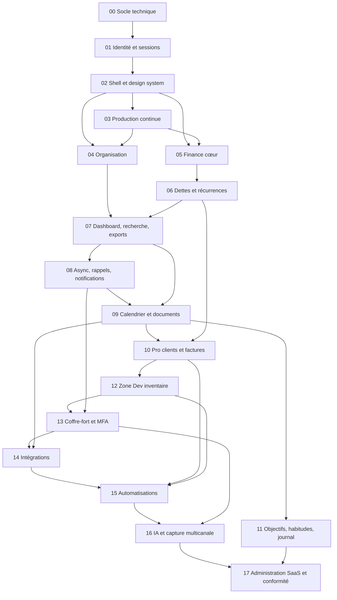

# ORBIT : feuille de route des 18 phases

- **Statut :** référence. Applique ADR-003 (développement intégral, sans V1 ni MVP).
- **Responsabilité :** ordre de construction, dépendances entre phases, jalons de mise en service, estimation globale, risques de planning.
- **Ne couvre pas :** le contenu détaillé d'une phase (`phases/PHASE-XX-*.md`), la manière de la conduire (`DEVELOPMENT_METHOD.md`).
- **Documents liés :** `PRODUCT_SCOPE.md` (§4 : modules, tables, phase de chaque module), `DECISIONS.md`, `DEVELOPMENT_METHOD.md`, `00-INDEX.md` (§4 : noms des fiches).

---

## 1. Les 18 phases

Estimations en **jours effectifs** (journées de travail concentré) pour un développeur solo assisté d'IA, revues et recette incluses. Elles ne tiennent pas compte des temps d'attente externes (validation Google OAuth, Meta WhatsApp, propagation DNS).

| N° | Titre | Objectif | Modules | Dépend de | Accès | Estimation |
|---|---|---|---|---|---|---|
| 00 | Socle technique | Monorepo, API et web squelettes, Prisma, logs, erreurs, CI de base, Docker Compose dev, tests d'architecture. | — | — | Tous | 3 à 4 |
| 01 | Identité et sessions | Inscription vérifiée, sessions cookie, reset, profil et préférences, rôles, contexte `user_id`, audit, rate limiting, harnais d'isolation. | M01 | 00 | Tous | 6 à 8 |
| 02 | Shell et design system | Design system, layout mobile/desktop, navigation, pages auth et paramètres, onboarding, capture rapide (coquille), PWA, états d'interface. | M02 | 01 | Tous | 5 à 7 |
| 03 | Production continue | Front sur Vercel (préversions, réécriture `/api`), API, worker et n8n sur VPS OVH derrière Caddy (ADR-038), OD-7 tranchée, CI/CD complète, sauvegardes restic avec restauration testée, observabilité (Sentry SaaS, Uptime Kuma), e-mail transactionnel, runbooks. | — | 02 | ADMIN (exploitation) | 5 à 7 |
| 04 | Organisation | Idées, tâches (sous-tâches, dépendances, vues, récurrence), projets, tags, notes et liens, conversion idée → projet, capture rapide réelle, file hors ligne. | M03 | 02, 03 | Tous | 8 à 10 |
| 05 | Finance, cœur | Devises, comptes (dont mobile money), catégories, contreparties, transactions, transferts multi-devises, frais, annulation, ajustement, idempotence, soldes, rapports, rapprochement. | M04 | 03, 02 | Tous | 9 à 12 |
| 06 | Dettes et récurrences | Dettes et créances, remboursements partiels, transactions récurrentes, occurrences et prévisions de trésorerie. | M05 | 05 | Tous | 6 à 8 |
| 07 | Dashboard, recherche, exports | Centre d'attention, recherche globale plein texte, exports JSON/CSV. | M06 | 04, 06 | Tous | 5 à 7 |
| 08 | Async, rappels, notifications | Redis/BullMQ, worker, outbox, rappels, notifications in-app/e-mail/push, préférences et heures silencieuses, génération planifiée des occurrences. | M07 | 07 | Tous | 7 à 9 |
| 09 | Calendrier et documents | Calendrier interne, documents privés (StoragePort, URL signées), liens documents ↔ entités. | M08 | 04, 05, 06, 07, 08 | Tous | 6 à 8 |
| 10 | Pro : clients et factures | Clients, contacts, contrats, factures numérotées, paiements fractionnés liés aux transactions, `projects.client_id`. | M09 | 04, 05, 06, 07, 08, 09 | Tous (désactivable) | 9 à 11 |
| 11 | Objectifs, habitudes, journal | Objectifs et liens, habitudes et suivis, apprentissage, journal personnel. | M10 | 04, 07, 08, 09 | Tous | 5 à 7 |
| 12 | Zone Dev : inventaire | Applications, environnements, domaines, serveurs, services, historique technique, alertes de renouvellement. | M11 | 04, 05, 06, 07, 08, 09, 10 | ADMIN | 7 à 9 |
| 13 | Coffre-fort et MFA | MFA TOTP pour tous, coffre-fort chiffré (enveloppe libsodium) pour ADMIN. | M12 | 01, 03, 08, 12 | TOTP : Tous ; coffre : ADMIN | 7 à 9 |
| 14 | Intégrations | Google OAuth, Calendar, Gmail, webhooks entrants, clés d'API, n8n. | M13 | 04, 08, 09, 13 | Tous (clés d'API : ADMIN) | 10 à 12 |
| 15 | Automatisations | Règles déclencheur → conditions → actions, journal d'exécution, garde-fous. | M14 | 04, 05, 08, 09, 10, 12, 14 | Tous | 7 à 9 |
| 16 | IA et capture multicanale | Assistant Claude à outils stricts, propositions confirmées, WhatsApp, voix. | M15 | 04, 05, 07, 08, 13, 14, 15 | Tous | 10 à 12 |
| 17 | Administration SaaS et conformité | Console ADMIN (métadonnées seulement), quotas, feature flags, export et suppression de compte, réévaluation RLS, audit final. | M16 | 00 à 16 (toutes) | Console : ADMIN ; compte : Tous | 9 à 11 |

## 2. Graphe de dépendances

**Ordre d'exécution recommandé :** l'ordre numérique. PHASE-04 et PHASE-05 sont théoriquement indépendantes, mais le propriétaire étant seul, elles restent séquentielles. PHASE-11 peut être menée avant ou après PHASE-12 (aucune dépendance entre elles). Le graphe montre les dépendances directes principales ; la liste exhaustive figure dans l'en-tête de chaque fiche (et dans la colonne « Dépend de » ci-dessus).

**Contraintes structurantes rappelées :**
- **ADR-015 :** PHASE-03 (production, sauvegardes testées) précède toute donnée financière réelle, donc PHASE-05.
- **ADR-012 :** avant PHASE-08, aucune fonctionnalité ne dépend d'un job. Les récurrences de PHASE-04 et PHASE-06 sont générées de façon synchrone (à la complétion, ou à la lecture dans une fenêtre bornée), puis planifiées par le worker en PHASE-08.
- **ADR-019 :** aucun secret réel dans le coffre avant la validation des tests de sécurité de PHASE-13.

## 3. Jalons de mise en service

| Jalon | Après | Qui | Ce qui devient possible |
|---|---|---|---|
| J0 : socle prêt | PHASE-00 | IA | Démarrer le développement métier sur une base testée. |
| J1 : comptes fonctionnels en local | PHASE-02 | Propriétaire (local) | S'inscrire, se connecter, naviguer dans l'app installable (PWA) en local. |
| J2 : en ligne, protégé | PHASE-03 | Propriétaire | Application en production HTTPS, sauvegardes restaurées avec succès. Inscription **fermée** (`REGISTRATION_MODE=allowlist`, seul le propriétaire est autorisé). |
| J3 : usage quotidien, organisation | PHASE-04 | Propriétaire | Utilisation **quotidienne** réelle : capture d'idées, tâches du jour, notes, projets, y compris hors ligne. |
| J4 : usage quotidien, finances | PHASE-05 puis PHASE-06 | Propriétaire | Saisie des vraies finances (Wave, Orange Money, espèces, banque), puis dettes et abonnements. C'est le jalon **« ORBIT remplace mes outils actuels »**. |
| J5 : bêta sur invitation | PHASE-05 (au plus tôt) | Proches invités | Ajout de quelques adresses à la liste d'autorisation, pour des retours d'usage. Pas d'ouverture publique. |
| J6 : **ouverture publique des inscriptions** | **PHASE-07 au plus tôt** (recommandé : après PHASE-08) | Public | `REGISTRATION_MODE=open`. Conditions : export de ses données disponible (PHASE-07), dashboard utile, isolation éprouvée sur toutes les routes, runbook d'incident testé, procédure **manuelle** de suppression de compte documentée en attendant PHASE-17, page de confidentialité publiée. L'ouverture après PHASE-08 ajoute les rappels et les e-mails de sécurité, ce qui est préférable. |
| J7 : zone Dev opérationnelle | PHASE-13 | ADMIN | Inventaire technique complet et coffre-fort avec MFA ; premiers secrets réels autorisés. |
| J8 : connecté et automatisé | PHASE-16 | Tous | Google Calendar, Gmail, n8n, automatisations, assistant IA, capture WhatsApp. |
| J9 : SaaS complet | PHASE-17 | Tous | Quotas, suppression et export de compte en libre-service, console d'administration, audit final. |

> **Avant J6, l'accès se fait uniquement sur invitation** (liste d'autorisation d'adresses e-mail gérée par le propriétaire). Ce mécanisme est introduit en PHASE-01 ; il ne crée **ni équipe ni partage** (ADR-001 reste valable).

## 4. Total estimé

| Bloc | Phases | Jours effectifs |
|---|---|---|
| Fondations | 00 à 03 | 19 à 26 |
| Cœur personnel (organisation, finance, attention, async) | 04 à 08 | 35 à 46 |
| Modules étendus | 09 à 13 | 34 à 44 |
| Connexions, automatisation, IA, SaaS | 14 à 17 | 36 à 44 |
| **Total** | **00 à 17** | **124 à 160 jours effectifs** |

À raison de 4 jours effectifs par semaine, cela représente **environ 31 à 40 semaines** (8 à 10 mois calendaires), hors attentes externes.

## 5. Risques et mitigations

| Risque | Impact | Mitigation |
|---|---|---|
| Dérive de contexte de l'IA (oubli des règles entre sessions) | Code incohérent, régressions d'isolation | Fiches autoportantes, rapports partiels avec point de reprise, `AGENTS.md`, tests d'architecture et d'isolation qui bloquent la CI. |
| Fuite de données entre utilisateurs | Critique (SaaS) | ADR-007 : extension `tenantScope`, clés étrangères composites, test d'isolation généré par route, `security-reviewer` obligatoire. |
| Erreur de calcul financier | Perte de confiance, données fausses | ADR-008/009, `packages/money` à 100 % de couverture, tests de propriétés fast-check, cas FIN-xx de `FINANCE_RULES.md`. |
| Perte de données en production | Critique | PHASE-03 avant toute donnée réelle ; restic chez un autre fournisseur ; restauration testée et répétée trimestriellement. |
| Sous-estimation des phases intégrations et IA (OAuth Google, validation Meta) | Retard de J8 | Mocks d'abord ; démarches externes (vérification Google, compte WhatsApp Business) lancées par le propriétaire dès PHASE-12. |
| Inscriptions publiques sans suppression de compte en libre-service | Non-conformité (protection des données) | Ouverture publique au plus tôt après PHASE-07 ; procédure manuelle documentée ; PHASE-17 l'automatise. |
| Coûts d'infrastructure ou de services | Budget | Aucun service payant sans accord ; VPS unique (OVH) et front sur Vercel Hobby, à passer en Pro (payant) en cas d'usage commercial (ADR-038) ; fournisseurs avec offre gratuite (e-mail, sauvegarde, Sentry) ; IA en PHASE-16 avec plafond de dépense. |
| Épuisement du développeur solo | Arrêt du projet | Jalons d'usage réel tôt (J3, J4) ; phases de 1 à 2 semaines ; recette courte et ciblée. |
| Dépendances obsolètes ou vulnérables | Sécurité | Scan de dépendances en CI (PHASE-03), mises à jour groupées entre phases. |
| Phase qui dérive de plus de 30 % | Planning | Redécoupage obligatoire, signalement au propriétaire (`DEVELOPMENT_METHOD.md`). |
